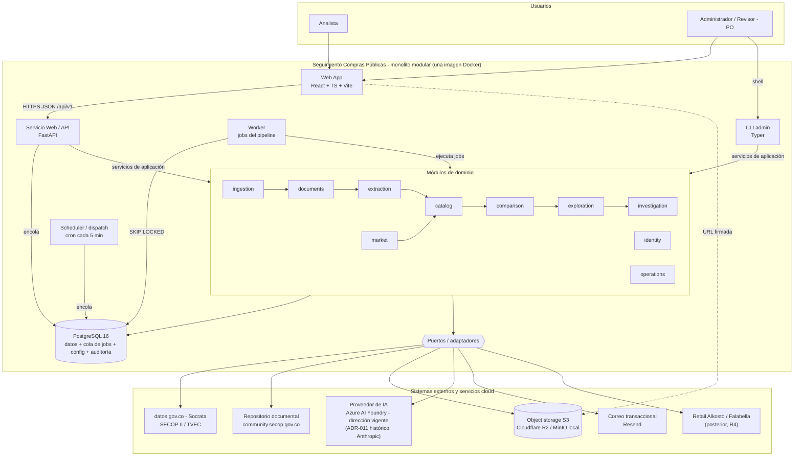

# Arquitectura del Sistema - GPS Principal

Este documento sirve como **GPS arquitectónico** para orientar decisiones de diseño y desarrollo en el ecosistema.

> **Estado:** greenfield. Sintetiza la **arquitectura objetivo aprobada** (2026-10-06); todavía no existe código de producto. Los scripts de los spikes D1/D4/D6 (`docs/propuesta/03-prd/insumos/d*-scripts/`) **no** son referencia de arquitectura ni de estilo.

## Resumen Ejecutivo

### Propósito y alcance del sistema

- **Qué es:** **Seguimiento Compras Públicas** convierte los datos y documentos públicos de contratación colombiana (SECOP II y TVEC) en **señales explicables y trazables** que indican qué compras de **televisores** merecen revisión humana.
- **Principio rector:** *mostrar hechos, no acusar*. Una señal es un motivo para revisar, nunca una conclusión. Los textos generados nunca usan "sobreprecio", "corrupción", "fraude" ni "hallazgo fiscal".
- **Flujo de valor:** SECOP/TVEC → documento → ítem extraído → producto normalizado → comparación (Benchmark 1 público y Benchmark 2 retail) → señal → evidencia → caso del Analista.
- **Núcleo determinístico + IA desacoplada:** ingesta, normalización, emparejamiento, benchmarks y señales son reglas puras que funcionan **sin IA**. La IA solo extrae y sugiere, y se puede desactivar sin redespliegue (*"la IA propone, las reglas deciden"*).
- **Contexto que condiciona la arquitectura:** volumen bajo (~355 contratos SECOP II y ~1.150 líneas TVEC; 3–5 analistas piloto y hasta 20 concurrentes); operación por una sola persona (~8 h/semana, sin on-call); techo de COP 300.000/mes de infraestructura y USD 50/mes de IA.
- **Objetivos de calidad que mandan:** OC-1 trazabilidad, OC-2 corrección analítica, OC-3 robustez ante dependencias externas, OC-4 operabilidad y costo, OC-5 cumplimiento y privacidad (Ley 1581/2012).

### Dominios y repositorios críticos

- **Monolito modular con 10 módulos** (nombres de código en inglés; cada uno es dueño de su esquema PostgreSQL):
  1. `ingestion`: SECOP II/TVEC, marcas de agua, lista blanca de campos, candidatos, clasificación por reglas.
  2. `operations`: configuración versionada, *feature flags*, jobs, programación, auditoría, KPIs y costos. Es transversal a los demás.
  3. `exploration`: búsqueda, filtros, lista de señales y ficha de contrato (solo lectura).
  4. `documents`: listado, priorización, descarga, hash, descompresión segura, páginas visuales.
  5. `extraction`: paquete para la IA, minimización, validación del esquema, evidencia, umbral y revisión humana.
  6. `catalog`: normalización y emparejamiento (mismo modelo, equivalente o insuficiente).
  7. `comparison`: Benchmark 1 y 2, homologación de IVA, señales versionadas y confianza.
  8. `market`: observaciones retail (de solo inserción), conectores con cumplimiento, carga manual y CSV.
  9. `investigation`: casos privados con instantáneas.
  10. `identity`: invitaciones, sesión y roles Analista y Administrador.
- **Repositorio:** uno solo (monorepo), con `backend/` (paquete Python `public_procurement`, con un mismo código para `api`, `worker`, `scheduler` y `cli`), `frontend/` (SPA), `docs/adr/`, un `Dockerfile` único y `.github/workflows/`. La estructura de carpetas está en [coding-standards.md](coding-standards.md).
- **Orden de construcción (*vertical slices*, no todo el backlog de una vez):**
  - **R0, *scaffold* mínimo e incremental:** la primera implementación incluye solo lo que necesita el primer *vertical slice*: estructura del monolito, núcleo compartido, Alembic, `/healthz` y CI básico.
    - El dispatcher, la CLI, la cola de jobs completa (todas las colas, latido, huérfanos) y la imagen productiva única son **objetivo arquitectónico**, no requisito de entrada.
    - Esas piezas se incorporan cuando un slice las necesite y **no bloquean** el primer slice.
  - **R1, MVP de entrega priorizado por el PO:** ingesta SECOP/TVEC → persistencia → API → exploración básica, más **versiones mínimas de señales y casos**.
    - En el roadmap arquitectónico original, las señales y los casos estaban en R3 y R5. Se adelantan para tener pronto un producto utilizable y preparado para experimentar con agentes.
    - Los servicios de consulta se preparan como herramientas para agentes en Azure AI Foundry.
  - **Después de R1:** se profundiza siguiendo el roadmap original. Documentos y extracción → normalización y B1 completos → retail y B2 → operación completa → agentes.
- **Límites:** incluye solo la web responsive y la categoría de televisores. Excluye la app nativa, SECOP I, las otras categorías, RAG, las alertas proactivas, el SSO, la colaboración entre analistas y la ÉPICA-009. El agente de investigación queda **preparado, no construido**.

## Arquitectura de Alto Nivel

### Diagrama principal del ecosistema

- **4 procesos del mismo código:** la `api` (síncrona, nunca llama a terceros dentro del request), el `worker` (todo lo largo o externo), el `dispatch` (solo encola y termina) y la `cli` (operación poco frecuente, auditada).
- **La API encola y el worker ejecuta:** relanzar, recalcular o cargar un CSV crea un job con `idempotency_key` y `correlation_id`.
- **Comunicación entre módulos:** solo por `<module>.services`. Ningún módulo toca las tablas de otro, y `import-linter` lo verifica en CI.
- **Dependencias externas solo por puertos inyectados:** `PublicDataSource`, `DocumentRepository`, `ObjectStorage`, `AIExtractor`, `Mailer`, `RetailConnector` y `JobQueue`.
- **Lectura rápida sin cálculo en línea:** el recálculo por lotes refresca vistas materializadas, con consistencia eventual de ≤ 1 h.
- **SPA sin reglas de negocio:** la evidencia binaria se sirve directo desde el bucket privado con URL firmada de corta duración.

## Stack y Patrones Clave

### Tecnologías que condicionan arquitectura

- **Backend, worker, scheduler y CLI:** Python 3.12, FastAPI (OpenAPI nativo), Pydantic v2 (contratos de API y salida de la IA), SQLAlchemy 2, Alembic y Typer. Se ejecuta con Gunicorn + Uvicorn.
- **Frontend:** React, TypeScript estricto y Vite. Usa una librería de componentes accesible existente (sin design system propio), PDF.js para el visor de evidencia y un cliente tipado generado desde OpenAPI.
- **Datos:** **PostgreSQL 16** es el único motor. Guarda el sistema de registro, la cola de jobs, la configuración versionada, la auditoría y la búsqueda (`pg_trgm`, `tsvector` en español, vistas materializadas). Hay un esquema por módulo.
- **Binarios:** object storage compatible con S3, direccionado por SHA-256 y sin sobrescritura: Cloudflare R2 (`enam`) en producción y MinIO en local.
- **Procesamiento documental local:** PyMuPDF (texto, detección de páginas visuales, render a 110 dpi), openpyxl/xlrd, LibreOffice *headless* sin macros y descompresión ZIP/RAR con límites.
- **Plataforma:** una imagen Docker multi-stage con 3 comandos (`web`, `worker`, `dispatch`) sobre Railway en US East. GitHub Actions hace CI/CD con aprobación manual. Ambientes: local (Docker Compose), CI efímero y producción.
- **Calidad:** ruff, mypy (strict en `domain/` y `services`), import-linter y pytest (Test Data Builder y 3A) en el backend; ESLint, Prettier y Vitest en el frontend.
- **Fuera del MVP:** microservicios, Kubernetes, broker o Redis, caché, data warehouse, motor de búsqueda y base vectorial.

### Patrones arquitectónicos relevantes

- **Monolito modular con capas `api → services → domain → adapters/repositories`:** el dominio no tiene ORM ni I/O. *Impacto:* una sola persona puede operarlo, y deja fronteras claras para los agentes de desarrollo y para extraer un módulo en el futuro.
- **Puertos y adaptadores (hexagonal):** cada proveedor (Socrata, SECOP, S3, IA, correo, retail, cola) va detrás de un puerto, con *fakes* para las pruebas. *Impacto:* cambiar de proveedor de IA o de storage no toca el dominio, y el CI corre sin red.
- **Pipeline por etapas con jobs idempotentes en PostgreSQL:** usa `FOR UPDATE SKIP LOCKED`, colas `ia`/`descargas`/`cpu`/`general` y coreografía (cada etapa encola la siguiente en la misma transacción). *Impacto:* los fallos externos se pueden reanudar sin perder ni duplicar trabajo.
- **"La IA propone, las reglas deciden":** la salida de la IA se valida contra un esquema y se verifica que sus localizadores existan. Hay un umbral calibrado (D4-4) y una cola de revisión humana; sin calibración no hay aceptación automática.
- **Hechos de solo inserción + versión vigente + `config_version_id` en cada cálculo:** se aplica a extracciones, revisiones, observaciones, benchmarks y señales. *Impacto:* cualquier señal histórica se puede reproducir.
- **Evidencia inmutable direccionada por contenido:** cada dato que llega a una señal tiene un `EvidenceLocator` (documento, hash, página, hoja o celda). Si falta, la señal queda **retenida**.
- **Estados explícitos en vez de valores por defecto:** se usan `indeterminado`, `insuficiente`, `no disponible`, `retenida` y `descarga fallida`. Nunca se asume un IVA del 19 %. Los montos en COP son `int` y nunca `float`.

## Integraciones Críticas

### Integraciones internas y externas de mayor impacto

| Integración | Participantes y propósito | Canal / protocolo | Criticidad | Release |
| ----------- | ------------------------- | ----------------- | ---------- | ------- |
| Datos abiertos SECOP II / TVEC | `worker` (`ingestion`) → datos.gov.co: contratos `jbjy-vk9h`, ítems `usqp-5nsn`/`3hdv-smhz`, órdenes `rgxm-mmea`, fecha de corte | HTTPS SODA/SoQL, paginado de 1.000, `X-App-Token`, reintentos 2/4/8 s | **Alta** | R1 |
| Cola de jobs y persistencia | `api`, `worker`, `dispatch` y `cli` ↔ PostgreSQL (estado, jobs, `Schedule`, config, auditoría) | SQL/TLS en red privada; `SKIP LOCKED`; `idempotency_key` única | **Alta** | R0 |
| SPA ↔ API | Web App ↔ Servicio Web: exploración, señales, casos, administración | REST JSON `/api/v1`, OpenAPI, errores RFC 9457, cookie de sesión y CSRF | **Alta** | R0–R1 |
| Archivos Descarga y documentos | `documents` → Socrata (lista) y community.secop.gov.co (GET binario con lista blanca de dominio, 2 en paralelo, 1 s entre solicitudes, timeout 120 s) | HTTPS | **Alta** | R2 |
| Object storage | `api` (firma URL, evidencias manuales) y `worker` (lectura y escritura) ↔ R2/MinIO; navegador ← URL firmada | API S3 (SigV4) | **Alta** | R2 (preparado en R0) |
| Proveedor de IA | `extraction` → `AIExtractor`: paquete minimizado → JSON validado, tokens, costo | HTTPS, salida estructurada, timeout 300 s, máx. 3 reintentos | **Alta** (desactivable) | R2 |
| Herramientas para agentes | Agente (Azure AI Foundry, dirección vigente) → servicios de consulta tipados de la aplicación, en nombre de un usuario | Herramientas registradas o MCP sobre `services`; **sin SQL** | Media | Preparación en R1, agente en R6 |
| Correo transaccional | `api` y `worker` → Resend: invitaciones, recuperación, alertas (≤ 1 h) | HTTPS API REST | Media | R1/R5 |
| Retail | `market` → Alkosto y Falabella: `robots.txt`, sitemaps, JSON-LD; suspensión ante 403/429 o CAPTCHA | HTTPS GET, *feature flag* por fuente | Media (degradable) | R4 |
| Entrega | GitHub Actions → Railway: imagen única, Alembic *pre-deploy*, healthcheck | HTTPS con token de despliegue | Media | R0 |

### Seguridad de integración (Auth/Authz)

- **Autenticación de usuarios:** propia, con registro solo por invitación. Contraseñas con Argon2id y sesión de servidor en PostgreSQL, con cookie `Secure`/`HttpOnly`/`SameSite=Lax`. Expira a los 30 min de inactividad y tiene límite de intentos.
- **Autorización:** RBAC (`analyst`, `administrator`) por dependencia en cada endpoint, más **autorización por propietario** en casos y notas (devuelve 404 a terceros). Los agentes actúan siempre con los permisos de un usuario y quedan auditados.
- **Credenciales hacia terceros:** se guardan como variables selladas de Railway, separadas por servicio y con mínimo privilegio (R2: `web` lee y firma; `worker` lee y escribe; backups solo escribe). Nunca van en el repositorio.
- **Controles web:** CSRF, CSP, HSTS, validación con Pydantic, SQL parametrizado y binarios servidos solo por URL firmada desde un bucket privado.
- **Privacidad en la frontera:** lista blanca de campos en la ingesta (los campos sensibles no existen en ninguna tabla), clasificación L1/L2/L3, minimización antes de la IA, ningún dato L3 en logs y término prohibido verificado en CI.
- **Archivos externos:** validación por tipo real, límites de descompresión (profundidad 3, 500 archivos, 1 GB, 100:1), LibreOffice sin macros y con tiempo límite, y archivos protegidos rechazados.

## Dependencias Externas Estratégicas

### Servicios y terceros que condicionan la solución

- **datos.gov.co (Socrata):** es la fuente oficial única de SECOP II y TVEC; está prohibido hacer scraping del portal transaccional. *Si falla:* la ingesta queda en la bitácora sin avanzar la marca de agua, llega una alerta y la exploración sigue con los datos existentes. Los *contract tests* semanales detectan cambios de esquema (R-06).
- **Repositorio documental SECOP II:** es el origen de la evidencia. *Si cambia o retira un documento:* la señal sigue siendo reproducible, porque la copia está conservada por hash.
- **Proveedor de IA y agentes:** **Azure AI Foundry es la dirección tecnológica vigente** para toda capacidad nueva de IA y de agentes.
  - Cualquier funcionalidad agéntica nueva se prepara para Foundry: SDK, endpoints, herramientas o MCP, según corresponda.
  - `AIExtractor` y los demás puertos siguen **independientes del proveedor**. El dominio, los servicios y las herramientas de agente nunca importan un SDK.
  - **ADR-011 (Anthropic Claude Sonnet para la extracción documental, validado en D4)** se conserva como **decisión histórica** hasta que se revise formalmente. No condiciona nuevas implementaciones.
  - *Si falla o se desactiva:* los procesos quedan "pendientes de extracción" y el núcleo determinístico sigue operando. Tiene tope mensual con pausa de la cola `ia`.
- **Railway (PaaS) y PostgreSQL gestionado:** concentran el cómputo, los backups diarios (RPO ≤ 24 h) y los secretos. *Mitigación ante dependencia:* imagen Docker estándar, `pg_dump` semanal cifrado en R2 y configuración como código.
- **Cloudflare R2:** guarda la evidencia inmutable. Su durabilidad depende solo de R2, y la replicación del bucket está pendiente de decisión. La ubicación `enam` es *best-effort* y no garantiza residencia (ADR-007).
- **Resend:** se usa para invitaciones y alertas. Requiere un dominio propio verificado antes del piloto.
- **Gates externos (no bloquean la arquitectura):** D4-4 (umbral de extracción), INV-01 (IVA en la TVEC), ToS de retail, D5 (validación con usuarios) y la revisión OWASP antes de abrir el registro.

## Referencias Base

### Documentación analizada y fuentes clave

- [Arquitectura de solución](../propuesta/04-arquitectura/arquitectura-solucion-comercial.md): arc42 completo, flujos F1–F6, 8.1–8.11 y ADR-001 a ADR-015. **Fuente principal.**
- [Tareas técnicas de arquitectura](../propuesta/04-arquitectura/tareas-tecnicas-arquitectura.md): 138 tareas, ruta crítica y secuencia de arranque.
- [Estándares de código](coding-standards.md): nombres, capas, imports, reglas transversales y herramientas.
- [Adenda de dimensionamiento](../propuesta/04-arquitectura/adenda-dimensionamiento-arquitectura-mvp.md): S-DIM-01 a 06.
- [PRD](../propuesta/03-prd/PRD.md), [épicas](../propuesta/03-prd/epicas.md) y [asunciones](../propuesta/03-prd/asunciones.md), como contexto funcional.
- **Inconsistencias registradas para resolver:**
  - ADR-011, INT-008 y POC-003 fijan a **Anthropic**, mientras que la dirección vigente es **Azure AI Foundry**. ADR-011 queda como decisión histórica, pendiente de revisión formal. En [coding-standards.md](coding-standards.md), el ejemplo `AnthropicAIExtractor` es solo un adaptador posible, no el proveedor fijado.
  - Las tareas técnicas usan nombres de módulo en español (`ingesta`, `extraccion`…), pero según los estándares el código va en inglés (`ingestion`, `extraction`…). Prevalecen los estándares.
  - **R0** (*scaffold* mínimo) no existe en los documentos fuente, que empiezan en R1. Lo introdujo el PO como primer objetivo de desarrollo.
  - El **R1 actual** es el MVP de entrega priorizado por el PO y no coincide con el R1 del documento de arquitectura: adelanta versiones mínimas de las señales (R3) y de los casos (R5).

---

**Este GPS es una vista arquitectónica ejecutiva para orientar decisiones y priorizar evolución del sistema.**

---

> **Método Ceiba documentar-arquitectura-base** v6.1.97 | Modelo: Claude Opus 5.5 | Usuario: Juan Camilo | Fecha: 2026-10-07
