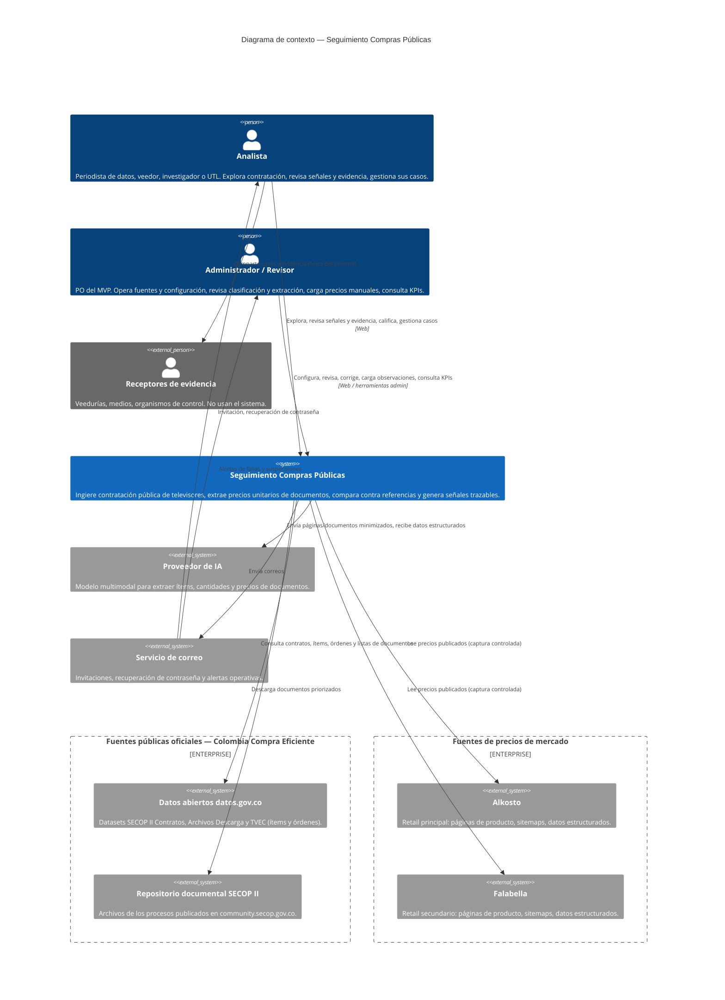
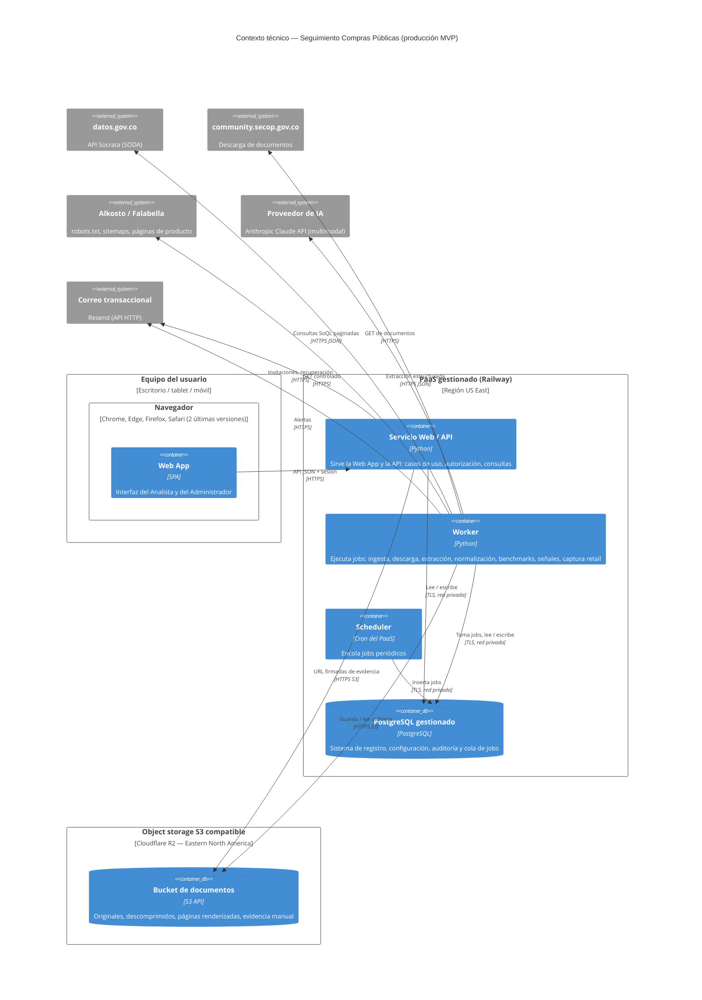
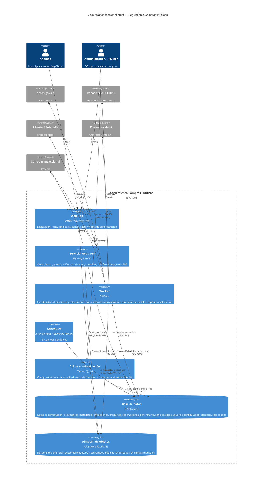
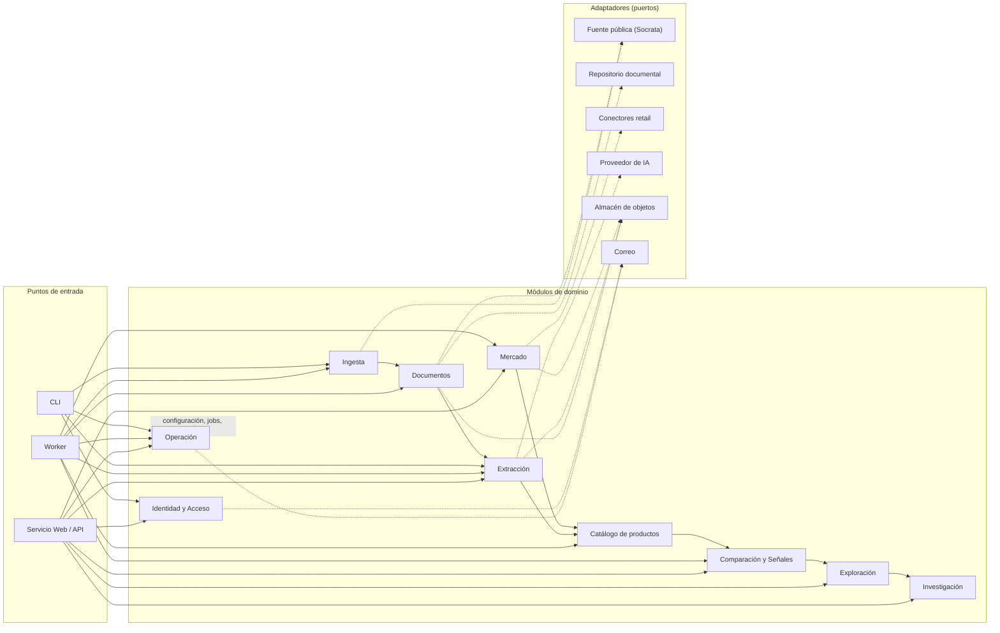
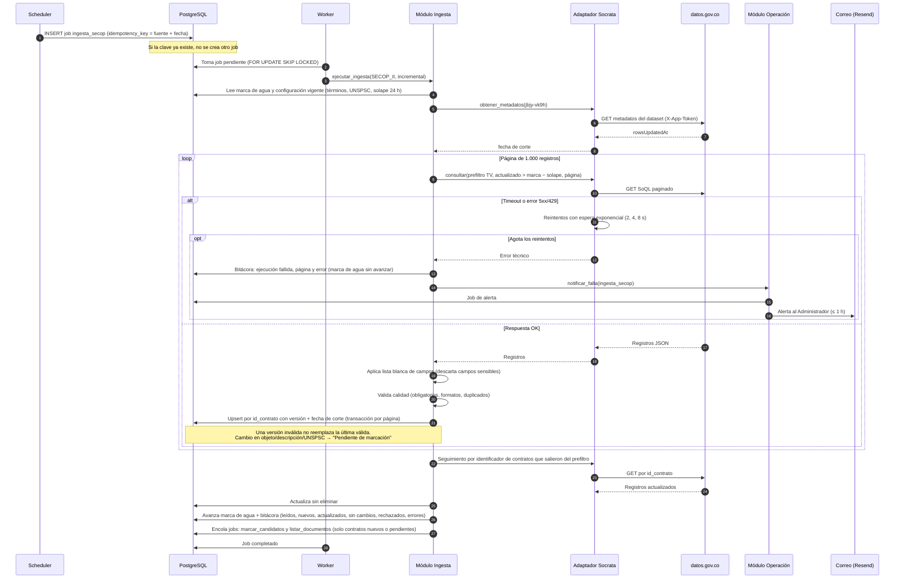
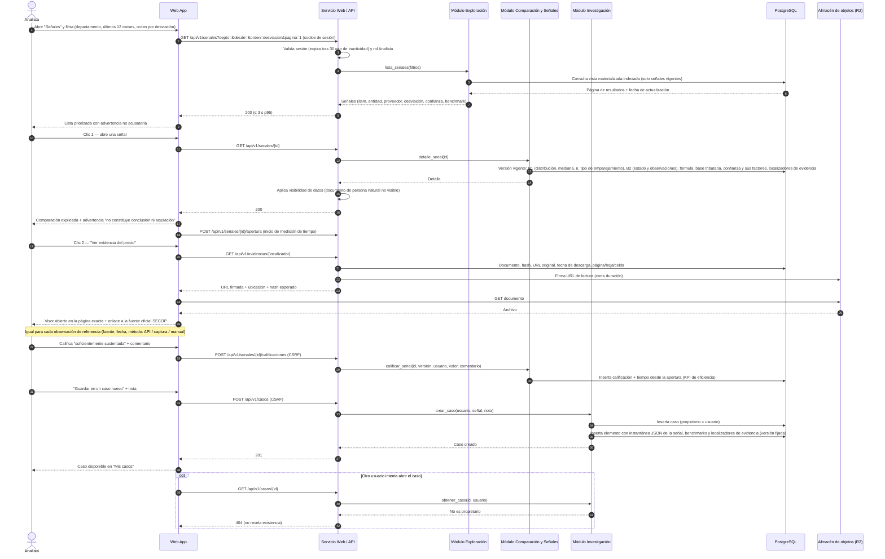
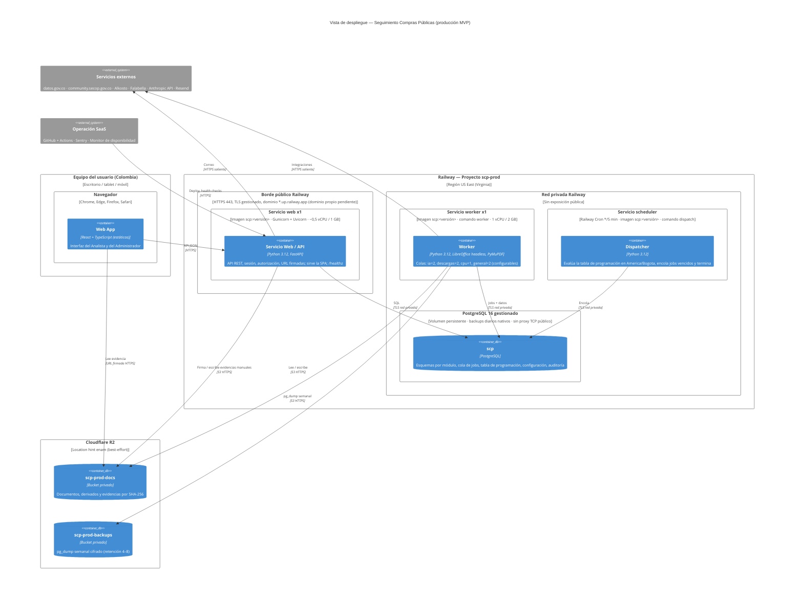
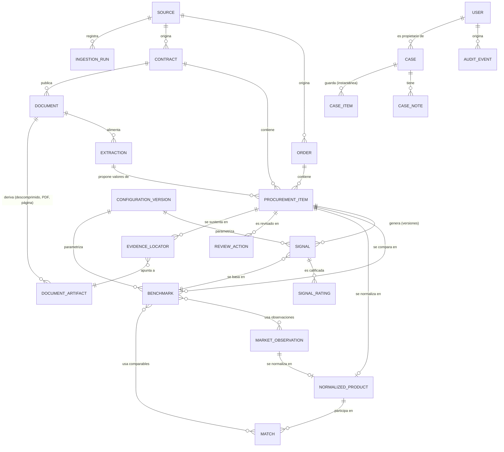

# Definición Arquitectura Proyecto Seguimiento Compras Públicas

**Fecha:** 2026-10-06  
**Versión:** 1.0  
**Autor:** Juan Camilo

---

## Introducción y Objetivos

### Resumen de Requisitos

El desarrollo de **Seguimiento Compras Públicas** está impulsado por la necesidad de convertir el volumen de la contratación pública colombiana —inviable de vigilar manualmente proceso por proceso— en **señales explicables y trazables** que dirijan la atención humana hacia las compras que merecen revisión. La variable clave para comparar, el **precio unitario**, rara vez existe como dato estructurado: está dentro de documentos del proceso (PDF nativos y escaneados, anexos XLSX/DOCX, archivos ZIP/RAR). Por eso el sistema combina una **base determinística** (ingesta, exploración, normalización, comparación y señales) que funciona sin IA, con una **extracción asistida por IA** que amplía la cobertura sobre documentos no estructurados.

Además, se aspira a **validar la hipótesis de valor** con 3–5 analistas piloto (≥ 70 % de señales calificadas como sustentadas y ≥ 70 % menos tiempo por caso), demostrar el flujo de extremo a extremo en una sola categoría (**televisores**) y dejar el terreno preparado para un futuro **agente de investigación** que use herramientas controladas de la aplicación.

**Principio rector del producto:** *mostrar hechos, no acusar*. Una señal es un motivo para revisar, nunca una conclusión de sobreprecio, corrupción o fraude.

Los principales requerimientos del sistema (95 FRs del MVP agrupados en 8 épicas; detalle en el [PRD](../03-prd/PRD.md) y en [epicas.md](../03-prd/epicas.md)) son:

- **Ingesta de fuentes públicas (ÉPICA-001):** carga histórica (3 años) e incremental diaria de SECOP II (`jbjy-vk9h`) y TVEC (`usqp-5nsn`, `rgxm-mmea`) desde la API Socrata de datos.gov.co, con bitácora de ejecuciones, validaciones de calidad, trazabilidad al registro de origen y exclusión de datos personales sensibles.
- **Identificación y clasificación de televisores (ÉPICA-001):** marcación de candidatos por UNSPSC y términos, y confirmación a nivel de **ítem** con reglas configurables, sugerencias de IA y revisión manual.
- **De documentos a datos comparables (ÉPICA-002):** listar, priorizar (~8 por proceso), descargar desde la URL oficial, descomprimir, descartar vacíos y duplicados, detectar páginas que requieren lectura visual y extraer con IA multimodal marca, modelo, tamaño, cantidad, precio unitario e IVA, con **evidencia localizada** (documento, página, hoja, celda), nivel de confianza, umbral de aceptación configurable, precio derivado bajo reglas estrictas y cola de revisión humana. La IA debe poder desactivarse sin afectar lo determinístico.
- **Normalización y emparejamiento (ÉPICA-003):** esquema común de producto y clasificación determinística de cada comparación como *mismo modelo*, *producto equivalente* o *insuficiente/no confiable*, sin relajar criterios.
- **Referencias de mercado trazables (ÉPICA-004):** base propia e inmutable de observaciones retail (Alkosto y Falabella), alimentada por captura automática controlada (respeto de `robots.txt`, límites de ritmo, suspensión ante bloqueos) o por carga manual y CSV con evidencia.
- **Benchmarks y señales (ÉPICA-005):** Benchmark 1 (compras públicas SECOP II + TVEC) y Benchmark 2 (mercado retail) con ventanas temporales, mínimos de observaciones y homologación de base tributaria; señales solo por desviación al alza, versionadas, con nivel de confianza compuesto, evidencia navegable y lenguaje no acusatorio.
- **Exploración y ficha de contrato (ÉPICA-006):** búsqueda, filtros y ordenamiento, lista priorizada de señales y ficha del contrato con su estado de procesamiento.
- **Espacio de investigación y cuentas (ÉPICA-007):** casos privados con instantáneas de evidencia y notas; registro por invitación, inicio de sesión, recuperación de contraseña y roles Analista y Administrador.
- **Operación, calidad y medición (ÉPICA-008):** estado de fuentes y relanzamientos, configuración versionada de parámetros, cola de revisión, KPIs de precisión y cobertura, costos de IA y log de auditoría. Puede resolverse con UI mínima, scripts o consultas.

**Flujo que valida la hipótesis:** *explorar → detectar señal → revisar comparación → revisar evidencia → guardar caso → continuar investigación*.

**Contexto que condiciona la arquitectura:**

- **Volumen acotado:** ~355 contratos SECOP II y ~1.150 líneas TVEC; 3–5 usuarios piloto y hasta 20 concurrentes; escenario de 24 meses con hasta 5 categorías, 5 años y 50 usuarios ([adenda de dimensionamiento](adenda-dimensionamiento-arquitectura-mvp.md)).
- **Operación por una persona:** el PO opera el sistema como Administrador y Revisor, con unas 8 h/semana y sin soporte 24x7.
- **Presupuesto del piloto:** techo provisional de COP 300.000/mes de infraestructura fija y USD 50/mes de IA (S-ARQ-06).
- **Validaciones externas tratadas como *gates* y no como bloqueos:** D4-4 (precisión y umbral de extracción), INV-01 (IVA en la TVEC), términos de uso de retail y D5 (validación con usuarios).

**Fuera de alcance del MVP:** ÉPICA-009 (fichas de entidad y proveedor, señales no de precio, exportación del expediente, múltiples oferentes), agente de investigación, RAG, alertas proactivas, otras categorías, SECOP I, colaboración entre analistas, SSO y exploración pública anónima.

### Objetivos de Calidad

Los siguientes objetivos de calidad, en orden de prioridad, son los requisitos arquitectónicamente significativos (ASR) que dictan las decisiones principales del sistema. Se toman del modelo de calidad de arc42 (https://quality.arc42.org/) y se derivan de los KPIs del Brief, los NFRs del PRD y los supuestos aprobados (S-ARQ, S-DIM).

| # | Objetivo de calidad | ASR (requisito arquitectónicamente significativo) |
|---|---|---|
| OC-1 | **Trazabilidad y explicabilidad** (*auditability, accountability*) | El **100 %** de las señales debe poder reconstruirse hasta el contrato, el documento, la página/hoja/celda de origen y cada observación de referencia usada, con la fórmula, la versión de configuración y la fecha de corte que la produjeron, aunque el documento original cambie o desaparezca de la fuente. |
| OC-2 | **Corrección analítica** (*functional correctness, accuracy*) | La extracción debe alcanzar **≥ 90 %** de precisión en campos críticos; el **100 %** de las comparaciones debe estar clasificado por tipo de emparejamiento y el **0 %** puede mezclar bases tributarias sin marcarse como incompleta. Ningún dato extraído por IA entra a una comparación sin superar el umbral calibrado o la revisión humana. |
| OC-3 | **Robustez ante dependencias externas** (*fault tolerance, graceful degradation*) | La caída, el cambio o la desactivación de cualquier dependencia externa (API de datos.gov.co, descarga de SECOP, proveedor de IA, fuentes retail) **no debe impedir** explorar los datos existentes, revisar evidencia ni ejecutar las reglas determinísticas, y no debe perder ni duplicar registros. |
| OC-4 | **Operabilidad y eficiencia de costos** (*operability, cost efficiency*) | El sistema debe poder operarse por **una sola persona con ~8 h/semana**, sin on-call, dentro de **COP 300.000/mes** de infraestructura fija y **USD 50/mes** de IA. Ingesta, jobs, backups, alertas y despliegue deben ser automáticos, y el costo de IA debe medirse por documento. |
| OC-5 | **Cumplimiento y privacidad** (*legal compliance, confidentiality*) | **0** campos personales sensibles almacenados; **0** mecanismos de evasión de CAPTCHA o bloqueos; **0** textos acusatorios generados por el sistema; casos accesibles solo por su autor y contenido minimizado antes de enviarlo a la IA (Ley 1581/2012). |

**Justificación e impacto en la arquitectura:**

- **OC-1 — Trazabilidad y explicabilidad.** Es el diferenciador del producto (*"evidencia antes que acusación"*) y la base del KPI de señales sustentadas (≥ 70 %): un analista no lleva una señal a una veeduría o a un medio si no puede mostrar de dónde sale cada número. También es la principal defensa ante el riesgo legal y reputacional de nombrar proveedores y entidades.
  *Impacto en el diseño:* modelo de datos con procedencia explícita (`EvidenceLocator`) y entidades derivadas versionadas (extracciones, benchmarks, señales); copia inmutable de los documentos de evidencia en object storage, con hash verificado; configuración versionada referenciada por cada cálculo; persistencia de solo inserción para observaciones y señales; instantáneas en los casos; log de auditoría.

- **OC-2 — Corrección analítica.** Un falso positivo por mala extracción, por emparejar productos distintos o por mezclar precios con y sin IVA destruye la credibilidad del producto antes de que pueda probar su valor. La precisión es una meta aprobada del Brief.
  *Impacto en el diseño:* separación estricta entre el **módulo determinístico** (normalización, emparejamiento, benchmarks, señales: reglas puras y testeables) y el **módulo de IA** (solo extracción y sugerencias); salidas del extractor con esquema validado; umbral de aceptación configurable y cola de revisión humana; *golden dataset* versionado (D4-4) como puerta de calidad para cambios de modelo o prompt; estados explícitos de *base tributaria indeterminada* y *evidencia insuficiente* en lugar de valores por defecto.

- **OC-3 — Robustez ante dependencias externas.** Todo el valor del sistema depende de fuentes que no controla (datos.gov.co, SECOP, retail) y de un proveedor de IA cuyo costo, disponibilidad y comportamiento pueden cambiar. El PRD exige expresamente que la IA pueda desactivarse sin afectar lo determinístico (FR-033, NFR-EVO-003) y que retail no bloquee el Benchmark 1.
  *Impacto en el diseño:* puertos y adaptadores para cada fuente y para el proveedor de IA; procesamiento asíncrono con jobs idempotentes, reintentos exponenciales y marcas de agua incrementales; ingesta desacoplada de la extracción; *feature flags* por fuente y para la IA; suspensión automática de conectores; degradación explícita de los benchmarks ("no disponible / evidencia insuficiente").

- **OC-4 — Operabilidad y eficiencia de costos.** El PO es a la vez desarrollador, operador y revisor, con dedicación parcial y sin equipo de DevOps, datos ni ML. Cualquier pieza que requiera atención manual frecuente o conocimiento especializado pone en riesgo la continuidad del MVP. El Brief exige además identificar los principales drivers de costo.
  *Impacto en el diseño:* monolito modular en una sola base de código y un solo lenguaje de backend; PaaS y PostgreSQL gestionados; sin Kubernetes, broker ni bases especializadas; jobs en PostgreSQL con scheduler del PaaS; CI/CD automatizado; alertas por correo; procesamiento de IA solo sobre documentos y páginas priorizados; registro de costo por documento y por componente.

- **OC-5 — Cumplimiento y privacidad.** El sistema procesa datos públicos que incluyen personas naturales, consume fuentes comerciales con reglas de acceso y publica señales sobre terceros identificables. Un incumplimiento (Ley 1581, términos de uso, lenguaje acusatorio) puede cerrar el proyecto con independencia de su calidad técnica, y la NFR-SEG-008 condiciona la apertura a usuarios piloto.
  *Impacto en el diseño:* lista blanca de campos en la ingesta, con verificación automática; clasificación de datos L1/L2/L3 y minimización antes de la IA; conectores retail con verificación de `robots.txt` en cada ejecución, límites de ritmo y User-Agent propio; autorización por propietario en los endpoints de casos; lista de términos prohibidos verificada en pruebas; secretos en el gestor del PaaS; TLS y cifrado en reposo gestionado.

> Otros atributos (rendimiento, disponibilidad, usabilidad, evolutividad, seguridad de acceso) se documentan como objetivos secundarios en la sección *Requerimientos de Calidad*: son relevantes, pero sus metas son holgadas para el volumen del MVP y no determinan por sí solas la forma de la arquitectura.

### Interesados

| **Nombre/Rol** | **Relación con la arquitectura** | **Expectativas** |
| -------------- | -------------------------------- | ---------------- |
| **Juan Camilo — Product Owner** | Aprueba la arquitectura y decide sobre alcance, costos y gates (D4-4, INV-01, ToS, D5) | Una arquitectura simple que valide la hipótesis de valor con el menor costo y tiempo; decisiones documentadas como ADR; costos de infraestructura e IA visibles y dentro del techo del piloto. |
| **Juan Camilo — Arquitecto y mantenedor técnico** | Diseña, construye, despliega y evoluciona el sistema (perfil generalista: Python, SQL, APIs, IA) | Un stack con pocos lenguajes y herramientas comunes; monolito modular comprensible; migraciones versionadas; pruebas automatizadas; CI/CD y rollback sencillos; documentación ligera y suficiente. |
| **Juan Camilo — Administrador y Revisor (operación)** | Opera fuentes, configuración, cola de revisión humana, carga manual de precios y KPIs (~8 h/semana, sin on-call) | Operación automatizada (ingesta, jobs, backups, alertas); cola de revisión acotada y priorizada; poder relanzar procesos, desactivar la IA o una fuente sin redesplegar; alertas por correo en ≤ 1 h; runbook mínimo. |
| **Agentes de desarrollo del Método Ceiba** | Trabajan con la arquitectura y el código para generar historias, código, pruebas y documentación | Límites de módulo claros, contratos explícitos (OpenAPI, JSON Schema/Pydantic), convenciones y ADRs que puedan seguir sin ambigüedad; *vertical slices* pequeños. |
| **Analistas piloto (3–5)** — periodistas de datos, veedores, academia/ONG, control político | Usuarios de diseño; validan el producto (D5) y califican las señales | Encontrar rápido casos que merezcan revisión; navegar de la señal a la evidencia de origen en ≤ 3 clics; respuestas en ≤ 3 s; casos y notas privados que se conserven; señales que no los expongan a afirmaciones acusatorias. |
| **Proveedores y entidades públicas nombrados en las señales** | Terceros afectados por los resultados; no usan el sistema | Que se muestren solo datos públicos y hechos verificables, sin calificativos acusatorios; que exista un mecanismo de corrección de errores (FR-070). |
| **Titulares de datos personales** (representantes, supervisores, proveedores persona natural) y **SIC** como autoridad de protección de datos | Condicionan qué datos se ingieren, almacenan, muestran y envían a la IA | Cumplimiento de la Ley 1581/2012: exclusión de campos sensibles, minimización, política de tratamiento publicada y control de la transferencia internacional (región de datos y proveedor de IA). |
| **Colombia Compra Eficiente / datos.gov.co** | Proveedor de las fuentes oficiales (SECOP II, TVEC, archivos) | Uso conforme de la API (app token, ritmo razonable) y de las URL oficiales de descarga, sin scraping del portal transaccional ni evasión de controles. |
| **Alkosto y Falabella** | Fuentes de precios de mercado | Respeto de `robots.txt`, términos de uso, límites de ritmo y User-Agent identificable; suspensión inmediata ante bloqueos. |
| **Proveedores de plataforma** (PaaS, object storage, proveedor de IA) | Proveen la infraestructura y los modelos | Uso dentro de sus límites y planes; integración desacoplada mediante adaptadores para poder cambiar de proveedor. |
| **Receptores de la evidencia** (veedurías, medios, organismos de control) | Interesados indirectos; reciben casos que preparan los analistas | Evidencia reproducible y verificable contra la fuente oficial, con fecha de corte, fórmula y documentos. |

---

## Restricciones

Las siguientes restricciones limitan la libertad de diseño, de implementación y del proceso de desarrollo. Provienen del PRD, del Brief, de las asunciones validadas por el PO y del documento de resolución de gaps para el MVP (S-ARQ-01 a S-ARQ-10, S-DIM-01 a S-DIM-06). No son supuestos: deben respetarse mientras no se revisen de forma explícita.

### Restricciones Técnicas

- **Acceso a fuentes públicas solo por canales oficiales:** SECOP II y TVEC se consumen exclusivamente desde la API de datos abiertos de datos.gov.co (Socrata) y los documentos desde las URL oficiales publicadas en los datasets de Archivos Descarga (lista blanca de dominios, inicialmente `community.secop.gov.co`, sin seguir redirecciones a otros dominios). Queda prohibido el scraping del portal transaccional de SECOP. *Fuente: FR-001, FR-020, exclusiones técnicas del PRD, A-028.*
- **Cero evasión de controles de acceso:** ningún componente puede resolver ni evadir CAPTCHA, bloqueos, autenticación ni restricciones de `robots.txt`. La captura retail solo usa mecanismos permitidos (sitemaps, datos estructurados) y se suspende al detectar un bloqueo. No se usan la API de búsqueda de Mercado Libre ni la API VTEX de Éxito. *Fuente: FR-047, NFR-CUM-002 a 005.*
- **Datos personales sensibles excluidos desde la ingesta:** banco, tipo y número de cuenta y documentos de identidad de representantes legales, supervisores y ordenadores del gasto no se ingieren ni se almacenan en ninguna capa (lista blanca de campos y verificación automática). *Fuente: FR-006, NFR-SEG-005, A-002.*
- **IA desacoplada y desactivable:** la extracción con IA (incluido OCR o lectura multimodal con IA) debe poder desactivarse por configuración, sin redespliegue y sin afectar ingesta, exploración, normalización, comparación ni señales. La normalización y el emparejamiento son determinísticos y no usan IA. *Fuente: FR-033, NFR-EVO-003, A-058, A-065.*
- **Condiciones del proveedor de IA:** solo se pueden usar proveedores que ofrezcan condiciones empresariales de no entrenamiento con los datos enviados y retención controlable; si no las ofrecen, ese flujo queda deshabilitado. Antes de enviar contenido a la IA se minimizan los datos personales. *Fuente: GAP-I006.*
- **Acceso de agentes mediante herramientas controladas:** los agentes (presentes o futuros) no acceden directamente a la base de datos de producción ni ejecutan SQL arbitrario; usan herramientas de la aplicación con contrato explícito y autorización. *Fuente: S-ARQ-09, sección 8 de resolución de gaps.*
- **Seguridad mínima obligatoria:** HTTPS con TLS 1.2 o superior en el 100 % del tráfico; cifrado en reposo gestionado; contraseñas con hash adaptativo (bcrypt, scrypt o Argon2); secretos en el gestor del PaaS o en variables cifradas, nunca en el repositorio. *Fuente: NFR-SEG-001, 002 y 006, GAP-I004.*
- **Solo aplicación web responsive:** sin aplicación móvil nativa; optimizada para escritorio desde 1366 × 768 px y funcional desde 360 px; compatible con las 2 últimas versiones de Chrome, Edge, Firefox y Safari; sin soporte para Internet Explorer. *Fuente: NFR-USA-001 y 002, exclusiones técnicas.*
- **Sin stack heredado obligatorio:** no se impone el stack de la tesis (Python/Dash/Selenium/AWS EC2) ni se selecciona Azure/Foundry sin justificación técnica por componente. El producto es independiente y no se acopla funcionalmente con Express App. *Fuente: exclusiones técnicas del PRD.*
- **Región de datos provisional:** aplicación, base de datos, object storage y servicio de IA en **East US / East US 2** (o la región equivalente más cercana del proveedor elegido), en la misma región o en regiones próximas. *Fuente: S-DIM-06.*

### Restricciones Organizativas

- **Equipo mínimo:** el MVP lo construye y mantiene el PO (perfil técnico generalista: Python, SQL, APIs e IA) con apoyo de los agentes del Método Ceiba. No hay equipos especializados de DevOps, datos, ML ni frontend. *Fuente: S-ARQ-08, GAP-I001, GAP-I003.*
- **Operación por una persona, sin 24x7:** el PO opera el sistema como Administrador y Revisor con unas 8 h/semana (desarrollo 4 h, revisión 2 h, operación 1 h, producto 1 h), con atención *best-effort* en horario hábil, sin on-call ni mesa de ayuda. Las metas de disponibilidad no son SLA contractuales. *Fuente: S-ARQ-07, S-DIM-05, M007.*
- **Presupuesto del piloto:** techo provisional de **COP 300.000/mes** de infraestructura fija y **USD 50/mes** de consumo de IA. Superarlo requiere una decisión del PO. *Fuente: S-ARQ-06.*
- **Directrices de arquitectura del MVP:** monolito modular (sin microservicios); servicios gestionados y PaaS (Railway o equivalente) antes que infraestructura autogestionada; sin Kubernetes, Kafka, service mesh, broker dedicado, data warehouse, motor de búsqueda dedicado ni base vectorial mientras el volumen no lo justifique. *Fuente: principios de resolución de gaps, S-ARQ-02 a S-ARQ-05.*
- **Ambientes:** solo dos ambientes permanentes (desarrollo local y producción), más un ambiente efímero en CI. Sin staging permanente en el MVP. *Fuente: S-ARQ-10.*
- **Proceso de entrega:** Git como fuente de verdad; CI/CD (GitHub Actions o equivalente) con lint, pruebas y build en cada PR; despliegue a producción con aprobación manual al inicio; rollback por redespliegue de la versión anterior y migraciones compatibles hacia adelante. *Fuente: GAP-I004.*
- **Secuencia de construcción por *walking skeleton*:** R1 ingesta SECOP/TVEC → persistencia → exploración básica; R2 documentos → extracción → evidencia; R3 normalización → Benchmark 1 → señal; R4 retail → Benchmark 2; R5 casos, notas y operación; R6 agentes. Una épica avanza en paralelo solo si no rompe el flujo de datos anterior. *Fuente: GAP-C003.*
- **Gates de producto y de paso a producción:** el umbral de aceptación automática se fija solo tras D4-4; el Benchmark 1 que depende de precios TVEC no se declara confiable hasta cerrar INV-01; la captura retail automática en producción requiere la revisión documentada de los términos de uso; el registro de usuarios piloto se abre solo tras la revisión OWASP Top 10 sin hallazgos altos o críticos y con la política de tratamiento de datos publicada. *Fuente: FR-028, P-07, NFR-CUM-001 y 006, NFR-SEG-008, A-105.*

### Restricciones Políticas (Legales y Contractuales)

- **Ley 1581 de 2012 (protección de datos personales) y su reglamentación:** política de tratamiento publicada antes de abrir el registro; aceptación de términos y de la política en el registro; minimización; `documento_proveedor` de personas naturales se almacena pero no es visible ni buscable; la ubicación de los datos fuera de Colombia se trata como transferencia internacional que debe vigilarse. *Fuente: NFR-CUM-001, FR-087, A-003, S-DIM-06.*
- **Principio "mostrar hechos, no acusar":** ningún texto generado por el sistema puede usar los términos "sobreprecio", "corrupción", "fraude" o "hallazgo fiscal" aplicados a un contrato, persona o empresa; cada señal muestra la advertencia de que no es una conclusión. Mitiga el riesgo legal y reputacional de nombrar a terceros. *Fuente: FR-064, FR-067, NFR-CUM-007.*
- **Términos de uso de fuentes comerciales:** los de Alkosto y Falabella deben revisarse y documentarse antes de habilitar la captura automática en producción; mientras tanto, solo se usa la carga manual o semiautomática. *Fuente: NFR-CUM-006, A-105.*
- **Condiciones de uso de datos abiertos:** consumo de datos.gov.co con app token y ritmo razonable, conservando la referencia a la fuente oficial y la fecha de corte de cada registro. *Fuente: FR-008, FR-009, NFR-SEG-006.*
- **Retención mínima:** log de auditoría 12 meses, logs de aplicación 30 días, backups diarios con retención de 30 días (configurables); las observaciones de mercado, las validaciones humanas y las copias de evidencia no se purgan en el MVP. *Fuente: NFR-SEG-007, NFR-OBS-003, NFR-DIS-002 y 003, A-043, A-089.*

### Convenciones

- **Calidad de código:** formatter y linter obligatorios en CI, tipado donde aplique, README por módulo y migraciones de base de datos versionadas. *Fuente: GAP-I001.*
- **Contratos e intercambio:** OpenAPI para los endpoints HTTP relevantes; JSON Schema / Pydantic para las salidas del extractor de IA y los mensajes internos. *Fuente: M001.*
- **Configuración:** variables por ambiente para lo técnico; tabla de configuración versionada para los parámetros funcionales (términos, ventanas, umbrales, frecuencias). Cada cálculo referencia la versión de configuración usada. *Fuente: M008, FR-089, A-078.*
- **Logs:** estructurados en JSON, con *correlation id* por job o solicitud. *Fuente: M008, GAP-I007.*
- **Decisiones de arquitectura:** se documentan como ADR (plantilla MADR o Nygard), empezando por ADR-001 a ADR-008 de la resolución de gaps. *Fuente: sección 11 de resolución de gaps.*
- **Pruebas:** unitarias para reglas determinísticas, de integración para adaptadores (Socrata, storage, IA) con *mocks*, E2E para el flujo crítico, *contract tests* ligeros para fuentes externas y *golden dataset* versionado (derivado de D4-4) como puerta para cambios de modelo o prompt. *Fuente: GAP-I002.*
- **Vocabulario y datos de dominio:** se respeta la distinción *dato → indicador → anomalía → señal → evidencia → conclusión humana*; montos en COP enteros; zona horaria America/Bogota para programación y fechas de negocio; identificadores de origen (`id_contrato`, `proceso_de_compra`, orden TVEC, `id_documento`) conservados sin transformar. *Fuente: Brief, A-007, A-084, FR-008.*
- **Documentación:** en español, ligera y mantenida junto al código; *runbook* operativo mínimo (relanzar ingesta y extracción, revisar job fallido, restaurar backup, rotar secretos, desactivar proveedor o fuente). *Fuente: M005, M006.*

---

## Contexto y Alcance

### Contexto de Negocio

El sistema se ubica entre las **fuentes públicas oficiales** de contratación, las **fuentes de precios de mercado** y los **usuarios humanos** que investigan. Su función es transformar datos y documentos públicos en señales con evidencia, sin publicar conclusiones. Los resultados no salen del sistema hacia terceros: es el Analista quien decide llevar un caso a una veeduría, medio u organismo de control.



**Entradas y salidas por socio de comunicación:**

| **Socio de comunicación** | **Entradas (hacia el sistema)** | **Salidas (desde el sistema)** |
| ------------------------- | ------------------------------- | ------------------------------ |
| **Analista** | Credenciales e invitación aceptada; criterios de búsqueda y filtros; calificación de señales ("sustentada / no sustentada") con comentario; casos, notas y elementos guardados; reportes de error en datos o señales | Listas de contratos e ítems; lista priorizada de señales; ficha de contrato con estado de procesamiento; detalle de señal (benchmarks, desviación, confianza, advertencia no acusatoria); evidencia navegable (documento, página, observación); casos con instantáneas |
| **Administrador / Revisor** | Parámetros analíticos y operativos (términos, ventanas, mínimos, umbrales, frecuencias); invitaciones de analistas; correcciones de clasificación y de datos extraídos; observaciones manuales y archivos CSV con evidencia; marcas de muestra de validación; relanzamiento de ingestas o capturas; habilitación de fuentes y de la IA | Estado de fuentes y ejecuciones; cola de revisión humana (clasificación dudosa, baja confianza, inconsistencias, precios anormalmente bajos, señales retenidas); KPIs de precisión, cobertura y señales sustentadas; costos de IA y de componentes; log de auditoría; alertas |
| **Datos abiertos datos.gov.co** | Registros de contratos SECOP II (`jbjy-vk9h`); listas de documentos por proceso (Archivos Descarga, datasets anuales); ítems (`usqp-5nsn` / `3hdv-smhz`) y órdenes (`rgxm-mmea`) de la TVEC; metadatos de actualización (fecha de corte) | Consultas paginadas filtradas por categoría y fecha de actualización, identificadas con app token |
| **Repositorio documental SECOP II** | Archivos de los procesos (PDF, XLSX/XLS, DOCX/DOC, imágenes, ZIP/RAR) | Solicitudes de descarga sobre la URL oficial, con User-Agent propio y límites de ritmo |
| **Alkosto / Falabella** | `robots.txt`, sitemaps y páginas de producto con datos estructurados: nombre, marca, modelo, SKU/EAN, vendedor, precio efectivo y anterior, condiciones de precio, disponibilidad | Solicitudes de lectura de baja frecuencia (semanal), con User-Agent propio y respetando `robots.txt` |
| **Proveedor de IA** | Datos estructurados extraídos por ítem (atributos, cantidad, precio unitario, IVA, etapa del precio), ubicación de la evidencia y nivel de confianza; consumo de tokens para costeo | Páginas o fragmentos priorizados de documentos (texto o imagen), con datos personales minimizados, más las instrucciones y el esquema de salida |
| **Servicio de correo** | Confirmación de envío o error | Correos de invitación, recuperación de contraseña y alertas de ingesta, captura o jobs fallidos |
| **Receptores de evidencia** *(indirecto)* | — | Nada directamente; reciben del Analista los casos, enlaces a la fuente oficial y evidencia reproducible |

### Contexto Técnico

Vista técnica de alto nivel: canales por los que el sistema se comunica con su entorno y plataforma que lo aloja. Siguiendo S-ARQ-05 y S-DIM-06, la topología inicial es **1 servicio web/API + 1 worker + 1 scheduler + PostgreSQL gestionado** en un PaaS, en **US East**, más un **object storage compatible con S3** en la misma zona geográfica. El detalle de nodos y configuración se baja de nivel en la *Vista de Despliegue*.



**Mapeo de canales técnicos con las entradas y salidas de negocio:**

| **Canal técnico** | **Protocolo / formato** | **Origen → destino** | **Entradas y salidas de negocio que transporta** |
| ----------------- | ----------------------- | -------------------- | ------------------------------------------------ |
| **C1 — Web** | HTTPS (TLS ≥ 1.2), API REST JSON documentada con OpenAPI, cookie de sesión segura | Navegador ↔ Servicio Web / API | Todas las interacciones del Analista (búsqueda, fichas, señales, evidencia, calificación, casos, reportes de error) y del Administrador (configuración, revisión, carga manual y CSV, KPIs, relanzamientos, invitaciones) |
| **C2 — Evidencia binaria** | HTTPS, URL firmadas de corta duración emitidas por la API | Navegador ← Object storage | Visualización y descarga de documentos de evidencia, páginas renderizadas y capturas de observaciones manuales (solo con sesión activa) |
| **C3 — Datos abiertos** | HTTPS, SODA/SoQL, JSON paginado, encabezado `X-App-Token` | Worker → datos.gov.co | Contratos SECOP II, listas de documentos por proceso, ítems y órdenes TVEC, metadatos de fecha de corte |
| **C4 — Descarga documental** | HTTPS GET binario, lista blanca de dominios, User-Agent propio, límites de ritmo | Worker → community.secop.gov.co | Archivos de los procesos (PDF, XLSX/XLS, DOCX/DOC, imágenes, ZIP/RAR) |
| **C5 — Captura retail** | HTTPS GET de `robots.txt`, sitemaps XML y HTML con datos estructurados (JSON-LD schema.org `Product`/`Offer`), User-Agent propio | Worker → Alkosto / Falabella | Observaciones de precio (producto, SKU/EAN, vendedor, precio efectivo y anterior, condiciones) |
| **C6 — IA** | HTTPS, API de mensajes con imágenes/PDF en base64 y salida estructurada validada contra JSON Schema | Worker ↔ Proveedor de IA | Envío: páginas priorizadas minimizadas + instrucciones. Respuesta: ítems, atributos, cantidad, precio, IVA, ubicación de evidencia, confianza, tokens consumidos |
| **C7 — Persistencia** | PostgreSQL wire protocol sobre TLS, red privada del PaaS | API / Worker / Scheduler ↔ PostgreSQL | Todo el estado del sistema: datos de contratación, extracciones, comparaciones, señales, casos, configuración, auditoría, cola de jobs |
| **C8 — Almacenamiento de objetos** | HTTPS, API S3 (firma SigV4) | API / Worker ↔ Object storage | Escritura y lectura de documentos originales y derivados; copias inmutables de evidencia |
| **C9 — Correo** | HTTPS, API REST del proveedor de correo | API / Worker → Resend → buzones | Invitaciones, recuperación de contraseña, alertas de ingesta, captura o jobs fallidos |
| **C10 — Entrega de software** | Git + GitHub Actions → despliegue en el PaaS | Repositorio → PaaS | Código, migraciones y configuración técnica (no transporta datos de negocio) |

**Componentes del contexto técnico:**

- **Web App (SPA en el navegador):** interfaz única para el Analista y el Administrador, desktop-first y responsive. *Justificación:* el PRD exige solo web responsive; una SPA servida por el mismo servicio web evita un despliegue adicional.
- **Servicio Web / API:** expone los casos de uso de la aplicación, aplica autenticación y autorización (roles y propiedad de casos), sirve consultas de exploración y emite URL firmadas de evidencia. Será también el punto de entrada de las herramientas para agentes. *Justificación:* el monolito modular (S-ARQ-02) concentra el dominio en una sola base de código, operable por una persona.
- **Worker:** proceso separado del mismo código que ejecuta todo lo largo o dependiente de terceros: ingesta, descarga, descompresión, extracción con IA, normalización, emparejamiento, benchmarks, señales y captura retail. *Justificación:* aísla la latencia y los fallos externos del tráfico web (OC-3) y cumple el procesamiento asíncrono de NFR-PER-004.
- **Scheduler (cron del PaaS):** dispara periódicamente la creación de jobs (ingesta diaria, captura semanal, recálculos, alertas). *Justificación:* servicio gestionado sin infraestructura adicional (GAP-I007).
- **PostgreSQL gestionado:** sistema de registro transaccional y analítico operacional, configuración versionada, auditoría y **cola de jobs** persistida. *Justificación:* el volumen (pocos GB, < 1.000 jobs/día, picos de 20.000) no requiere broker ni bases especializadas (S-ARQ-03, S-DIM-03); backups, TLS y cifrado los gestiona el PaaS.
- **Object storage compatible con S3 (Cloudflare R2, ubicación Eastern North America):** guarda documentos originales, archivos descomprimidos, páginas renderizadas y evidencias de carga manual; las copias de evidencia son inmutables y verificadas por hash. *Justificación:* S-ARQ-04; costo marginal para ~15–35 GB, sin cargos de egreso al servir evidencia, y compatible con S3 para no atarse al proveedor. *Alternativa equivalente:* buckets del propio PaaS o AWS S3 `us-east-1`; la elección se cierra en un ADR.
- **datos.gov.co (API Socrata):** fuente oficial de SECOP II y TVEC. *Justificación:* canal oficial y estable validado en D1; evita scraping.
- **community.secop.gov.co:** origen de los documentos de los procesos, accesibles sin CAPTCHA según la muestra de D4.
- **Alkosto / Falabella:** fuentes retail con captura controlada detrás de *feature flag*; si no se habilita, se usa carga manual.
- **Proveedor de IA (Anthropic Claude API, detrás de un adaptador):** extracción multimodal estructurada. *Justificación:* D4 validó el enfoque con un modelo de esta familia (≈ USD 0,05 por contrato con Sonnet 5.5), los términos comerciales de la API no usan los datos para entrenamiento, la infraestructura está en EE. UU. (coherente con S-DIM-06) y el adaptador (S-ARQ-09) permite cambiar de modelo o proveedor si D4-4 lo recomienda.
- **Correo transaccional (Resend, API HTTP):** invitaciones, recuperación de contraseña y alertas. *Justificación:* nivel gratuito suficiente para el piloto; API HTTP en lugar de SMTP (algunos PaaS restringen SMTP saliente).
- **GitHub + GitHub Actions:** repositorio y CI/CD con despliegue al PaaS (GAP-I004).

---

## Estrategia de Solución

La estrategia de solución se centra en un **monolito modular en Python con procesamiento asíncrono por etapas**, desplegado en un **PaaS gestionado** sobre **PostgreSQL** y **object storage**. Busca demostrar de extremo a extremo el flujo *SECOP/TVEC → documento → ítem extraído → producto normalizado → comparación → señal → evidencia* con **trazabilidad total**, **corrección analítica verificable** y **operación por una sola persona**, dejando la IA como una capacidad intercambiable y desactivable. Los elementos clave de la estrategia son:

- **Monolito modular con módulos por contexto de negocio:** una sola base de código y un solo despliegue lógico, organizado en módulos con fronteras explícitas: *Ingesta*, *Documentos*, *Extracción*, *Catálogo de productos* (normalización y emparejamiento), *Mercado* (observaciones retail), *Comparación y Señales*, *Exploración*, *Investigación* (casos), *Identidad y Acceso* y *Operación* (configuración, jobs, KPIs y auditoría). Cada módulo expone servicios de aplicación y no accede a las tablas de otro. *Por qué:* S-ARQ-02 y OC-4; un solo mantenedor no puede operar microservicios, pero las fronteras claras permiten que los agentes de desarrollo trabajen por módulo y que un módulo se extraiga más adelante si el volumen lo exige.

- **Python como único lenguaje de backend y worker, con FastAPI, Pydantic v2, SQLAlchemy 2 y Alembic:** FastAPI genera OpenAPI de forma nativa (M001), Pydantic valida tanto la API como la salida del extractor de IA, SQLAlchemy da acceso tipado a PostgreSQL y Alembic versiona las migraciones. *Por qué:* GAP-I001 (perfil Python/SQL); el ecosistema de Python es el más fuerte para procesar documentos e integrar IA, y los spikes D1, D4 y D6 ya están en Python.

- **Frontend SPA con React + TypeScript (Vite), servido como estáticos por el servicio web:** las vistas centrales (exploración con filtros, ficha, detalle de señal con distribución de comparables, visor de documento en la página de evidencia, casos) se benefician de componentes maduros (tablas, gráficos, PDF.js). Se usa una librería de componentes existente, sin design system propio (M009). *Por qué:* es el framework "estándar" de GAP-I001 con mayor soporte de los agentes de desarrollo y de librerías; al servirse desde el mismo servicio no agrega infraestructura. *Alternativa descartada:* renderizado en servidor con HTMX (un lenguaje menos, pero menos apto para el visor de evidencia y las tablas interactivas).

- **Pipeline por etapas con estado persistido y jobs idempotentes en PostgreSQL:** cada contrato, documento e ítem avanza por estados explícitos (*identificado → documentos listados → descargado → extraído → revisado → normalizado → comparado*). Cada transición es un job con *idempotency key*, intentos, error y *correlation id*, tomado por el worker con `SELECT … FOR UPDATE SKIP LOCKED` (implementación propia ligera o librería basada en PostgreSQL como Procrastinate). El scheduler del PaaS solo encola. *Por qué:* GAP-I007 y S-DIM-03 (< 1.000 jobs/día, picos de 20.000 sin tiempo real); hace reanudables los fallos externos (OC-3) y alimenta directamente el estado de procesamiento de la ficha (FR-075) y los KPIs de cobertura.

- **Ingesta desacoplada de la extracción:** la ingesta incremental diaria solo crea o actualiza registros y marca candidatos; la extracción con IA corre en jobs propios y solo sobre documentos nuevos o pendientes. Una nueva ingesta nunca dispara reprocesamiento de lo ya extraído. *Por qué:* FR-003 y NFR-DAT-001; controla el costo de IA (OC-4).

- **Núcleo determinístico separado de la IA ("la IA propone, las reglas deciden"):** la IA solo extrae datos y sugiere clasificaciones, con salidas validadas contra un esquema y nivel de confianza. Clasificación final, precio derivado, base tributaria, normalización, emparejamiento, benchmarks, nivel de confianza y señales son **funciones puras y versionadas**, con pruebas unitarias. Los datos de IA entran a comparación solo si superan el umbral calibrado o la revisión humana. *Por qué:* OC-2 y OC-3; FR-033 exige que todo lo determinístico funcione con la IA desactivada.

- **Puertos y adaptadores para toda dependencia externa:** interfaces propias para *fuente de datos públicos* (Socrata), *repositorio documental*, *conector retail* (uno por tienda), *proveedor de IA*, *almacenamiento de objetos* y *correo*. Cada adaptador encapsula reintentos exponenciales, límites de ritmo, User-Agent, verificación de `robots.txt` y suspensión ante bloqueos. *Por qué:* OC-3 y NFR-EVO-001 (una nueva tienda = un nuevo conector); permite cambiar de proveedor de IA o de storage sin tocar el dominio (S-ARQ-09) y probar con *mocks* (GAP-I002).

- **Proveedor de IA inicial Anthropic Claude (familia Sonnet) con salida estructurada y procesamiento selectivo:** una solicitud por proceso con el paquete priorizado (~8 documentos); solo las páginas que lo requieren se envían como imagen (detección determinística previa); el contenido se minimiza antes de enviarlo. El modelo, el prompt y el esquema se versionan, y cada extracción registra la versión, los tokens y el costo. Un cambio de modelo o prompt solo se promueve si no degrada el *golden dataset* de D4-4. *Por qué:* D4 midió ≈ USD 0,05 por contrato y viabilidad multimodal; mantiene el costo dentro de USD 50/mes y hace medible la precisión (OC-2, OC-4).

- **Procesamiento documental con librerías locales en el worker:** PyMuPDF para capa de texto, detección de páginas sin texto o con imágenes y renderizado a 110 dpi; openpyxl/xlrd para hojas de cálculo; LibreOffice en modo *headless* para convertir DOC/DOCX a PDF paginado; descompresión ZIP/RAR con límites de profundidad, tamaño y relación de compresión; SHA-256 para deduplicación. *Por qué:* FR-019 a FR-023 y A-040 a A-042; evita pagar IA por lo que se resuelve de forma determinística y protege contra archivos maliciosos ("zip bombs").

- **Evidencia inmutable y direccionada por contenido:** cada archivo se guarda en el object storage bajo su hash SHA-256 y nunca se sobrescribe; la base de datos guarda metadatos, procedencia (URL, fuente, fecha de descarga) y localizadores de evidencia (documento, página, hoja, celda). Al servirla, se verifica el hash y se entrega con URL firmada de corta duración. *Por qué:* OC-1, FR-024 y A-043; la señal sigue siendo reproducible aunque SECOP cambie o retire el documento.

- **Datos con historia: solo inserción, versionado y configuración versionada:** observaciones de mercado, correcciones humanas, extracciones, benchmarks y señales se insertan como nuevas versiones (con estado vigente / no vigente) en lugar de sobrescribirse. Los parámetros funcionales viven en una tabla de configuración versionada y cada cálculo referencia la versión usada. Los casos guardan instantáneas. *Por qué:* OC-1; FR-053, FR-081 y A-087, A-127; permite explicar por qué una señal cambió.

- **Recálculo por lotes con consistencia eventual:** tras una ingesta relevante o un cambio de configuración, un job recalcula los benchmarks y las señales afectados en ≤ 1 hora; mientras tanto se sirven los resultados vigentes con su versión y fecha de cálculo. *Por qué:* S-DIM-04; evita cálculos en el request web y mantiene la API rápida.

- **PostgreSQL como único motor de datos, incluidas búsqueda y exploración:** índices B-tree y compuestos para filtros, `pg_trgm` y búsqueda de texto en español para entidad, proveedor y objeto, y tablas o vistas materializadas de lectura para la lista de señales y la ficha. Sin Redis ni caché hasta que una medición lo justifique. *Por qué:* S-ARQ-03 y M010; el volumen del MVP (miles de filas) cumple holgadamente ≤ 3 s p95 con 20 usuarios concurrentes.

- **Degradación controlada mediante *feature flags* y estados explícitos:** interruptores en la configuración para la IA, para cada conector retail y para la aceptación automática. Cuando falta información, el sistema muestra estados explícitos (*base tributaria indeterminada*, *evidencia insuficiente*, *Benchmark 2 no disponible*, *señal retenida*) en lugar de valores por defecto. *Por qué:* OC-3 y gates externos (INV-01, D4-4, ToS); el producto funciona y es honesto sobre sus límites mientras se resuelven.

- **Seguridad y privacidad por diseño:** sesión de servidor en PostgreSQL con cookie `HttpOnly`/`Secure`/`SameSite`, protección CSRF, Argon2id para contraseñas, expiración por inactividad, RBAC (Analista / Administrador) más autorización por propietario en los casos; lista blanca de campos en la ingesta; clasificación de datos L1/L2/L3; secretos en el PaaS; lista de términos prohibidos verificada en pruebas. *Por qué:* OC-5; NFR-SEG-001 a 008 y NFR-CUM-007.

- **Herramientas administrativas mínimas y por partes:** el Administrador tiene UI solo para lo frecuente o propenso a errores (cola de revisión, corrección de extracciones y clasificación, carga manual y CSV de observaciones, estado de fuentes y relanzamiento, KPIs). La configuración avanzada, las invitaciones y algunos reportes se resuelven con comandos CLI del mismo código y consultas, siempre auditados. *Por qué:* nota del Dominio 12 del PRD; reduce el esfuerzo de frontend sin perder trazabilidad.

- **Observabilidad ligera y de costos:** logs JSON con *correlation id*, métricas de jobs (pendientes, fallidos, duración) y de costos (IA por documento, componentes por mes) calculadas desde PostgreSQL, alertas por correo ante fallas en ≤ 1 hora, y captura de errores con el plan gratuito de una herramienta como Sentry. *Por qué:* OC-4; NFR-OBS-001 a 003 y operación sin on-call.

- **Preparado para agentes, sin construirlos aún:** los servicios de aplicación de consulta (contratos, documentos, comparables, señales, casos) se diseñan como operaciones con contrato explícito y autorización, reutilizables más adelante como herramientas (*tool calling* / MCP) por un agente de investigación asistida. No se incorpora RAG ni memoria vectorial en el MVP. *Por qué:* S-ARQ-09 y secuencia R6; habilita el siguiente incremento sin rediseño.

- **Entrega incremental por *walking skeleton* con calidad automatizada:** construir primero el flujo completo delgado (R1 → R6) y luego profundizar; CI con linter, tipado, pruebas unitarias, de integración con *mocks* y E2E del flujo crítico; despliegue a producción con aprobación manual; dos ambientes (local y producción); ADRs para cada decisión significativa. *Por qué:* GAP-C003, GAP-I002, GAP-I004 y S-ARQ-10; valida temprano la hipótesis con el menor riesgo para un equipo de una persona.

---

## Vista Estática (Componentes)

### Nivel 2 — Contenedores

El sistema se descompone en **cuatro procesos ejecutables del mismo código** (Servicio Web/API, Worker, Scheduler y CLI de administración), una **SPA** que corre en el navegador y **dos almacenes de datos** gestionados.



| **Contenedor** | **Propósito/Responsabilidad** | **Interfaces** |
| -------------- | ----------------------------- | -------------- |
| **Web App** (React + TypeScript, Vite) | Interfaz única, desktop-first y responsive. Vistas del Analista: exploración y filtros, lista de señales, ficha de contrato, detalle de señal con benchmarks y distribución, visor de evidencia (PDF.js en la página exacta, celda de hoja, observación), casos y notas, calificación y reporte de errores. Vistas mínimas del Administrador: cola de revisión, corrección de extracción y clasificación, carga manual y CSV de observaciones, estado de fuentes y relanzamiento, KPIs y costos. Maneja estados explícitos: cargando, vacío, error, procesando y resultado (M002). No contiene reglas de negocio. | **Consume:** API REST JSON (C1) y URL firmadas del almacén de objetos (C2). **Expone:** interfaz web en HTTPS. |
| **Servicio Web / API** (Python, FastAPI) | Punto de entrada síncrono. Expone los casos de uso de los módulos del monolito; autentica (sesión de servidor), autoriza (RBAC + propietario del caso), valida entradas, sirve consultas de lectura, emite URL firmadas de evidencia tras verificar permisos, registra auditoría y encola jobs ante acciones que requieren procesamiento (relanzar, cargar CSV, recalcular). Nunca ejecuta procesos largos ni llama a fuentes externas o a la IA dentro del request. Sirve los estáticos de la SPA. | **Expone:** API REST `/api/v1/...` documentada con OpenAPI; futuras herramientas para agentes. **Consume:** PostgreSQL (C7), almacén de objetos (C8), correo (C9). |
| **Worker** (Python, mismo código) | Ejecuta de forma asíncrona y reanudable los jobs del pipeline: ingesta SECOP II/TVEC, marcación y clasificación de candidatos, listado, priorización, descarga y descompresión de documentos, conversión y detección de páginas visuales, extracción con IA, precio derivado, base tributaria, normalización, emparejamiento, benchmarks, señales, captura retail, procesamiento de CSV, cálculo de KPIs y costos, envío de alertas. Concurrencia configurable por tipo de job (M011). | **Consume:** cola de jobs y datos en PostgreSQL (C7), almacén de objetos (C8), datos.gov.co (C3), SECOP (C4), retail (C5), IA (C6), correo (C9) — siempre mediante adaptadores. **Expone:** nada hacia afuera; su estado se observa en la tabla de jobs. |
| **Scheduler** (cron del PaaS + comando Python) | Dispara en horarios configurados (America/Bogota) la creación de jobs: ingesta SECOP 02:00, ítems TVEC 02:30, órdenes TVEC 03:00, captura retail lunes 02:00, recálculos, verificación de alertas, purga de logs según retención. No ejecuta trabajo pesado. | **Consume:** PostgreSQL (inserta jobs con *idempotency key* por ventana). |
| **CLI de administración** (Python, Typer) | Operaciones administrativas poco frecuentes sin UI: cambios de configuración versionada, emisión de invitaciones, relanzamiento de procesos, reextracción selectiva, marcación de la muestra de validación, exportación de reportes y del *golden dataset*, tareas del runbook. Toda acción se registra en el log de auditoría con el usuario que la ejecuta. | **Expone:** comandos ejecutables en el shell del PaaS o en local. **Consume:** los mismos servicios de aplicación que la API (no SQL directo). |
| **Base de datos** (PostgreSQL gestionado) | Sistema de registro único: datos de contratación e ítems, metadatos y procedencia de documentos, extracciones y localizadores de evidencia, productos normalizados y emparejamientos, observaciones de mercado, benchmarks y señales versionados, casos e instantáneas, usuarios y sesiones, configuración versionada, auditoría, bitácora de ingestas y **cola de jobs**. Esquemas separados por módulo. Búsqueda con índices, `pg_trgm` y texto completo en español. | **Expone:** protocolo PostgreSQL sobre TLS en la red privada del PaaS, solo a los procesos del sistema. Backups diarios gestionados. |
| **Almacén de objetos** (Cloudflare R2) | Guarda binarios direccionados por SHA-256: documentos originales, archivos extraídos de comprimidos, PDF convertidos de DOC/DOCX, páginas renderizadas para lectura visual y evidencias de observaciones manuales. Los objetos no se sobrescriben ni se eliminan automáticamente en el MVP. Bucket privado. | **Expone:** API S3 (C8) a API y Worker con credenciales de mínimo privilegio; URL firmadas de lectura de corta duración para el navegador (C2). |

### Módulos del monolito (vista interna de API, Worker y CLI)

Los tres procesos comparten los mismos módulos de dominio. Cada módulo tiene capas *API/servicios de aplicación → dominio → adaptadores/repositorios*, es dueño de su esquema de datos y solo se comunica con otros módulos a través de sus servicios de aplicación.



| **Módulo** | **Responsabilidad** | **Interfaces principales (servicios de aplicación)** | **FRs** |
| ---------- | ------------------- | ---------------------------------------------------- | ------- |
| **Ingesta** | Carga histórica e incremental de SECOP II y TVEC con marcas de agua; lista blanca de campos; validaciones de calidad; relación ítem-orden TVEC; marcación de candidatos y clasificación por reglas a nivel de ítem; bitácora de ejecuciones. | `ejecutar_ingesta(fuente, modo)`, `marcar_candidatos()`, `clasificar_item()`, `corregir_clasificacion()` | FR-001 a FR-017 |
| **Documentos** | Listado de documentos por proceso, priorización, descarga desde URL oficial, deduplicación por hash, descompresión segura, conversión a representación paginada, detección de páginas que requieren lectura visual, conservación de la copia de evidencia. | `listar_documentos(proceso)`, `priorizar(proceso)`, `descargar(documento)`, `preparar_paquete(proceso)` | FR-018 a FR-024 |
| **Extracción** | Construcción del paquete para la IA, minimización, invocación del proveedor mediante el puerto de IA, validación del esquema, registro de evidencia y confianza, precio derivado, base tributaria, inconsistencias aritméticas, información insuficiente, umbral de aceptación, cola y correcciones del Revisor, costo y tiempo por documento. | `extraer(proceso)`, `aceptar_o_enviar_a_revision(item)`, `revisar_item(item, correcciones)` | FR-025, FR-027 a FR-034, FR-099, FR-100 |
| **Catálogo de productos** | Normalización determinística a esquema común (marca, modelo, tamaño, resolución, tecnología, Smart, generación), reglas de equivalencia versionadas, emparejamiento *mismo modelo / equivalente / insuficiente* con criterios registrados. | `normalizar(producto)`, `emparejar(item_objetivo)`, `criterios(emparejamiento)` | FR-035 a FR-040 |
| **Mercado** | Base inmutable de observaciones retail; conectores de captura controlada con `robots.txt`, límites y suspensión; filtro de vendedor; precio efectivo y condicionado; carga manual, búsqueda completa y CSV con evidencia. | `capturar(fuente)`, `registrar_observacion_manual()`, `registrar_busqueda()`, `cargar_csv(paquete)`, `anular_observacion()` | FR-041 a FR-053 |
| **Comparación y Señales** | Selección de comparables (Benchmark 1 escalonado y Benchmark 2), homologación tributaria, estadísticos, desviación, generación de señales al alza con estrategia híbrida, precios bajos a revisión, confianza compuesta, evidencia de la señal, versiones, calificación y reporte de errores. | `recalcular(alcance)`, `detalle_senal(id)`, `calificar_senal()`, `reportar_error()` | FR-054 a FR-070 |
| **Exploración** | Consultas de lectura optimizadas: búsqueda y filtros de contratos e ítems, lista priorizada de señales, ficha de contrato con estado de procesamiento y fecha de actualización. Aplica la visibilidad de datos (p. ej., documento de persona natural no visible ni buscable). | `buscar(filtros, orden, página)`, `lista_senales()`, `ficha_contrato(id)` | FR-071 a FR-076 |
| **Investigación** | Casos privados del Analista: creación desde señal o contrato, elementos guardados con instantánea, notas, tiempo por caso. Autorización por propietario. | `crear_caso()`, `agregar_elemento()`, `notas()`, `mis_casos()` | FR-077 a FR-082, FR-093 |
| **Identidad y Acceso** | Invitaciones, registro con aceptación de términos y política, inicio y cierre de sesión, expiración por inactividad, recuperación de contraseña, roles. | `invitar()`, `registrar()`, `iniciar_sesion()`, `recuperar_contrasena()` | FR-083 a FR-087 |
| **Operación** | Configuración versionada y *feature flags*, cola y ejecución de jobs, estado de fuentes y relanzamientos, cola de revisión consolidada, muestra de validación, KPIs, costos por componente, alertas, log de auditoría. Transversal a todos los módulos. | `config_vigente()`, `nueva_version_config()`, `encolar(job)`, `estado_fuentes()`, `kpis()`, `auditar(evento)` | FR-088 a FR-094 |

---

## Vista Dinámica (Ejecución)

Se documentan los escenarios con mayor relevancia arquitectónica: los que recorren interfaces externas críticas, materializan los objetivos de calidad OC-1 a OC-5 o incluyen caminos de error y degradación. No se describen todos los casos de uso.

| **#** | **Flujo** | **Punto de vista** | **Por qué es arquitectónicamente relevante** |
| ----- | --------- | ------------------ | -------------------------------------------- |
| F1 | Ingesta incremental diaria de SECOP II / TVEC | Interfaz externa crítica + operación | Idempotencia, marcas de agua, reintentos, lista blanca de datos sensibles, alertas (OC-3, OC-4, OC-5) |
| F2 | Documentos → extracción con IA → aceptación o revisión | Caso de uso central + interfaz externa | Pipeline asíncrono, evidencia inmutable, minimización, umbral, IA desactivable, costos (OC-1, OC-2, OC-3, OC-4) |
| F3 | Revisión humana de un ítem extraído | Operación y administración | Trazabilidad de correcciones, auditoría, recálculo disparado (OC-1, OC-2) |
| F4 | Recálculo de benchmarks y generación de señales | Caso de uso central | Funciones determinísticas, versionado, consistencia eventual, confianza, señales retenidas (OC-1, OC-2) |
| F5 | Analista: de la señal a la evidencia y al caso | Caso de uso del usuario de diseño | ≤ 3 clics, URL firmadas, autorización por propietario, instantáneas (OC-1, OC-5) |
| F6 | Captura retail controlada con suspensión ante bloqueo | Interfaz externa crítica + escenario de error | `robots.txt`, límites, *feature flag*, suspensión y alerta, degradación del Benchmark 2 (OC-3, OC-5) |


### F1 — Ingesta incremental diaria de SECOP II / TVEC

Se ejecuta a diario (SECOP II 02:00, ítems TVEC 02:30, órdenes TVEC 03:00, hora de Colombia). El ejemplo muestra SECOP II; la TVEC sigue el mismo patrón con sus datasets. La ingesta **no** dispara reextracción con IA de documentos ya procesados (FR-003).



**Decisiones visibles en el flujo:**

- **Idempotencia y reanudación:** la *idempotency key* evita ingestas duplicadas; el upsert por identificador de origen y la marca de agua con solape garantizan que un reintento no pierda ni duplique registros (NFR-DAT-005). La marca de agua solo avanza al terminar con éxito.
- **Privacidad en la frontera:** la lista blanca de campos se aplica **antes** de persistir, por lo que los campos sensibles nunca llegan a ninguna capa (FR-006, NFR-SEG-005).
- **Fallas como estado, no como silencio:** una falla técnica queda en la bitácora, separada de los rechazos de calidad (A-017), y genera alerta por correo (NFR-OBS-002).
- **Desacople:** la ingesta solo encola las etapas siguientes para contratos nuevos o pendientes; los documentos ya extraídos no se reprocesan.


### F2 — Documentos → extracción con IA → aceptación o revisión

Recorre un proceso candidato desde la lista de documentos hasta los ítems de televisor extraídos con evidencia. Son dos etapas encadenadas por jobs: **preparación documental** (determinística) y **extracción** (IA + reglas determinísticas).

```mermaid
sequenceDiagram
    autonumber
    participant W as Worker
    participant DOC as Módulo Documentos
    participant SOC as Adaptador Socrata
    participant SEC as Repositorio SECOP II
    participant OBJ as Almacén de objetos (R2)
    participant EXT as Módulo Extracción
    participant IA as Adaptador IA
    participant LLM as Anthropic Claude API
    participant DB as PostgreSQL

    rect rgb(240,245,255)
    Note over W,DB: Etapa 1 — Preparación documental (sin IA)
    W->>DOC: listar_documentos(proceso)
    DOC->>SOC: Consultar datasets anuales de Archivos Descarga
    SOC-->>DOC: Lista de documentos (nombre, descripción, URL)
    DOC->>DB: Registra documentos (id_documento, URL, tipo)
    DOC->>DOC: Prioriza por nombre y descripción (exclusiones primero, lote del TV, cupo inicial 8)

    loop Documento priorizado (máx. 2 en paralelo, 1 s entre solicitudes)
        DOC->>DOC: Verifica dominio en lista blanca
        DOC->>SEC: GET URL oficial (User-Agent propio, timeout 120 s)
        alt Descarga fallida
            SEC-->>DOC: Error / bloqueo
            DOC->>DB: Estado "descarga fallida" (nunca "sin documentos"), reintento programado
        else OK
            SEC-->>DOC: Archivo
            DOC->>DOC: SHA-256, deduplicación dentro del proceso
            DOC->>OBJ: PUT objeto por hash (si no existe)
            opt ZIP / RAR
                DOC->>DOC: Descompresión segura (profundidad 3, 500 archivos, 1 GB, 100:1)
                DOC->>OBJ: PUT archivos internos ({id_documento}::{ruta})
            end
            DOC->>DOC: Detecta vacío o formulario en blanco
            opt DOC / DOCX
                DOC->>DOC: Convierte a PDF paginado (LibreOffice headless)
                DOC->>OBJ: PUT PDF derivado
            end
            DOC->>DOC: Por página: capa de texto, imágenes incrustadas → ¿requiere lectura visual?
            DOC->>OBJ: PUT páginas renderizadas a 110 dpi (solo las visuales)
        end
    end
    DOC->>DOC: Si hubo vacíos, en blanco, duplicados o fallos → recalcula priorización
    DOC->>DB: Proceso "listo para extracción" + encola job extraer(proceso)
    end

    rect rgb(245,255,245)
    Note over W,DB: Etapa 2 — Extracción (IA propone, reglas deciden)
    W->>EXT: extraer(proceso)
    EXT->>DB: Lee configuración vigente (flag IA, umbral, versión de modelo y prompt)
    alt IA desactivada
        EXT->>DB: Proceso queda "pendiente de extracción" (se procesa por antigüedad al reactivar)
    else IA activa
        EXT->>OBJ: Lee texto y páginas visuales del paquete priorizado
        EXT->>EXT: Minimiza datos personales; no incluye el valor del contrato de datos abiertos
        EXT->>IA: extraer(paquete, esquema JSON, versión de prompt)
        IA->>LLM: Mensaje con texto + imágenes, salida estructurada (timeout 300 s)
        alt Error, timeout o salida inválida
            IA->>IA: Reintento (máx. 3)
            IA-->>EXT: Fallo → proceso "requiere intervención" tras 3 ejecuciones
        else OK
            LLM-->>IA: JSON de ítems + tokens consumidos
            IA->>IA: Valida contra el esquema (Pydantic)
            IA-->>EXT: Ítems con atributos, cantidad, precio, IVA, etapa del precio, ubicación, confianza
            EXT->>EXT: Verifica que cada ubicación de evidencia exista (documento, página, hoja, celda)
            EXT->>EXT: Reglas: precedencia documental, base tributaria, precio derivado (FR-099), aritmética, información insuficiente
            EXT->>DB: Inserta extracción versionada + localizadores de evidencia + costo y tiempo por documento
            alt Umbral sin calibrar, confianza bajo umbral, inconsistencia o conflicto
                EXT->>DB: Ítem a cola de revisión humana
            else Supera el umbral y sin alertas
                EXT->>DB: Ítem "aceptado automáticamente" + encola normalizar(ítem)
            end
            EXT->>DB: Marca documentos con datos extraídos como evidencia retenida (sin eliminación)
        end
    end
    end
```

**Decisiones visibles en el flujo:**

- **Lo determinístico antes de la IA:** priorización, deduplicación, descompresión, conversión y detección de páginas visuales se resuelven localmente; a la IA solo llega el paquete priorizado y, como imagen, únicamente las páginas que lo necesitan (control de costo, OC-4).
- **Evidencia inmutable desde la descarga:** los archivos se guardan por hash al llegar, así que los localizadores que devuelve la IA siempre apuntan a una copia conservada (OC-1, FR-024). Además se verifica que la ubicación citada por la IA exista, como defensa ante alucinaciones.
- **La IA propone, las reglas deciden:** la salida del modelo se valida contra un esquema y pasa por reglas determinísticas; solo se acepta automáticamente si existe un umbral calibrado (D4-4) y no hay alertas. Sin calibración, todo dato crítico va a revisión (FR-028, A-053).
- **Degradación y protección de datos:** con la IA desactivada el proceso queda pendiente sin afectar el resto del sistema (FR-033); el contenido se minimiza antes de salir hacia el proveedor (OC-5).
- **Reproducibilidad:** cada extracción guarda la versión de modelo y de prompt, los tokens y el costo; una reextracción no sobrescribe datos validados por el Revisor (A-048).

### F3 — Revisión humana de un ítem extraído

El Administrador (Revisor en el MVP) atiende la cola consolidada de revisión: datos de baja confianza, inconsistencias aritméticas, conflictos entre documentos, clasificación dudosa y precios anormalmente bajos. El ejemplo muestra la corrección de un precio unitario mal extraído.

```mermaid
sequenceDiagram
    autonumber
    actor ADM as Administrador / Revisor
    participant SPA as Web App
    participant API as Servicio Web / API
    participant EXT as Módulo Extracción
    participant OPE as Módulo Operación
    participant DB as PostgreSQL
    participant OBJ as Almacén de objetos (R2)

    ADM->>SPA: Abre "Cola de revisión"
    SPA->>API: GET /api/v1/revision?tipo=&orden=prioridad
    API->>API: Verifica sesión y rol Administrador
    API->>DB: Consulta ítems pendientes (motivo, confianza, antigüedad)
    DB-->>API: Página de pendientes
    API-->>SPA: Lista priorizada

    ADM->>SPA: Abre un ítem
    SPA->>API: GET /api/v1/revision/items/{id}
    API->>DB: Extracción vigente, valores por campo, confianza, alertas, localizadores de evidencia, versión
    API->>OBJ: Firma URL de lectura del documento (corta duración)
    API-->>SPA: Detalle + URL firmada + página/celda
    SPA->>OBJ: GET documento (URL firmada)
    OBJ-->>SPA: Archivo
    SPA-->>ADM: Visor en la página exacta junto a los datos extraídos

    ADM->>SPA: Corrige precio unitario, elige motivo y comenta
    SPA->>API: PATCH /api/v1/revision/items/{id} (campos, motivo, comentario, versión, token CSRF)
    API->>API: Valida rol, CSRF, rangos (cantidad 1–999.999; valor ≤ 10.000 millones) y motivo de lista cerrada
    API->>EXT: revisar_item(id, correcciones, usuario, versión)
    EXT->>DB: Verifica versión (control de concurrencia optimista)
    alt Versión desactualizada
        EXT-->>API: Conflicto
        API-->>SPA: 409 — el ítem cambió, recargar
    else Versión vigente
        EXT->>EXT: Recalcula reglas determinísticas del ítem (precio derivado, aritmética, base tributaria)
        EXT->>DB: Inserta revisión: valor original, valor corregido, usuario, fecha, motivo
        EXT->>DB: Estado del ítem → "validado manualmente" (campos protegidos ante reextracción)
        EXT->>OPE: auditar(corrección_extracción)
        OPE->>DB: Evento en log de auditoría
        EXT->>OPE: encolar(normalizar ítem) y encolar(recalcular comparaciones afectadas)
        OPE->>DB: Jobs con idempotency key
        EXT-->>API: OK
        API-->>SPA: 200 + siguiente ítem de la cola
    end

    opt El Revisor rechaza el ítem (p. ej., no es un televisor)
        ADM->>SPA: Rechaza con motivo
        SPA->>API: POST /api/v1/revision/items/{id}/rechazo
        API->>EXT: rechazar_item()
        EXT->>DB: Ítem "rechazado" (no elegible como objetivo ni como comparable) + auditoría
        EXT->>OPE: encolar(recalcular) → señales afectadas pasan a "No vigente"
    end
```

**Decisiones visibles en el flujo:**

- **Evidencia al lado del dato:** el Revisor corrige viendo el documento en la página o celda exacta, servido con URL firmada de corta duración tras verificar el rol (OC-1, A-043).
- **Corrección sin pérdida de historia:** se conservan el valor original y el corregido, con usuario, fecha y motivo; los campos validados quedan protegidos frente a una reextracción posterior, que solo genera una "propuesta" (FR-032, A-048).
- **Concurrencia segura:** control optimista por versión, suficiente para un único Revisor y robusto si se suman otros.
- **Efecto controlado en el resto del sistema:** la API no recalcula en línea; encola la normalización y el recálculo de comparaciones y señales afectadas, que se completan en ≤ 1 hora (S-DIM-04). Toda acción queda en el log de auditoría (FR-094).

### F4 — Recálculo de benchmarks y generación de señales

Se dispara al terminar una ingesta relevante, una normalización, una revisión humana, una carga de observaciones retail o la activación de una nueva versión de configuración. Es un job por lotes, determinístico y con consistencia eventual: mientras corre, el Analista ve los resultados vigentes anteriores con su versión y fecha de cálculo (S-DIM-04).

```mermaid
sequenceDiagram
    autonumber
    participant OPE as Módulo Operación
    participant W as Worker
    participant CMP as Módulo Comparación y Señales
    participant CAT as Módulo Catálogo
    participant MER as Módulo Mercado
    participant DB as PostgreSQL

    OPE->>DB: Encola recalcular(alcance, motivo) — idempotency key por alcance y versión de configuración
    W->>DB: Toma job (SKIP LOCKED)
    W->>CMP: recalcular(alcance)
    CMP->>DB: Lee versión vigente de configuración (ventanas, mínimos, reglas de señal, penalizaciones)
    CMP->>DB: Determina ítems objetivo afectados (aceptados, con fecha de compra y precio unitario)

    loop Lote de ítems objetivo (transacción por lote)
        CMP->>CAT: emparejamientos(ítem) — mismo modelo / equivalente / insuficiente
        CAT-->>CMP: Candidatos clasificados + criterios

        Note over CMP: Benchmark 1 — Compras públicas (SECOP II + TVEC)
        CMP->>CMP: Selección escalonada: mismo modelo ±6m → ±12m → + equivalentes ±6m → ±12m
        CMP->>CMP: Excluye el propio ítem, su contrato u orden y los ítems no elegibles
        CMP->>CMP: Homologa base tributaria (sin tasa explícita → comparación incompleta)
        alt ≥ mínimo de observaciones (inicial 5)
            CMP->>CMP: Mediana, Q1, Q3, IQR, desviación %
        else Por debajo del mínimo
            CMP->>CMP: "Referencia disponible" — mediana de lo disponible, sin cuartiles
        end

        Note over CMP: Benchmark 2 — Mercado retail
        CMP->>MER: observaciones_aptas(producto, fecha de compra ± 30 días)
        alt Error técnico
            MER-->>CMP: Error
            CMP->>CMP: B2 = "No disponible – error de cálculo" (B1 no se afecta)
        else OK
            MER-->>CMP: Una observación por tienda y producto (la más cercana a la fecha)
            CMP->>CMP: ≥ 3 observaciones de ≥ 2 fuentes → referencia; menos → "referencia de mercado disponible"; ninguna → "no disponible"
        end

        CMP->>CMP: Regla de señal: muestra suficiente y homogénea → Q3 + 1,5 × IQR; si no → umbral % (+30 % mismo modelo, +50 % equivalente)
        alt Desviación al alza sobre el umbral
            CMP->>CMP: Confianza = 100 − penalizaciones (equivalente, evidencia limitada, IVA, automático, derivado, manual)
            CMP->>CMP: Verifica evidencia crítica completa (ítem → documento → página; cada referencia)
            alt Evidencia incompleta
                CMP->>DB: Señal "Retenida" → cola de revisión (no se publica)
            else Evidencia completa
                CMP->>DB: ¿Cambió respecto a la versión vigente?
                CMP->>DB: Inserta nueva versión "Vigente" con fórmula, referencias, observaciones, versión de configuración y fecha de corte; la anterior pasa a "No vigente"
            end
        else Desviación anormalmente baja
            CMP->>DB: Ítem a cola de revisión de calidad (no genera señal)
        else Sin desviación relevante
            CMP->>DB: Si existía señal vigente → "No vigente" (nunca se elimina)
        end
        CMP->>DB: Guarda benchmarks versionados del ítem
    end

    CMP->>DB: REFRESH MATERIALIZED VIEW CONCURRENTLY (lista de señales, resumen de ficha)
    CMP->>OPE: Registra ejecución (ítems, señales nuevas, cambiadas, retenidas, duración)
    W->>DB: Job completado
```

**Decisiones visibles en el flujo:**

- **Cálculo determinístico y reproducible:** toda la lógica es una función pura de los datos aceptados y de una **versión de configuración** explícita, que queda registrada en cada benchmark y señal; con los mismos insumos se obtiene el mismo resultado (OC-1, OC-2).
- **Benchmarks independientes y con degradación explícita:** un fallo o la falta de datos retail no afecta al Benchmark 1; los estados "referencia disponible" y "no disponible" sustituyen a cifras sin sustento (FR-059, FR-060, A-125).
- **Honestidad tributaria:** sin tasa de IVA explícita, la comparación se marca como incompleta en lugar de suponer el 19 % (A-120 modificada por el PO; INV-01 sigue abierto para la TVEC).
- **Señales versionadas y nunca borradas:** cada cambio crea una nueva versión y deja la anterior como no vigente; las instantáneas guardadas en los casos no se alteran (A-127, FR-081).
- **Trazabilidad como condición de publicación:** una señal con evidencia crítica incompleta queda **retenida** y no llega al Analista (NFR-CAL-004, A-131).
- **Lectura rápida sin cálculo en línea:** el recálculo actualiza vistas materializadas de forma concurrente; la API solo lee y cumple ≤ 3 s p95 (NFR-PER-001/002).

### F5 — Analista: de la señal a la evidencia y al caso

Materializa el *Journey 1* del PRD y el flujo que valida la hipótesis: *explorar → detectar señal → revisar comparación → revisar evidencia → guardar caso*. Navegación objetivo: **lista de señales (1) → detalle de señal (2) → evidencia de origen (3)** (NFR-USA-003).



**Decisiones visibles en el flujo:**

- **Rendimiento por diseño de lectura:** la lista y la ficha leen vistas materializadas e índices preparados por F4; no hay cálculo en el request, lo que cumple ≤ 3 s p95 con 20 usuarios concurrentes (NFR-PER-001 a 003).
- **Trazabilidad navegable en ≤ 3 clics:** el detalle ya trae los localizadores de evidencia; el visor abre el documento conservado en la página exacta, con enlace a la fuente oficial (OC-1, FR-066, NFR-USA-003).
- **Acceso seguro a binarios:** la evidencia solo se sirve con URL firmada de corta duración emitida tras validar la sesión; el bucket es privado (A-043).
- **Casos privados e inmutables frente a recálculos:** autorización por propietario en cada endpoint (respuesta 404 para no revelar existencia) e instantánea con la versión de la señal fijada al guardarla (FR-081, FR-082, NFR-SEG-004).
- **Medición incorporada al flujo:** apertura y calificación quedan registradas para los KPIs de señales sustentadas y de eficiencia (FR-069, FR-093).
- **Lenguaje no acusatorio:** la advertencia acompaña la lista y el detalle; los textos se validan contra la lista de términos prohibidos (FR-067, NFR-CUM-007).

### F6 — Captura retail controlada con suspensión ante bloqueo

Ejecución semanal por fuente (inicial: lunes 02:00, hora de Colombia), solo si el conector está habilitado por *feature flag*. Es el principal escenario de error y degradación con una interfaz externa que el sistema no controla. Si la captura no está habilitada o queda suspendida, el Benchmark 2 sigue alimentándose por carga manual o CSV (Adenda 2).

```mermaid
sequenceDiagram
    autonumber
    participant CRON as Scheduler
    participant W as Worker
    participant MER as Módulo Mercado
    participant CON as Conector retail (Alkosto / Falabella)
    participant WEB as Sitio retail
    participant OBJ as Almacén de objetos (R2)
    participant DB as PostgreSQL
    participant OPE as Módulo Operación
    participant MAIL as Correo (Resend)
    actor ADM as Administrador

    CRON->>DB: Encola captura(fuente, semana) con idempotency key
    W->>MER: capturar(fuente)
    MER->>DB: Lee estado de la fuente y configuración (flag, patrón de URL, límites, presupuesto semanal)
    alt Flag apagado, fuente suspendida o sin revisión de términos de uso registrada (producción)
        MER->>DB: Ejecución "omitida" con motivo
    else Habilitada
        MER->>CON: iniciar(fuente)
        CON->>WEB: GET /robots.txt (User-Agent propio con contacto)
        alt robots.txt ilegible
            CON-->>MER: Detener sin más solicitudes
            MER->>DB: Ejecución fallida
        else Prohíbe las rutas requeridas
            CON-->>MER: Prohibido
            MER->>DB: Fuente "suspendida" (motivo: robots.txt)
            MER->>OPE: notificar_suspensión(fuente)
        else Permite
            CON->>CON: Ritmo = máx(Crawl-delay, 1 solicitud / 2 s)
            CON->>WEB: GET sitemaps (reutiliza por lastmod)
            WEB-->>CON: URL de producto
            CON->>CON: Filtra por patrón de URL de televisores, recorta al presupuesto semanal (inicial 2.000)

            loop Página de producto (respetando ritmo)
                CON->>WEB: GET página
                alt 403 / 429, CAPTCHA o patrón de login
                    WEB-->>CON: Bloqueo
                    CON-->>MER: Bloqueo detectado
                    MER->>DB: Fuente "suspendida" (motivo, evidencia de la respuesta) — se detiene el ciclo
                    MER->>OPE: notificar_suspensión(fuente)
                else OK
                    WEB-->>CON: HTML con JSON-LD (Product / Offer)
                    CON->>CON: Extrae marca, modelo, SKU/EAN, vendedor, precio efectivo y anterior, condición, disponibilidad
                    CON-->>MER: Observación candidata
                    MER->>MER: Filtros: TV individual, disponible, vendedor = tienda, modelo identificable; condición especial → no apta
                    alt Descartada
                        MER->>DB: Contador de descarte por motivo (no se guarda como observación)
                    else Válida
                        MER->>OBJ: PUT evidencia (fragmento de página / JSON-LD) por hash
                        MER->>DB: INSERT observación (solo inserción, método = captura, sin duplicar URL en la ejecución)
                    end
                end
            end
            MER->>DB: Bitácora de la ejecución (leídas, guardadas, descartadas por motivo, errores)
            opt > 50 % de páginas con error o sin datos estructurados
                MER->>DB: Ejecución "fallida"
                MER->>OPE: notificar_falla(fuente)
            end
            MER->>OPE: encolar(normalizar observaciones) y encolar(recalcular Benchmark 2 afectado)
        end
    end

    OPE->>MAIL: Alerta al Administrador (≤ 1 h; reintento cada 15 min si el envío falla)

    Note over ADM,DB: Recuperación
    ADM->>DB: Usa carga manual / CSV con evidencia mientras la fuente está suspendida (vía Web App)
    ADM->>DB: Reactiva la fuente con nota (vía Web App o CLI, auditado) — no ejecuta de inmediato; espera la próxima programación
```

**Decisiones visibles en el flujo:**

- **Cumplimiento verificado en cada ejecución:** `robots.txt` se lee siempre antes de capturar; si no se puede leer, no se hacen más solicitudes; el `Crawl-delay` más restrictivo prevalece; se identifica con User-Agent propio (NFR-CUM-002 a 004, A-106).
- **Suspensión inmediata y conservadora:** un solo 403/429, un CAPTCHA o un patrón de login detienen la fuente; no hay reintentos que puedan interpretarse como evasión (FR-047, NFR-CUM-005, A-110).
- **Habilitación explícita:** *feature flag* por fuente y, en producción, registro previo de la revisión de términos de uso (NFR-CUM-006, A-105). La reactivación es manual, con nota y auditada.
- **Base de mercado inmutable y trazable:** cada observación se inserta con su evidencia en el almacén de objetos y el método de adquisición; las condiciones especiales se guardan como evidencia, pero no son aptas para referencia (FR-045, FR-046, FR-053).
- **Degradación sin bloqueo del producto:** una fuente suspendida solo reduce el Benchmark 2, que se sigue alimentando con carga manual o CSV; el Benchmark 1 no se afecta (FR-043, FR-060).
- **Extensibilidad:** cada tienda es un conector detrás del mismo puerto; agregar una fuente no modifica normalización, comparación ni señales (NFR-EVO-001).


---

## Vista de Despliegue

Esta vista baja de nivel respecto al *Contexto Técnico*: muestra los nodos concretos de producción, su configuración inicial, los entornos y los elementos operativos de soporte. Las decisiones de esta sección fueron validadas por el PO el 2026-10-06.

### Diagrama de despliegue — Producción MVP



### Ubicaciones geográficas

| **Elemento** | **Ubicación** | **Observación** |
| ------------ | ------------- | --------------- |
| Servicios Railway (web, worker, scheduler) y PostgreSQL | US East (Virginia) | Decisión provisional S-DIM-06 |
| Cloudflare R2 (documentos y respaldos) | *Location hint* `enam` (Eastern North America) | **Preferencia best-effort de ubicación, no garantía jurídica de residencia de datos**; se registra en el ADR de región y como riesgo de cumplimiento |
| Anthropic API, Resend, GitHub, Sentry, monitor | EE. UU. (SaaS) | Dependencias externas con sus propios términos de tratamiento de datos |
| Usuarios | Colombia | Acceso por internet vía HTTPS |

### Entornos

| **Entorno** | **Composición** | **Uso** |
| ----------- | --------------- | ------- |
| **Local** | Docker Compose con la misma imagen de la aplicación + PostgreSQL 16 + MinIO (S3 local); adaptadores externos con *mocks* o credenciales de desarrollo; bucket R2 de desarrollo opcional | Desarrollo del PO y de los agentes; pruebas manuales |
| **CI efímero** | GitHub Actions con contenedor de servicio PostgreSQL 16 | En cada PR: lint, tipado, pruebas unitarias, de integración (adaptadores con *mocks*) y E2E del flujo crítico; build de la imagen |
| **Producción** | Proyecto Railway `scp-prod` + buckets R2 `scp-prod-docs` y `scp-prod-backups` | Piloto. Despliegue con aprobación manual. Sin staging permanente (S-ARQ-10) |

### Infraestructura de producción y configuración

- **Imagen Docker única** (`scp:<versión>`): construcción multi-stage (Node compila la SPA; runtime Python 3.12-slim con LibreOffice headless, unrar y dependencias de PyMuPDF). Un mismo artefacto se ejecuta con tres comandos: `web`, `worker` y `dispatch`. Si el tamaño de la imagen o el tiempo de arranque del servicio web se vuelven un problema por LibreOffice o el renderizado, se separarán imágenes; **no se hace de forma preventiva**.
- **Servicio `web`:** 1 réplica (~0,5 vCPU / 1 GB), Gunicorn con workers Uvicorn; *healthcheck* `/healthz` (verifica BD) usado por Railway para el despliegue sin interrupción; único servicio con dominio público. Durante el desarrollo se usa el dominio generado por Railway; el **dominio propio queda pendiente y no bloqueante, y se define antes de exponer el piloto a usuarios externos**.
- **Servicio `worker`:** 1 réplica con **1 vCPU / 2 GB RAM** inicial; concurrencia por cola `ia=2`, `descargas=2`, `cpu=1`, `general=2`, configurable por ambiente (M011). Sin dominio público. Se redimensiona solo con métricas reales (colas sostenidas, memoria, duración de jobs).
- **Servicio `scheduler` (dispatcher):** Railway Cron cada 5 minutos que ejecuta `dispatch`: lee la **tabla de programación en PostgreSQL**, evalúa en `America/Bogota` qué ejecuciones están vencidas, crea los jobs con *idempotency key* por ventana y termina. **No ejecuta trabajo de larga duración**; eso lo hace el worker. Las frecuencias funcionales (ingesta diaria, captura semanal, recálculos, alertas, respaldo) se cambian como configuración, sin redespliegue (FR-089).
- **PostgreSQL 16 gestionado:** volumen persistente; acceso solo por la red privada (sin proxy TCP público); conexión TLS; **backups diarios nativos de Railway como mecanismo principal de recuperación** (RPO ≤ 24 h, retención según el plan, objetivo 30 días).
- **Respaldo externo:** job semanal del worker que ejecuta `pg_dump` lógico, lo cifra y lo almacena en el bucket **`scp-prod-backups`**, independiente de los documentos de negocio, con retención inicial de **4 a 8 copias semanales**. Cubre la pérdida del proyecto o de la cuenta en el PaaS. **Antes del piloto se debe ejecutar al menos una prueba de restauración** documentada en el runbook.
- **Cloudflare R2:** bucket `scp-prod-docs` privado, claves por SHA-256, sin sobrescritura ni eliminación automática; credenciales separadas de mínimo privilegio (web: lectura y firma de URL, escritura solo de evidencias manuales; worker: lectura y escritura). Las copias de evidencia ya están fuera de PostgreSQL, por lo que su durabilidad depende de R2 (NFR-DIS-003).
- **Secretos:** variables selladas de Railway por servicio (API key de Anthropic, app token de Socrata, credenciales R2, API key de Resend, DSN de Sentry, clave de cifrado de respaldos). Nunca en el repositorio (NFR-SEG-006).

### Canales y redes

| **Canal** | **Desde → hacia** | **Red / protocolo** | **Controles** |
| --------- | ----------------- | ------------------- | ------------- |
| Acceso de usuarios | Internet → `web` | HTTPS 443, TLS gestionado por Railway | Única entrada pública; cookies `Secure`/`HttpOnly`/`SameSite`; CSRF |
| Datos internos | `web`, `worker`, `scheduler` → PostgreSQL | Red privada Railway, TLS | Sin endpoint público de BD; usuario de aplicación sin privilegios de superusuario |
| Objetos | `web`, `worker` → R2; navegador → R2 | HTTPS, API S3 / URL firmadas | Bucket privado; URL de lectura de corta duración |
| Integraciones salientes | `worker` (y `web` para correo) → servicios externos | HTTPS saliente | Lista blanca de dominios para descargas; límites de ritmo; User-Agent propio |
| Entrega | GitHub Actions → Railway | HTTPS (token de despliegue) | Despliegue a producción con aprobación manual |

### Consideraciones de despliegue y operación

- **Flujo de entrega:** PR → CI (lint, tipado, pruebas, build) → merge a `main` → aprobación manual → Railway construye y despliega la misma imagen en los tres servicios → *healthcheck* → tráfico a la nueva versión.
- **Migraciones:** Alembic se ejecuta como paso previo al arranque de la nueva versión (*pre-deploy*). Las migraciones son **compatibles hacia adelante** (expandir → migrar → contraer), lo que permite que el rollback sea un **redespliegue de la versión anterior** sin revertir el esquema (GAP-I004).
- **Jobs ante despliegues:** el worker termina el job en curso al recibir la señal de apagado (o lo libera para reintento); como los jobs son idempotentes y el estado está en PostgreSQL, un despliegue no pierde trabajo.
- **Observabilidad:** logs JSON en Railway (retención según plan; objetivo 30 días), errores en Sentry (plan gratuito), monitor de disponibilidad externo (plan gratuito) sobre `/healthz` que mide el 99 % mensual y alerta por correo; alertas funcionales (ingesta, captura, jobs fallidos) desde la aplicación vía Resend.
- **Runbook mínimo** (M005): relanzar ingesta, relanzar extracción, revisar o reintentar un job fallido, restaurar desde backup nativo, restaurar desde `pg_dump` externo, rotar secretos, desactivar el proveedor de IA o una fuente retail.
- **Costo:** el orden de magnitud estimado (servicios Railway + PostgreSQL ≈ USD 15–25/mes; R2 < USD 1/mes con ~15–35 GB; Sentry, monitor y Resend en planes gratuitos) queda **por verificar contra las tarifas vigentes** y se monitorea frente al techo de COP 300.000/mes (S-ARQ-06).
- **Disparadores de revisión de la infraestructura:** colas sostenidas por horas, memoria del worker al límite, imagen o arranque del servicio web problemáticos, más de 50 usuarios activos o almacenamiento fuera del rango de S-DIM-02.

## Aspectos Transversales

Reglas y soluciones que atraviesan varios módulos y capas. Su objetivo es mantener la **integridad conceptual**: que cada módulo resuelva igual la trazabilidad, los errores, la seguridad o la integración con IA, en lugar de soluciones fragmentadas. La estructura fue validada por el PO el 2026-10-06.

**Documentos externos de referencia aplicables de forma transversal:** [PRD](../03-prd/PRD.md) (FRs y NFRs), [asunciones validadas](../03-prd/asunciones.md) (A-001 a A-213), [historias de usuario por épica](../03-prd/epicas/), [adenda de dimensionamiento](adenda-dimensionamiento-arquitectura-mvp.md) (S-DIM), `resolucion-gaps-arquitectura-mvp-compras-publicas.docx` (S-ARQ, GAP-I/C/M) y los ADRs de la sección *Decisiones de Arquitectura*.

### 8.1 Modelo de dominio

Modelo canónico relacional (GAP-I005). Cada entidad pertenece a un solo módulo (dueño de su esquema); los demás módulos la consultan por sus servicios de aplicación.



| **Módulo dueño** | **Entidades** |
| ---------------- | ------------- |
| Ingesta | `Source`, `IngestionRun`, `Contract` (SECOP II), `Order` (TVEC), `ProcurementItem` (identidad, clasificación) |
| Documentos | `Document`, `DocumentArtifact` |
| Extracción | `Extraction`, `EvidenceLocator`, `ReviewAction`, valores extraídos del `ProcurementItem` |
| Catálogo de productos | `NormalizedProduct`, `Match`, reglas de equivalencia |
| Mercado | `MarketObservation`, `CaptureRun`, `ManualSearch` |
| Comparación y Señales | `Benchmark`, `Signal`, `SignalRating`, `ErrorReport` |
| Investigación | `Case`, `CaseItem`, `CaseNote`, `CaseTimer` |
| Identidad y Acceso | `User`, `Invitation`, `Session`, aceptación de términos |
| Operación | `ConfigurationVersion`, `Schedule`, `Job`, `AuditEvent`, métricas de costo y KPIs |

**Ciclos de vida principales** (estados explícitos, base del estado de procesamiento de la ficha, FR-075):

- **Contrato SECOP II:** `ingerido → candidato (preliminar) → documentos listados → documentos preparados → extraído → revisado → comparado`, con salidas `excluido` e `información insuficiente (causa: fuente | procesamiento)`.
- **Documento:** `listado → priorizado | descartado → descargado | descarga fallida → preparado → extraído`, con marcas `vacío`, `en blanco`, `duplicado`, `evidencia retenida`.
- **Ítem:** `extraído → pendiente de revisión | aceptado automáticamente → validado manualmente | rechazado → normalizado → comparado`.
- **Señal:** `Vigente | No vigente | Retenida`; nunca se elimina.
- **Fuente retail:** `deshabilitada | habilitada | suspendida`.

### 8.2 Trazabilidad, procedencia y versionado

- **Identificadores de origen inmutables:** `id_contrato`, `proceso_de_compra`, `:id` de la TVEC e `id_documento` se guardan sin transformar junto a la URL o referencia reproducible y la **fecha de corte** (FR-008, FR-009).
- **Solo inserción para hechos con historia:** extracciones, revisiones, observaciones de mercado, benchmarks, señales y calificaciones se insertan; una corrección crea una nueva versión o una anulación con motivo vinculada. Ninguna tabla de estos hechos admite `UPDATE` de los valores de negocio ni `DELETE` (A-087, A-127).
- **Versión vigente explícita:** las entidades versionadas tienen `version`, `vigente` (booleano con índice parcial único) y `creado_en`; las consultas de lectura usan solo lo vigente.
- **Localizador de evidencia (`EvidenceLocator`):** `id_documento`, hash SHA-256, tipo de ubicación (`pagina` | `hoja_celda` | `observacion`), página, hoja, celda, fragmento citado y `id_artifact` de la copia conservada. Todo dato que llegue a una señal debe tener al menos un localizador válido; si no, la señal queda **retenida** (A-131).
- **Configuración versionada:** cada benchmark, señal, regla de clasificación y regla de equivalencia guarda el `id` de la `ConfigurationVersion` con que se calculó. Activar una nueva versión exige justificación y tiene efecto prospectivo (A-078).
- **Instantáneas en casos:** un `CaseItem` guarda un JSON inmutable con la versión de la señal, sus benchmarks y localizadores; el caso no cambia aunque se recalcule (FR-081).
- **Procedencia de la IA:** cada extracción registra proveedor, modelo, versión de prompt, versión de esquema, tokens, costo y tiempo.

### 8.3 Persistencia y transacciones

- **Un esquema PostgreSQL por módulo** (`ingesta`, `documentos`, `extraccion`, `catalogo`, `mercado`, `comparacion`, `investigacion`, `identidad`, `operacion`). Las claves foráneas entre esquemas se permiten solo hacia identificadores estables; las escrituras siempre pasan por el módulo dueño.
- **Repositorios con SQLAlchemy 2** dentro de cada módulo; el dominio no depende del ORM. Consultas de lectura complejas (exploración) en SQL explícito sobre vistas o vistas materializadas.
- **Límites transaccionales:** una transacción por unidad de trabajo idempotente: por página en la ingesta, por proceso en la extracción, por lote de ítems en el recálculo, por solicitud en la API. Un job nunca mantiene una transacción abierta mientras llama a un servicio externo.
- **Concurrencia:** control optimista por columna `version` en entidades editables (revisión de ítems, casos y notas); `SELECT … FOR UPDATE SKIP LOCKED` para tomar jobs; restricciones únicas para garantizar idempotencia (p. ej., `(fuente, id_origen)`, `(idempotency_key)`, URL por contexto de captura).
- **Migraciones:** Alembic, versionadas en el repositorio, compatibles hacia adelante (expandir → migrar datos → contraer en una versión posterior), ejecutadas antes del arranque de la nueva versión.
- **Vistas de lectura:** vistas materializadas para la lista de señales y el resumen de la ficha, refrescadas `CONCURRENTLY` al final de cada recálculo. Índices B-tree compuestos para filtros frecuentes, `pg_trgm` y `tsvector` en español para búsqueda textual.
- **Tipos y formatos:** montos en `BIGINT` (COP enteros) o `NUMERIC` cuando haya decimales intermedios; fechas de negocio en `DATE`; marcas de tiempo en `TIMESTAMPTZ` (UTC almacenado, `America/Bogota` para presentación y programación); JSONB solo para instantáneas, salidas crudas de IA y metadatos no consultados.

### 8.4 Procesamiento asíncrono y jobs

- **Contrato de un job:** `id`, `tipo`, `cola`, `payload` (JSON validado), `idempotency_key` (única), `estado` (`pendiente | en_curso | completado | fallido | requiere_intervencion | cancelado`), `intentos`, `max_intentos`, `programado_para`, `iniciado_en`, `terminado_en`, `error`, `correlation_id`, `creado_por`.
- **Colas y concurrencia:** `ia`, `descargas`, `cpu` y `general`, con concurrencia configurable por ambiente (inicial 2/2/1/2). Las colas separan cuellos de botella distintos (proveedor de IA, sitios externos, CPU local).
- **Reintentos:** espera exponencial con *jitter* y límite por tipo de job. Se reintentan errores transitorios (timeouts, 5xx, 429 de datos.gov.co); **no** se reintentan errores de validación ni bloqueos retail (que suspenden la fuente).
- **Jobs huérfanos:** un job `en_curso` sin latido por más de un tiempo configurable vuelve a `pendiente` (si no superó intentos) o pasa a `fallido`; el dispatcher hace esta verificación cada 5 minutos.
- **Programación:** tabla `Schedule` (tipo de job, expresión cron, zona `America/Bogota`, activo, última ejecución). El dispatcher crea jobs con `idempotency_key = tipo + ventana programada`.
- **Encadenamiento:** cada etapa encola la siguiente al terminar (coreografía simple por tabla de jobs); no hay orquestador externo. El `correlation_id` se propaga a lo largo de la cadena de un mismo proceso.
- **Evolución:** si aparecen colas sostenidas por horas o contención en la tabla de jobs, se cambia la implementación del puerto de colas (p. ej., Redis) sin modificar los módulos de dominio (GAP-I007).

### 8.5 Integración con IA

- **Puerto único `ExtractorIA`** con operaciones `extraer_items(paquete) → ResultadoExtraccion` y `sugerir_clasificacion(item) → Sugerencia`. El adaptador inicial usa la API de Anthropic (familia Claude Sonnet); el dominio no conoce al proveedor (S-ARQ-09).
- **Artefactos versionados en el repositorio:** prompt, esquema de salida (Pydantic → JSON Schema) y configuración del modelo. Toda extracción registra sus versiones.
- **Construcción del paquete:** solo documentos priorizados; texto plano de páginas con texto utilizable e imagen (110 dpi) solo de páginas que requieren lectura visual (máx. 60 por proceso); identificadores de documento y página incluidos para que el modelo cite ubicaciones.
- **Minimización previa:** se eliminan del paquete los datos personales identificables que no aportan a la extracción (números de identificación, correos, teléfonos) mediante reglas determinísticas; no se envía el valor del contrato de datos abiertos ni nombres de entidades o proveedores en la clasificación asistida (A-024, A-046).
- **Validación de la salida:** esquema estricto, verificación de que cada localizador citado exista, rangos de valores, coherencia aritmética. Una salida inválida se trata como error reintentable (máx. 3).
- **Decisión determinística posterior:** el umbral de aceptación automática se configura por campo crítico; **sin umbral calibrado, nada se acepta automáticamente** (A-053). La confianza del modelo nunca se presenta como probabilidad.
- **Evaluación continua:** *golden dataset* versionado derivado de D4-4; un comando de evaluación calcula precisión global y por campo (NFR-CAL-002). Un cambio de modelo, prompt o esquema solo se promueve si no degrada las métricas acordadas (GAP-I002).
- **Control de costo:** costo y tokens por solicitud, repartidos por documento según el tamaño de entrada (A-059); tope mensual configurable que, al alcanzarse, pausa la cola `ia` y alerta al Administrador.
- **Interruptor:** *feature flag* `ia.extraccion.habilitada` (y otro para la clasificación asistida) en la configuración; al desactivarlo, la cola `ia` deja de tomar jobs y los procesos quedan pendientes (A-058).

### 8.6 Manejo de errores y degradación

- **Taxonomía de errores:**
  - **Técnicos** (red, timeouts, proveedor caído, error de programación): se reintentan si son transitorios, se registran con `correlation_id` y se reportan a Sentry.
  - **De calidad de datos** (registro inválido, formato, documento vacío): no son fallas del sistema; se registran como rechazos o advertencias con motivo de catálogo cerrado (A-015, A-017).
  - **De negocio** (información insuficiente, base tributaria indeterminada, evidencia limitada): son **estados del dominio** visibles al usuario, nunca excepciones.
- **Nunca valores por defecto que oculten la falta de información:** se usan estados explícitos (`indeterminado`, `insuficiente`, `no disponible`, `retenida`, `descarga fallida`) en lugar de ceros, nulos silenciosos o supuestos (p. ej., IVA del 19 %).
- **API:** errores con formato *problem details* (RFC 9457) y códigos coherentes: 400 validación, 401 sin sesión, 403 sin rol, 404 recurso inexistente o ajeno (casos), 409 conflicto de versión, 422 regla de negocio, 503 dependencia degradada. Ningún error expone trazas ni datos internos.
- **Degradación controlada:** *feature flags* por fuente retail, IA y aceptación automática; cada benchmark se calcula y falla de forma independiente; la exploración y la evidencia ya extraída siguen disponibles aunque fallen la ingesta, la IA o el retail (OC-3).
- **Alertas:** fallas de ingesta, captura o jobs que lleguen a `requiere_intervencion`, suspensión de fuentes, tope de costo de IA y caída de disponibilidad se notifican por correo en ≤ 1 hora (NFR-OBS-002).

### 8.7 Seguridad

- **Autenticación:** registro solo por invitación de un solo uso con expiración; contraseñas con Argon2id y longitud mínima de 10; sesión de servidor almacenada en PostgreSQL con cookie `Secure`, `HttpOnly`, `SameSite=Lax`; expiración por inactividad (inicial 30 min) y absoluta; rotación del identificador de sesión al iniciar sesión; límite de intentos de inicio de sesión y de recuperación de contraseña.
- **Autorización:** RBAC (`analista`, `administrador`) aplicado por dependencia en cada endpoint, más **autorización por propietario** en casos y notas (respuesta 404 a terceros); pruebas automáticas de autorización en el 100 % de los endpoints de casos (NFR-SEG-004).
- **Protección web:** token CSRF en operaciones de escritura; cabeceras de seguridad (CSP restrictiva, HSTS, `X-Content-Type-Options`, `frame-ancestors`); validación de entradas con Pydantic; consultas siempre parametrizadas.
- **Archivos:** las descargas de SECOP y las cargas manuales se validan por tipo real de contenido (no por extensión), tamaño y límites de descompresión; los archivos protegidos con contraseña no se abren; la conversión con LibreOffice se ejecuta sin macros y con tiempo límite; los binarios nunca se sirven desde el dominio de la aplicación, solo por URL firmada del bucket privado.
- **Secretos y credenciales:** variables selladas del PaaS; credenciales de R2 separadas por servicio con mínimo privilegio; usuario de base de datos de la aplicación sin privilegios de superusuario; rotación documentada en el runbook.
- **Dependencias y verificación:** análisis de dependencias y de vulnerabilidades en CI; revisión contra **OWASP Top 10 (2021)** sin hallazgos altos o críticos antes de abrir el piloto (NFR-SEG-008).

### 8.8 Privacidad y cumplimiento

| **Nivel** | **Descripción** | **Ejemplos** | **Tratamiento** |
| --------- | --------------- | ------------ | --------------- |
| **L1 — Público oficial** | Datos publicados por fuentes oficiales o comerciales | Contratos, ítems, documentos SECOP, observaciones retail | Cifrado gestionado; visible según rol |
| **L2 — Interno operativo** | Datos generados por la operación del sistema | Configuración, logs, jobs, KPIs, casos y notas del Analista, calificaciones | Acceso por rol o propietario; logs sin datos personales |
| **L3 — Personal / restringido** | Datos personales de usuarios o de terceros | Correo y contraseña (hash) de usuarios, `documento_proveedor` de personas naturales, nombres de personas en documentos | Minimización, no visible ni buscable cuando aplica (A-003), nunca en logs, minimizado antes de la IA |

- **Lista blanca en la frontera:** la ingesta solo persiste campos aprobados; una prueba automática verifica que los campos sensibles excluidos no existan en ninguna tabla (FR-006, NFR-SEG-005).
- **Envío a terceros:** solo el contenido minimizado necesario para extraer va al proveedor de IA, bajo condiciones de no entrenamiento y retención controlada; la región de proveedores fuera de Colombia se trata como transferencia internacional y se documenta en la política de tratamiento (S-DIM-06).
- **Lenguaje no acusatorio verificable:** los textos que genera el sistema provienen de plantillas; una prueba automatizada recorre plantillas y respuestas de la API contra la lista de términos prohibidos (NFR-CUM-007). Toda señal incluye la advertencia de FR-067.
- **Reglas de captura retail:** centralizadas en la clase base de conectores (verificación de `robots.txt`, límites, User-Agent, suspensión), de modo que ningún conector nuevo pueda omitirlas (NFR-CUM-002 a 005).
- **Retención:** auditoría 12 meses, logs 30 días, backups según 7; evidencia, observaciones y validaciones sin purga en el MVP. La purga de logs y auditoría la ejecuta un job programado.

### 8.9 Observabilidad y costos

- **Logs JSON** con `timestamp`, `nivel`, `modulo`, `evento`, `correlation_id`, `job_id` o `request_id`, `usuario_id` (nunca correo ni datos L3) y duración.
- **Métricas operativas** consultables por el Administrador (desde PostgreSQL): jobs por estado y cola, antigüedad del pendiente más viejo, duración p50/p95 por tipo, tasa de fallos, última ingesta por fuente, estado de las fuentes retail.
- **KPIs del MVP** calculados por job y guardados con fecha: precisión global y por campo, disponibilidad en la fuente, cobertura de extracción, cobertura end-to-end, clasificación de comparabilidad, trazabilidad, señales sustentadas, tiempo por caso (FR-091, NFR-CAL-001 a 008).
- **Costos:** costo de IA por documento y acumulado mensual; costo de los demás componentes registrado mensualmente (manual o por API del proveedor cuando exista) para el reporte por componente (NFR-OBS-001).
- **Errores y disponibilidad:** Sentry para excepciones de `web` y `worker`; monitor externo sobre `/healthz` para la disponibilidad mensual.

### 8.10 Experiencia de usuario

- **Estados explícitos en todas las vistas:** cargando, vacío, error, procesando y resultado (M002). Los estados de negocio (insuficiente, indeterminado, no disponible, evidencia limitada) tienen un texto y un estilo propios, distintos de los errores.
- **Transparencia permanente:** fecha de actualización de los datos en exploración y ficha (FR-076); fórmula, fuentes, tipo de emparejamiento, base tributaria y factores de confianza visibles en cada señal; observaciones manuales identificadas como tales (FR-049).
- **Evidencia a un clic:** patrón común "ver evidencia" que abre el visor en la página o celda exacta, con enlace a la fuente oficial.
- **Accesibilidad y compatibilidad:** WCAG 2.1 AA en las vistas principales; desktop-first desde 1366 × 768 y funcional desde 360 px; librería de componentes accesible existente (sin design system propio).
- **Alcance:** el diseño visual y los textos finales se resuelven en el trabajo de UX/UI y la validación D5 (M002, M004, M009); la arquitectura solo fija los patrones anteriores.

### 8.11 Preparación para agentes

- Las operaciones de consulta (contratos, documentos, comparables, señales, casos) se exponen como **servicios de aplicación con contrato tipado** de entrada y salida, reutilizables como herramientas (*tool calling* o MCP) sin duplicar lógica.
- Un agente actúa **siempre en nombre de un usuario** y con sus permisos; no existe un "superusuario agente".
- **Sin SQL arbitrario** ni acceso directo a la base de datos de producción; solo herramientas registradas.
- Toda acción de un agente que modifique clasificación, evidencia, señal o caso queda en el log de auditoría con el agente y el usuario.
- El primer agente será de **investigación asistida** (propone pasos, ejecuta herramientas permitidas, presenta evidencia); no se implementa RAG ni memoria vectorial hasta demostrar un caso que la búsqueda estructurada no resuelva.

## Decisiones de Arquitectura

Las decisiones importantes, costosas de revertir o riesgosas se registran como **ADR** con la plantilla **MADR simplificada** (contexto, opciones consideradas, decisión y consecuencias). La sección *Estrategia de Solución* resume el *qué*; aquí se documentan las alternativas y el *por qué*, para que los interesados puedan seguir el razonamiento. ADR-001 a ADR-008 provienen de la resolución de gaps; ADR-009 a ADR-015 surgen de este diseño. Todos están en estado **Aceptado** para el MVP (2026-10-06, decisor: Juan Camilo, PO), y se revisan si se activan sus disparadores. En el repositorio, cada ADR vivirá como archivo propio en `docs/adr/`.

| **ADR** | **Decisión** | **Objetivos de calidad** |
| ------- | ------------ | ------------------------ |
| ADR-001 | Monolito modular para el MVP | OC-4 |
| ADR-002 | PostgreSQL como persistencia principal y cola de jobs | OC-4, OC-1 |
| ADR-003 | Object storage S3 compatible (Cloudflare R2) direccionado por contenido para documentos y evidencia | OC-1, OC-4 |
| ADR-004 | Dispatcher cron + tabla de programación + worker, sin broker | OC-3, OC-4 |
| ADR-005 | Puertos y adaptadores para fuentes externas, IA, almacenamiento y correo | OC-3 |
| ADR-006 | Dos ambientes, CI/CD con aprobación manual y rollback por redespliegue | OC-4 |
| ADR-007 | Clasificación de datos, minimización antes de la IA y región US East | OC-5 |
| ADR-008 | Agentes solo mediante herramientas de aplicación, sin SQL arbitrario | OC-5, OC-1 |
| ADR-009 | Python (FastAPI) en backend y worker; React + TypeScript en frontend | OC-4 |
| ADR-010 | Railway como PaaS del piloto | OC-4 |
| ADR-011 | "La IA propone, las reglas deciden" con Anthropic Claude como proveedor inicial | OC-2, OC-3, OC-4 |
| ADR-012 | Hechos de solo inserción, versiones vigentes y configuración versionada | OC-1, OC-2 |
| ADR-013 | Búsqueda y exploración sobre PostgreSQL, sin motor de búsqueda ni caché | OC-4 |
| ADR-014 | Autenticación propia con sesión de servidor e invitaciones | OC-5, OC-4 |
| ADR-015 | Correo transaccional por API HTTP (Resend) | OC-4 |

---

#### ADR-001 — Monolito modular para el MVP

- **Contexto:** un solo mantenedor con dedicación parcial, 10 capacidades de negocio, volumen bajo (S-DIM-01/03) y necesidad de que agentes de desarrollo trabajen con fronteras claras.
- **Opciones:** (a) microservicios por dominio; (b) monolito sin estructura; (c) **monolito modular** con módulos por contexto y procesos separados (web, worker, dispatcher).
- **Decisión:** (c). Una base de código, una imagen, 10 módulos con esquema propio que se comunican solo por servicios de aplicación.
- **Consecuencias:** ➕ un despliegue, depuración simple, transacciones locales, costo mínimo. ➖ requiere disciplina para no cruzar fronteras: se verificará en CI con reglas de importación (p. ej., `import-linter`). **Revisar si:** un módulo necesita escalar o desplegarse de forma independiente de forma sostenida.

#### ADR-002 — PostgreSQL como persistencia principal y cola de jobs

- **Contexto:** datos relacionales con fuerte trazabilidad, consultas de exploración con filtros, pocos GB, < 1.000 jobs/día (picos de 20.000).
- **Opciones:** (a) PostgreSQL + Redis/RabbitMQ para colas + Elasticsearch para búsqueda; (b) base documental; (c) **solo PostgreSQL** (datos, búsqueda, configuración, auditoría y jobs).
- **Decisión:** (c), PostgreSQL 16 gestionado.
- **Consecuencias:** ➕ una sola tecnología de datos que operar y respaldar; transacciones entre el estado de negocio y el job. ➖ la cola en tabla tiene un límite de rendimiento (muy por encima del volumen previsto). **Revisar si:** colas sostenidas por horas, contención de bloqueos o > 5 categorías y 50 usuarios activos.

#### ADR-003 — Object storage S3 compatible y direccionado por contenido

- **Contexto:** ~15 GB iniciales y ~10 GB/año de binarios; la evidencia debe sobrevivir a cambios en SECOP (FR-024) y respaldarse (NFR-DIS-003).
- **Opciones:** (a) binarios en PostgreSQL; (b) volumen de disco del PaaS; (c) **object storage compatible con S3**: AWS S3, buckets del PaaS o **Cloudflare R2**.
- **Decisión:** (c) con **Cloudflare R2**, *location hint* `enam`, bucket privado, clave = SHA-256 del contenido, sin sobrescritura; acceso del navegador solo por URL firmada. R2 se elige por costo marginal y por no cobrar egreso al servir evidencia.
- **Consecuencias:** ➕ durabilidad gestionada, deduplicación natural, portabilidad por API S3. ➖ un proveedor adicional; `enam` es preferencia *best-effort*, no garantía de residencia. **Revisar si:** surgen requisitos jurídicos de residencia o el costo deja de ser marginal.

#### ADR-004 — Dispatcher cron + tabla de programación + worker, sin broker

- **Contexto:** procesos largos y dependientes de terceros (ingesta, descargas, IA), frecuencias configurables por el Administrador, operación sin on-call.
- **Opciones:** (a) Celery + Redis/RabbitMQ; (b) un cron del PaaS por cada tipo de job; (c) **cron cada 5 minutos como dispatcher + tabla `Schedule` en PostgreSQL + worker** que toma jobs con `SKIP LOCKED`.
- **Decisión:** (c). El cron solo identifica ejecuciones vencidas (evaluadas en `America/Bogota`), encola y termina; el worker ejecuta con colas `ia`, `descargas`, `cpu` y `general`.
- **Consecuencias:** ➕ sin infraestructura adicional; frecuencias cambiables sin redespliegue (FR-089); jobs idempotentes y reanudables. ➖ granularidad mínima de 5 minutos (suficiente) y una implementación ligera de cola que mantener (o librería como Procrastinate). **Revisar si:** ver ADR-002.

#### ADR-005 — Puertos y adaptadores para dependencias externas

- **Contexto:** el valor del sistema depende de fuentes y proveedores que cambian o fallan (OC-3); la IA debe poder cambiarse o desactivarse; se necesitan pruebas sin red.
- **Opciones:** (a) llamadas directas a SDK y HTTP desde el dominio; (b) **interfaces propias (puertos) con adaptadores** por dependencia.
- **Decisión:** (b). Puertos: `FuentePublica`, `RepositorioDocumental`, `ConectorRetail` (clase base con reglas de cumplimiento), `ExtractorIA`, `AlmacenObjetos`, `Correo`, `ColaJobs`.
- **Consecuencias:** ➕ cambiar de proveedor o agregar una tienda no toca el dominio (NFR-EVO-001); *mocks* para CI; cumplimiento centralizado. ➖ algo más de código de interfaces.

#### ADR-006 — Ambientes, CI/CD y rollback

- **Contexto:** una persona despliega; el riesgo de despliegue es bajo con 3–5 usuarios; presupuesto acotado.
- **Opciones:** (a) local + staging + producción; (b) **local + producción + CI efímero**.
- **Decisión:** (b). GitHub Actions ejecuta lint, tipado, pruebas y build en cada PR; despliegue a producción con aprobación manual; migraciones compatibles hacia adelante; rollback = redespliegue de la imagen anterior.
- **Consecuencias:** ➕ menos costo y operación. ➖ sin ensayo previo en un entorno idéntico a producción; se mitiga con E2E en CI, *healthcheck* y migraciones aditivas. **Revisar si:** crece el número de usuarios o aparece un incidente atribuible a la falta de staging.

#### ADR-007 — Clasificación de datos, minimización y región

- **Contexto:** Ley 1581/2012; documentos con datos de personas; proveedores en EE. UU.; no hay requisito jurídico de residencia identificado.
- **Opciones:** (a) región en Colombia o Sudamérica (menos oferta PaaS e IA, mayor costo); (b) **US East con clasificación L1/L2/L3, lista blanca en la ingesta y minimización antes de la IA**.
- **Decisión:** (b). Todos los componentes en US East / `enam`; proveedores de IA solo con no entrenamiento y retención controlable; la transferencia internacional se declara en la política de tratamiento.
- **Consecuencias:** ➕ coherencia con la oferta de PaaS e IA y menor costo. ➖ riesgo de cumplimiento a vigilar (ver *Riesgos*). **Revisar si:** aparece un requisito de residencia o una observación de la autoridad de protección de datos.

#### ADR-008 — Herramientas seguras para agentes

- **Contexto:** el siguiente incremento es un agente de investigación; los agentes con acceso libre a datos son un riesgo de seguridad, privacidad y trazabilidad.
- **Opciones:** (a) acceso del agente a SQL de solo lectura; (b) **herramientas registradas sobre los servicios de aplicación**, con contrato tipado, permisos del usuario y auditoría.
- **Decisión:** (b). Sin SQL arbitrario ni acceso directo a la base de producción; el agente actúa en nombre de un usuario.
- **Consecuencias:** ➕ mismas reglas de autorización y visibilidad que la UI; auditoría completa. ➖ cada capacidad del agente requiere una herramienta explícita.

#### ADR-009 — Stack de lenguajes y frameworks

- **Contexto:** mantenedor generalista con Python y SQL (GAP-I001); spikes en Python; procesamiento documental e IA; UI con tablas, filtros, gráficos y visor de documentos.
- **Opciones backend:** (a) Node.js/TypeScript full-stack; (b) **Python con FastAPI, Pydantic v2, SQLAlchemy 2 y Alembic**; (c) Django. **Opciones frontend:** (a) **React + TypeScript (Vite) como SPA**; (b) renderizado en servidor con HTMX; (c) Dash/Streamlit.
- **Decisión:** backend (b): OpenAPI nativo, Pydantic compartido entre API y salidas de IA, mejor ecosistema documental (PyMuPDF, openpyxl). Frontend (a): ecosistema maduro (PDF.js, tablas, gráficos) y mayor soporte de los agentes de desarrollo; se sirve desde el mismo servicio web.
- **Consecuencias:** ➕ cada capa usa la herramienta más productiva para su problema. ➖ dos lenguajes (Python y TypeScript) y un paso de build de Node. Dash/Streamlit se descartan por limitaciones de autenticación, control de UX y escalabilidad para usuarios externos.

#### ADR-010 — Railway como PaaS del piloto

- **Contexto:** S-ARQ-05 acepta Railway o equivalente si cubre TLS, backups, secretos y observabilidad básica; techo de COP 300.000/mes.
- **Opciones:** (a) **Railway**; (b) Render / Fly.io; (c) AWS (ECS/App Runner + RDS) o Azure App Service.
- **Decisión:** (a). Servicios `web`, `worker` y `scheduler` (cron) con una imagen Docker única, PostgreSQL 16 gestionado con red privada y backups diarios, región US East.
- **Consecuencias:** ➕ despliegue desde Git, cron nativo, costo estimado de USD 15–25/mes (por verificar). ➖ dependencia de un proveedor más pequeño; se mitiga con Docker estándar, PostgreSQL estándar y `pg_dump` semanal en R2 (salida en horas hacia otro PaaS). **Revisar si:** problemas de disponibilidad, costo fuera del techo o necesidad de capacidades de nube corporativa.

#### ADR-011 — "La IA propone, las reglas deciden" con Anthropic Claude como proveedor inicial

- **Contexto:** la precisión es una meta del Brief (≥ 90 %); la IA puede alucinar, cambiar de comportamiento o desactivarse; D4 midió viabilidad multimodal y ≈ USD 0,05 por contrato con Claude Sonnet.
- **Opciones de rol:** (a) la IA calcula y decide (clasificación final, comparación); (b) **la IA solo extrae y sugiere; reglas determinísticas deciden**. **Opciones de proveedor:** Anthropic Claude, OpenAI, Google Gemini, Azure OpenAI.
- **Decisión:** rol (b). Proveedor inicial **Anthropic Claude (familia Sonnet)** detrás del puerto `ExtractorIA`, con salida estructurada validada, verificación de localizadores, umbral calibrado con D4-4 y *golden dataset* como puerta de cambios.
- **Consecuencias:** ➕ resultados explicables y reproducibles; la IA es reemplazable y desactivable; costo previsible. ➖ más trabajo de reglas y de revisión humana mientras no exista calibración. **Revisar si:** D4-4 muestra que otro modelo o proveedor ofrece mejor precisión por campo.

#### ADR-012 — Hechos de solo inserción, versiones vigentes y configuración versionada

- **Contexto:** OC-1 exige explicar cualquier señal histórica; los parámetros analíticos se recalibran; las correcciones humanas deben conservar el original.
- **Opciones:** (a) actualizar en sitio con tabla de auditoría genérica; (b) *event sourcing* completo; (c) **solo inserción para hechos de negocio + marca de versión vigente + `ConfigurationVersion` referenciada en cada cálculo**.
- **Decisión:** (c).
- **Consecuencias:** ➕ trazabilidad sin la complejidad de *event sourcing*; instantáneas y recálculos explicables. ➖ más filas y consultas que deben filtrar lo vigente (índices parciales); crecimiento aceptable para el volumen previsto.

#### ADR-013 — Búsqueda y exploración sobre PostgreSQL

- **Contexto:** ≤ 3 s p95 con 20 usuarios concurrentes sobre miles de ítems; búsqueda por entidad, proveedor y objeto.
- **Opciones:** (a) Elasticsearch/OpenSearch; (b) Redis como caché; (c) **índices compuestos, `pg_trgm`, texto completo en español y vistas materializadas** refrescadas por el recálculo.
- **Decisión:** (c). Caché solo si una medición lo justifica (M010).
- **Consecuencias:** ➕ sin componentes extra; consistencia con el sistema de registro. ➖ capacidades de búsqueda menos avanzadas (relevancia, facetas complejas), no requeridas en el MVP. **Revisar si:** p95 > 3 s con índices optimizados o crecimiento a varias categorías.

#### ADR-014 — Autenticación propia con sesión de servidor e invitaciones

- **Contexto:** 3–5 usuarios por invitación, correo y contraseña, roles simples, sin SSO ni login social en el MVP (FR-083 a FR-087).
- **Opciones:** (a) proveedor de identidad gestionado (Auth0, Clerk, Supabase Auth); (b) **autenticación en la aplicación con librerías probadas** (Argon2id, sesión de servidor en PostgreSQL, cookies seguras).
- **Decisión:** (b), sin implementar criptografía propia y con controles de 8.7.
- **Consecuencias:** ➕ sin costo ni dependencia adicional; control total del flujo de invitación y aceptación de términos. ➖ responsabilidad de seguridad propia; se mitiga con la revisión OWASP previa al piloto y pruebas de autorización. **Revisar si:** se requiere SSO, login social o registro abierto.

#### ADR-015 — Correo transaccional por API HTTP

- **Contexto:** invitaciones, recuperación de contraseña y alertas operativas de bajo volumen; algunos PaaS restringen SMTP saliente.
- **Opciones:** (a) SMTP de un buzón corporativo; (b) Amazon SES; (c) **Resend** (API HTTP, plan gratuito).
- **Decisión:** (c) detrás del puerto `Correo`.
- **Consecuencias:** ➕ configuración mínima y sin costo en el piloto. ➖ requiere verificar el dominio de envío (ligado al dominio propio pendiente); mientras tanto se usa el dominio de prueba del proveedor solo para desarrollo.

## Requerimientos de Calidad

### Otros objetivos de Calidad

Los objetivos de calidad principales (OC-1 a OC-5) están documentados en *Introducción y Objetivos*. Esta sección recoge los **objetivos secundarios**: atributos relevantes cuyo incumplimiento no genera riesgos altos para el MVP y cuyas metas, dado el volumen del piloto, se alcanzan con las decisiones ya tomadas sin forzar la forma de la arquitectura. Se toman del modelo de calidad de arc42 (https://quality.arc42.org/).

| **Objetivo de Calidad** | **Descripción** |
| ----------------------- | --------------- |
| **OS-1 Eficiencia en tiempo de respuesta** (*time behaviour*) | Búsquedas, filtros, ficha y detalle de señal en ≤ 3 s p95 con el volumen del MVP (NFR-PER-001/002). Extracción asíncrona ≤ 5 min p95 por documento (NFR-PER-004). Se cumple leyendo vistas preparadas por el recálculo y sin cálculo en línea (ADR-013). |
| **OS-2 Capacidad y escalabilidad moderada** (*capacity, scalability*) | 20 usuarios concurrentes (NFR-PER-003); < 1.000 jobs/día y picos de 20.000; carga histórica en ≤ 7 días (NFR-DAT-004); crecer hasta 5 categorías, 5 años y 50 usuarios sin rediseño estructural (S-DIM-01). Se escala ajustando concurrencia y réplicas del worker. |
| **OS-3 Disponibilidad y recuperabilidad** (*availability, recoverability*) | 99 % mensual de la aplicación web, sin SLA contractual (NFR-DIS-001); RPO y RTO ≤ 24 h con backup diario nativo y `pg_dump` semanal externo; evidencia, observaciones y validaciones incluidas en el respaldo (NFR-DIS-002/003). Prueba de restauración antes del piloto. |
| **OS-4 Frescura de datos** (*timeliness*) | Contrato nuevo disponible en ≤ 48 h e ítems extraídos en ≤ 72 h si no requieren revisión (NFR-DAT-002); recálculo de señales en ≤ 1 h tras una ingesta o cambio de configuración (S-DIM-04); fecha de actualización visible. |
| **OS-5 Usabilidad y aprendibilidad** (*usability, learnability*) | Un Analista nuevo llega de la lista de señales a la evidencia en ≤ 3 clics (NFR-USA-003); estados y advertencias comprensibles; onboarding mínimo dentro de la app. |
| **OS-6 Accesibilidad y compatibilidad** (*accessibility, compatibility*) | WCAG 2.1 AA en vistas principales; desktop-first desde 1366 × 768 y funcional desde 360 px; 2 últimas versiones de Chrome, Edge, Firefox y Safari (NFR-USA-001, 002, 004). |
| **OS-7 Modificabilidad y extensibilidad** (*modifiability, extensibility*) | Nueva fuente retail = un nuevo conector (NFR-EVO-001); nueva categoría = configuración de reglas sin rediseñar el modelo de datos (NFR-EVO-002); parámetros analíticos cambiables sin redespliegue (FR-089). |
| **OS-8 Testabilidad** (*testability*) | Reglas determinísticas como funciones puras con pruebas unitarias; adaptadores sustituibles por *mocks*; E2E del flujo crítico en CI; *golden dataset* de IA reproducible (GAP-I002). |
| **OS-9 Portabilidad / independencia de proveedor** (*portability, replaceability*) | Cambiar de PaaS, object storage, proveedor de IA o de correo en días y sin modificar el dominio: imagen Docker estándar, PostgreSQL estándar, API S3, puertos y adaptadores (ADR-005, ADR-010). |
| **OS-10 Integridad de datos** (*integrity*) | Ningún registro se pierde o duplica ante reintentos (NFR-DAT-005); los hechos con historia no se sobrescriben; los hashes de evidencia se verifican al servirla (ADR-012, A-043). |
| **OS-11 Interoperabilidad para agentes** (*interoperability*) | Servicios de consulta con contrato tipado (OpenAPI / JSON Schema) reutilizables como herramientas de un agente sin duplicar lógica (ADR-008). |

### Requerimientos de calidad por interesado

| **Interesado** | **Atributos prioritarios desde su perspectiva** | **Impacto en su área** | **Decisiones arquitectónicas que los atienden** |
| -------------- | ----------------------------------------------- | ---------------------- | ----------------------------------------------- |
| **Analistas piloto** | OC-1 trazabilidad, OC-2 corrección, OS-1 tiempo de respuesta, OS-5 usabilidad, confidencialidad de sus casos (OC-5) | Confiar en una señal para llevarla a terceros; no perder tiempo; no exponer su investigación | Localizadores de evidencia y visor en página exacta; vistas materializadas; autorización por propietario e instantáneas (ADR-012, ADR-013, ADR-014) |
| **PO** | OC-4 costo y operabilidad, OC-2 corrección (KPIs del Brief), OS-7 modificabilidad | Validar la hipótesis con poco presupuesto y recalibrar sin redesplegar | Monolito modular en PaaS; configuración versionada; KPIs y costos medidos (ADR-001, ADR-010, ADR-012) |
| **Arquitecto / mantenedor** | OS-8 testabilidad, OS-9 portabilidad, OS-7 modificabilidad | Cambiar con seguridad y sin dependencia irreversible | Puertos y adaptadores; CI completo; imagen y base estándar (ADR-005, ADR-006, ADR-009) |
| **Administrador / Revisor** | OC-4 operabilidad, OC-3 robustez, OS-3 recuperabilidad, OS-4 frescura | Atender pocas horas por semana, con alertas solo cuando hace falta | Jobs idempotentes, alertas por correo, cola de revisión, *feature flags*, runbook (ADR-004) |
| **Agentes de desarrollo del Método Ceiba** | OS-8 testabilidad, OS-11 interoperabilidad, OS-7 modificabilidad | Generar y modificar código por módulo con poca ambigüedad | Fronteras de módulo verificadas, contratos OpenAPI y Pydantic, ADRs |
| **Proveedores y entidades nombrados** | OC-2 corrección, OC-5 lenguaje no acusatorio, OC-1 trazabilidad | Riesgo reputacional ante errores o calificativos | Señales retenidas sin evidencia completa; términos prohibidos verificados; mecanismo de corrección |
| **Titulares de datos y SIC** | OC-5 privacidad, OS-10 integridad | Protección de datos personales y transferencia internacional | Lista blanca en la ingesta, L1/L2/L3, minimización antes de la IA (ADR-007) |
| **Colombia Compra Eficiente, Alkosto, Falabella** | OC-5 cumplimiento de reglas de acceso | Carga razonable y respeto de sus condiciones | Límites de ritmo, `robots.txt`, suspensión, User-Agent propio en adaptadores (ADR-005) |

### Conflictos identificados y su resolución

| **Conflicto** | **Resolución adoptada** |
| ------------- | ----------------------- |
| **Cobertura de extracción (OC-2, meta ≥ 80 %) vs. precisión (≥ 90 %)**: aceptar más datos automáticamente aumenta la cobertura y reduce la precisión | Prevalece la precisión: umbral calibrado con D4-4; sin calibración, todo dato crítico pasa por revisión. La cobertura se recalibra explícitamente si no es alcanzable (NFR-CAL-003). |
| **Operabilidad por una persona (OC-4) vs. revisión humana exhaustiva (OC-2)**: una cola grande consume las 2 h/semana del Revisor | Cola priorizada y acotada; aceptación automática en cuanto exista umbral calibrado; los insuficientes por causa de la fuente no van a revisión (A-054). |
| **Costo (OC-4) vs. precisión multimodal (OC-2)**: enviar todo como imagen mejora la lectura y eleva el costo | Detección determinística de páginas visuales; solo esas se envían como imagen; tope mensual de costo con alerta. |
| **Frescura (OS-4) vs. costo y cumplimiento retail (OC-4, OC-5)**: capturar más seguido daría precios más actuales | Captura semanal con presupuesto de solicitudes; carga manual como complemento; el Benchmark 2 se marca como no disponible antes que forzar la frecuencia. |
| **Disponibilidad (OS-3) vs. costo y simplicidad (OC-4)**: alta disponibilidad requeriría réplicas y staging | 99 % sin SLA con 1 réplica por servicio y despliegue con *healthcheck*; backups y prueba de restauración en lugar de redundancia activa. |
| **Trazabilidad total (OC-1) vs. minimización de datos (OC-5)**: conservar documentos completos implica guardar datos personales incluidos en ellos | Se conservan las copias por exigencia de reproducibilidad, en bucket privado, accesibles solo con sesión y URL firmada; la minimización se aplica a lo que se muestra, se indexa y se envía a la IA. |
| **Evolutividad hacia agentes (OS-11) vs. seguridad (OC-5)** | Los agentes solo usan herramientas sobre servicios de aplicación con los permisos del usuario y auditoría (ADR-008). |

**Verificación de alineación:** las decisiones de mayor impacto (ADR-001, 002, 004, 010, 011, 012) se revisaron contra los atributos prioritarios de los interesados más relevantes (Analistas y PO). Ninguna sacrifica OC-1 u OC-2 para mejorar un objetivo secundario; los sacrificios aceptados (sin staging, una réplica, granularidad de 5 minutos, búsqueda menos avanzada) afectan solo objetivos secundarios con metas holgadas.

### Escenarios de Calidad

Los escenarios materializan los objetivos de calidad principales (OC-1 a OC-5) en condiciones medibles y verificables. Sirven como **criterios de aceptación arquitectónica**, como checklist para evaluar cambios y como lenguaje común entre el PO, los agentes de desarrollo y los usuarios piloto. Las medidas marcadas con *[propuesta de arquitectura]* no provienen del PRD; son valores iniciales configurables que el PO puede ajustar.

| **ID** | **Escenario** | **Objetivo** | **Verificación principal** |
| ------ | ------------- | ------------ | -------------------------- |
| QS-01 | De la señal a la evidencia de origen | OC-1 | E2E en CI + prueba de usabilidad D5 |
| QS-02 | Documento retirado o modificado en SECOP | OC-1 | Prueba de integración con fuente simulada |
| QS-03 | Señal reproducible tras cambio de configuración | OC-1 | Prueba de recálculo con versiones |
| QS-04 | Extracción de baja confianza sin umbral calibrado | OC-2 | Pruebas unitarias de reglas de aceptación |
| QS-05 | Cambio de modelo o prompt de IA | OC-2 | Evaluación contra *golden dataset* |
| QS-06 | Comparación con base tributaria indeterminada | OC-2 | Pruebas unitarias del motor de comparación |
| QS-07 | La IA cita una ubicación de evidencia inexistente | OC-2 | Prueba de validación de salida |
| QS-08 | Caída de datos.gov.co durante la ingesta | OC-3 | Prueba de integración con fallos inyectados |
| QS-09 | Desactivación o caída del proveedor de IA | OC-3 | Prueba E2E con *flag* apagado |
| QS-10 | Bloqueo de una fuente retail | OC-3 | Prueba de contrato del conector |
| QS-11 | Operación semanal por una persona | OC-4 | Medición durante el piloto |
| QS-12 | Costo mensual del piloto | OC-4 | Reporte de costos por componente |
| QS-13 | Reprocesamiento masivo | OC-4 | Ejecución controlada en producción |
| QS-14 | Despliegue defectuoso y rollback | OC-4 | Ensayo documentado en runbook |
| QS-15 | Campo sensible nuevo en el dataset de origen | OC-5 | Prueba automática de esquema |
| QS-16 | Acceso a un caso ajeno | OC-5 | Pruebas de autorización en CI |
| QS-17 | Texto acusatorio introducido en la interfaz | OC-5 | Prueba de términos prohibidos en CI |

#### OC-1 — Trazabilidad y explicabilidad

| **Escenario**            | **QS-01 — De la señal a la evidencia de origen** |
| ------------------------ | ------------------------------------------------ |
| **Fuente**               | Analista piloto autenticado |
| **Estímulo**             | Abre una señal de la lista priorizada y solicita la evidencia del precio unitario y de cada referencia |
| **Artefacto**            | Web App, Servicio Web / API, módulo Comparación y Señales, almacén de objetos |
| **Respuesta**            | Muestra benchmarks, fórmula, tipo de emparejamiento, base tributaria y confianza; abre la copia conservada del documento en la página o celda exacta, con enlace a la fuente oficial; muestra cada observación de referencia con fuente, fecha y método |
| **Medida de Respuesta**  | 100 % de las señales vigentes con localizadores válidos (NFR-CAL-004); ≤ 3 clics desde la lista (NFR-USA-003); detalle en ≤ 3 s p95 (NFR-PER-002) |
| **Entorno**              | Operación normal, 20 usuarios concurrentes |
| **Atributos de Calidad** | Trazabilidad, explicabilidad, usabilidad, tiempo de respuesta |

| **Escenario**            | **QS-02 — Documento retirado o modificado en SECOP** |
| ------------------------ | ---------------------------------------------------- |
| **Fuente**               | Repositorio documental SECOP II |
| **Estímulo**             | Un documento usado como evidencia de una señal deja de estar disponible o cambia su contenido en la URL original |
| **Artefacto**            | Módulo Documentos, almacén de objetos, localizadores de evidencia |
| **Respuesta**            | La señal sigue mostrando la evidencia desde la copia conservada; el hash verificado coincide con el registrado; se indica la fecha de descarga y la URL original |
| **Medida de Respuesta**  | 100 % de las señales vigentes siguen siendo reproducibles; 0 copias de evidencia sobrescritas o eliminadas; verificación de hash en el 100 % de las entregas |
| **Entorno**              | Operación normal, meses después de la extracción |
| **Atributos de Calidad** | Trazabilidad, integridad, durabilidad |

| **Escenario**            | **QS-03 — Señal reproducible tras cambio de configuración** |
| ------------------------ | ---------------------------------------------------------- |
| **Fuente**               | Administrador |
| **Estímulo**             | Activa una nueva versión de configuración (p. ej., umbral de señal de +30 % a +40 %) |
| **Artefacto**            | Módulo Operación (configuración), módulo Comparación y Señales, módulo Investigación |
| **Respuesta**            | El recálculo crea nuevas versiones de las señales afectadas; las anteriores pasan a "No vigente" conservando versión de configuración, fórmula y referencias; los casos mantienen sus instantáneas |
| **Medida de Respuesta**  | 100 % de benchmarks y señales con versión de configuración registrada; recalcular con la versión anterior produce resultados idénticos; 0 instantáneas de casos alteradas; recálculo completo en ≤ 1 h (S-DIM-04) |
| **Entorno**              | Operación normal, durante y después del recálculo |
| **Atributos de Calidad** | Trazabilidad, reproducibilidad, integridad |

#### OC-2 — Corrección analítica

| **Escenario**            | **QS-04 — Extracción de baja confianza sin umbral calibrado** |
| ------------------------ | ------------------------------------------------------------ |
| **Fuente**               | Proveedor de IA |
| **Estímulo**             | Devuelve un precio unitario con confianza 0,60 mientras D4-4 no ha calibrado el umbral |
| **Artefacto**            | Módulo Extracción (reglas de aceptación) |
| **Respuesta**            | El ítem va a la cola de revisión humana; no queda disponible para comparación hasta su validación |
| **Medida de Respuesta**  | 0 ítems aceptados automáticamente sin umbral configurado (A-053); 100 % de los datos críticos bajo el umbral en la cola de revisión |
| **Entorno**              | Antes de cerrar D4-4 |
| **Atributos de Calidad** | Corrección funcional, exactitud |

| **Escenario**            | **QS-05 — Cambio de modelo o prompt de IA** |
| ------------------------ | ------------------------------------------- |
| **Fuente**               | Mantenedor o agente de desarrollo |
| **Estímulo**             | Propone cambiar la versión del modelo, del prompt o del esquema de salida |
| **Artefacto**            | Adaptador `ExtractorIA`, *golden dataset* versionado, comando de evaluación |
| **Respuesta**            | Se ejecuta la evaluación sobre el *golden dataset* y se compara contra la versión vigente; el cambio solo se promueve si cumple las métricas |
| **Medida de Respuesta**  | Precisión ≥ 90 % global y en cada campo crítico (NFR-CAL-001/002); ningún campo crítico cae más de 2 puntos porcentuales frente a la versión vigente *[propuesta de arquitectura]*; costo por contrato registrado |
| **Entorno**              | Desarrollo / CI, antes de desplegar |
| **Atributos de Calidad** | Exactitud, testabilidad, mantenibilidad |

| **Escenario**            | **QS-06 — Comparación con base tributaria indeterminada** |
| ------------------------ | -------------------------------------------------------- |
| **Fuente**               | Job de recálculo |
| **Estímulo**             | Compara un ítem SECOP II con IVA incluido contra comparables TVEC cuya base tributaria es indeterminada (INV-01 abierto) |
| **Artefacto**            | Módulo Comparación y Señales |
| **Respuesta**            | Si las observaciones con base determinada alcanzan el mínimo, excluye las indeterminadas; si no, usa todas y marca la comparación como incompleta / no confiable con confianza limitada a Baja |
| **Medida de Respuesta**  | 0 % de comparaciones que mezclen bases sin marca (NFR-CAL-006); 100 % de las comparaciones clasificadas por tipo de emparejamiento (NFR-CAL-005) |
| **Entorno**              | Mientras INV-01 no esté cerrado |
| **Atributos de Calidad** | Corrección funcional, transparencia |

| **Escenario**            | **QS-07 — La IA cita una ubicación de evidencia inexistente** |
| ------------------------ | ------------------------------------------------------------ |
| **Fuente**               | Proveedor de IA |
| **Estímulo**             | Devuelve un ítem que cita la página 14 de un documento de 9 páginas |
| **Artefacto**            | Módulo Extracción (validación de salida) |
| **Respuesta**            | El localizador se rechaza; el ítem va a revisión con motivo "evidencia no verificable" y no puede sustentar una señal |
| **Medida de Respuesta**  | 100 % de los localizadores verificados contra el documento conservado antes de persistir; 0 señales publicadas con localizadores inválidos |
| **Entorno**              | Operación normal |
| **Atributos de Calidad** | Exactitud, trazabilidad |

#### OC-3 — Robustez ante dependencias externas

| **Escenario**            | **QS-08 — Caída de datos.gov.co durante la ingesta** |
| ------------------------ | ---------------------------------------------------- |
| **Fuente**               | API de datos.gov.co |
| **Estímulo**             | Responde con timeouts o errores 5xx a partir de la página 3 de la ingesta diaria |
| **Artefacto**            | Módulo Ingesta, adaptador Socrata, cola de jobs |
| **Respuesta**            | Reintenta con espera exponencial; al agotar los reintentos registra la falla técnica sin avanzar la marca de agua y alerta al Administrador; la siguiente ejecución recupera desde la marca de agua con solape |
| **Medida de Respuesta**  | 0 registros perdidos o duplicados (NFR-DAT-005); alerta en ≤ 1 h (NFR-OBS-002); exploración y señales existentes 100 % disponibles durante la falla |
| **Entorno**              | Ejecución programada nocturna |
| **Atributos de Calidad** | Tolerancia a fallos, integridad, disponibilidad |

| **Escenario**            | **QS-09 — Desactivación o caída del proveedor de IA** |
| ------------------------ | ---------------------------------------------------- |
| **Fuente**               | Administrador (o el proveedor de IA no disponible) |
| **Estímulo**             | Desactiva el *flag* de extracción con IA (o el proveedor falla de forma sostenida) |
| **Artefacto**            | Cola `ia`, módulo Extracción, configuración |
| **Respuesta**            | La cola `ia` deja de tomar jobs; los procesos quedan "pendientes de extracción"; ingesta, exploración, normalización, comparación y señales sobre datos ya extraídos siguen operando; al reactivar se procesan por antigüedad |
| **Medida de Respuesta**  | 0 redespliegues (NFR-EVO-003); efecto en ≤ 5 minutos *[propuesta de arquitectura]*; 0 funcionalidades determinísticas afectadas (FR-033) |
| **Entorno**              | Operación normal |
| **Atributos de Calidad** | Degradación controlada, modificabilidad operativa |

| **Escenario**            | **QS-10 — Bloqueo de una fuente retail** |
| ------------------------ | ---------------------------------------- |
| **Fuente**               | Sitio de Falabella |
| **Estímulo**             | Responde 429 (o presenta un CAPTCHA) durante la captura semanal |
| **Artefacto**            | Conector retail, módulo Mercado, módulo Comparación y Señales |
| **Respuesta**            | Suspende la fuente en la primera respuesta de bloqueo, detiene la ejecución, registra el motivo y alerta; el Benchmark 2 sigue con observaciones vigentes y carga manual; el Benchmark 1 no se afecta |
| **Medida de Respuesta**  | 0 solicitudes adicionales tras el bloqueo; alerta en ≤ 1 h; 0 mecanismos de evasión (NFR-CUM-005); reactivación solo manual y auditada |
| **Entorno**              | Captura automática habilitada en producción |
| **Atributos de Calidad** | Cumplimiento, tolerancia a fallos, degradación controlada |

#### OC-4 — Operabilidad y eficiencia de costos

| **Escenario**            | **QS-11 — Operación semanal por una persona** |
| ------------------------ | --------------------------------------------- |
| **Fuente**               | Administrador / Revisor (PO) |
| **Estímulo**             | Ejecuta su rutina semanal: estado de fuentes, cola de revisión, carga manual, KPIs |
| **Artefacto**            | Sistema completo en producción |
| **Respuesta**            | Ingesta, extracción, recálculo, backups y alertas corren sin intervención; el Administrador solo atiende excepciones y la cola priorizada |
| **Medida de Respuesta**  | Operación y revisión ≤ 3 h/semana dentro de las 8 h totales del PO (S-DIM-05); 0 tareas manuales rutinarias para ingesta, backup o despliegue; cola de revisión sin crecimiento sostenido semana a semana *[propuesta de arquitectura]* |
| **Entorno**              | Piloto en régimen estable |
| **Atributos de Calidad** | Operabilidad, automatización |

| **Escenario**            | **QS-12 — Costo mensual del piloto** |
| ------------------------ | ------------------------------------ |
| **Fuente**               | Operación del piloto durante un mes |
| **Estímulo**             | Ingesta diaria, extracción de contratos nuevos, captura semanal y uso de 3–5 analistas |
| **Artefacto**            | Infraestructura (Railway, R2) y proveedor de IA |
| **Respuesta**            | Se registra el costo por documento procesado y el acumulado mensual por componente; al acercarse al tope de IA se alerta y, al alcanzarlo, se pausa la cola `ia` |
| **Medida de Respuesta**  | Infraestructura fija ≤ COP 300.000/mes; IA ≤ USD 50/mes (S-ARQ-06); alerta al 80 % del tope de IA *[propuesta de arquitectura]*; 100 % de los documentos procesados con costo registrado (NFR-OBS-001) |
| **Entorno**              | Piloto en régimen estable |
| **Atributos de Calidad** | Eficiencia de costos, observabilidad |

| **Escenario**            | **QS-13 — Reprocesamiento masivo** |
| ------------------------ | ---------------------------------- |
| **Fuente**               | Administrador |
| **Estímulo**             | Lanza la reextracción del universo por un cambio aprobado de prompt (~7.000–10.000 operaciones) |
| **Artefacto**            | Worker, colas, PostgreSQL |
| **Respuesta**            | Los jobs se procesan en segundo plano respetando las colas y los límites de ritmo; los datos validados por el Revisor no se sobrescriben; la aplicación web sigue respondiendo |
| **Medida de Respuesta**  | Hasta 20.000 operaciones completadas en ≤ 24 h (S-DIM-03); búsquedas y ficha se mantienen en ≤ 3 s p95 durante el proceso; costo dentro del tope o pausa controlada |
| **Entorno**              | Pico de carga |
| **Atributos de Calidad** | Capacidad, aislamiento de carga, eficiencia de costos |

| **Escenario**            | **QS-14 — Despliegue defectuoso y rollback** |
| ------------------------ | -------------------------------------------- |
| **Fuente**               | PO / mantenedor |
| **Estímulo**             | Una nueva versión desplegada falla en producción (errores en Sentry o *healthcheck* fallido) |
| **Artefacto**            | Pipeline de CI/CD, servicios Railway, migraciones |
| **Respuesta**            | Railway no enruta tráfico a una versión con *healthcheck* fallido; si el fallo es funcional, se redespliega la imagen anterior sin revertir el esquema (migraciones compatibles hacia adelante); los jobs interrumpidos se reanudan |
| **Medida de Respuesta**  | Rollback en ≤ 15 minutos *[propuesta de arquitectura]*; 0 pérdida de datos; 0 jobs perdidos |
| **Entorno**              | Despliegue en horario hábil |
| **Atributos de Calidad** | Operabilidad, recuperabilidad |

#### OC-5 — Cumplimiento y privacidad

| **Escenario**            | **QS-15 — Campo sensible nuevo en el dataset de origen** |
| ------------------------ | -------------------------------------------------------- |
| **Fuente**               | Dataset SECOP II en datos.gov.co |
| **Estímulo**             | Agrega una columna con el número de identificación del supervisor |
| **Artefacto**            | Módulo Ingesta (lista blanca de campos), esquema de base de datos |
| **Respuesta**            | La columna se descarta en la frontera porque no está en la lista blanca; se registra una advertencia de campo desconocido para revisión del Administrador |
| **Medida de Respuesta**  | 0 campos sensibles almacenados en cualquier capa (NFR-SEG-005); prueba automática de esquema en CI y verificación tras cada ingesta |
| **Entorno**              | Ingesta incremental en producción |
| **Atributos de Calidad** | Privacidad, cumplimiento legal |

| **Escenario**            | **QS-16 — Acceso a un caso ajeno** |
| ------------------------ | ---------------------------------- |
| **Fuente**               | Analista autenticado |
| **Estímulo**             | Solicita por API el identificador de un caso de otro Analista |
| **Artefacto**            | Servicio Web / API, módulo Investigación |
| **Respuesta**            | Responde 404 sin revelar la existencia del caso y registra el intento |
| **Medida de Respuesta**  | 100 % de los endpoints de casos y notas cubiertos por pruebas de autorización (NFR-SEG-004); 0 hallazgos altos o críticos en la revisión OWASP previa al piloto (NFR-SEG-008) |
| **Entorno**              | Operación normal |
| **Atributos de Calidad** | Confidencialidad, seguridad |

| **Escenario**            | **QS-17 — Texto acusatorio introducido en la interfaz** |
| ------------------------ | ------------------------------------------------------ |
| **Fuente**               | Mantenedor o agente de desarrollo |
| **Estímulo**             | Agrega una plantilla o mensaje que califica una desviación como "sobreprecio" |
| **Artefacto**            | Plantillas de texto, respuestas de la API, pipeline de CI |
| **Respuesta**            | La prueba de términos prohibidos falla y bloquea la integración del cambio |
| **Medida de Respuesta**  | 0 textos generados por el sistema con "sobreprecio", "corrupción", "fraude" o "hallazgo fiscal" (NFR-CUM-007); 100 % de las señales con la advertencia de FR-067 |
| **Entorno**              | Desarrollo / CI |
| **Atributos de Calidad** | Cumplimiento, mitigación de riesgo legal |

**Uso en la validación arquitectónica:** las decisiones de la sección *Decisiones de Arquitectura* se revisaron contra estos escenarios. No se identifican escenarios críticos que la arquitectura actual no pueda cumplir. Los escenarios **QS-04, QS-05 y QS-06** dependen de gates externos (D4-4 e INV-01): la arquitectura los soporta, pero sus medidas definitivas se confirman cuando esos gates se cierren.

## Riesgos y Deuda Técnica

Riesgos técnicos y deudas técnicas presentes o potenciales en la arquitectura, ordenados por prioridad (combinación de impacto y probabilidad o urgencia). Primero aparecen los que amenazan los objetivos de calidad principales. Complementa los riesgos de producto de la sección 6 del [PRD](../03-prd/PRD.md); aquí se tratan desde la perspectiva arquitectónica. Las deudas técnicas listadas son **intencionales**: simplificaciones aceptadas para el MVP con un disparador y un plan de pago definidos.

**Revisión:** el PO revisa esta lista al cierre de cada release (R1–R6) y cuando se cierre un gate (D4-4, INV-01, ToS, D5): actualiza el estado, ajusta prioridades, marca lo resuelto y agrega lo nuevo. Los riesgos de prioridad Alta se comunican a los analistas piloto cuando afecten la interpretación de las señales.

### Riesgos técnicos

| **ID** | **Prioridad** | **Tipo** | **Descripción** | **Área Afectada** | **Impacto** | **Probabilidad** | **Medidas Propuestas** | **Estado** |
| ------ | ------------- | -------- | --------------- | ----------------- | ----------- | ---------------- | ---------------------- | ---------- |
| R-01 | Alta | Riesgo | La extracción con IA no alcanza ≥ 90 % de precisión en algún campo crítico (precio unitario, cantidad) o la confianza del modelo no permite calibrar un umbral útil | Módulo Extracción; OC-2 | Señales sin sustento o una cola de revisión inmanejable; KPI del Brief incumplido | Media | **Evitar:** *golden dataset* D4-4 como puerta de cambios (QS-05). **Mitigar:** umbral por campo; revisión humana obligatoria sin calibración; cambiar modelo o proveedor vía `ExtractorIA` (ADR-011). **Minimizar:** precedencia documental, verificación de localizadores y reglas aritméticas. | En progreso (D4-4) |
| R-02 | Alta | Riesgo | La cola de revisión humana supera la capacidad del PO (~2 h/semana), sobre todo antes de calibrar el umbral y durante la carga histórica | Módulos Extracción y Operación; OC-4 | Ítems represados, pocas señales publicables, abandono del flujo de revisión | Alta | **Mitigar:** cola priorizada por impacto (ítems con posible señal primero); los insuficientes por causa de la fuente no entran (A-054); métrica de crecimiento de la cola (QS-11). **Minimizar:** activar aceptación automática por campo apenas D4-4 lo permita; procesar el histórico por lotes acotados. | Pendiente |
| R-03 | Alta | Riesgo | Base tributaria de los precios TVEC indeterminada (INV-01) | Módulo Comparación y Señales; Benchmark 1; OC-2 | Gran parte del Benchmark 1 queda incompleto y las señales con confianza Baja, reduciendo su valor percibido | Media | **Mitigar:** estado explícito "incompleto" y exclusión de indeterminadas cuando el mínimo se alcanza con bases conocidas (QS-06). **Evitar:** cerrar INV-01 con documentación oficial; parametrizar la base TVEC para activarla sin cambios de código (A-121). | En progreso (INV-01) |
| R-04 | Alta | Riesgo | Falsos positivos por emparejamiento inadecuado (modelos escasos en SECOP II, equivalencias amplias) | Módulos Catálogo y Comparación; OC-2 | Pérdida de credibilidad (KPI ≥ 70 % de señales sustentadas) y riesgo reputacional | Media | **Evitar:** piso no configurable de criterios (A-078) y prohibición de relajar criterios (FR-040). **Mitigar:** umbrales distintos para mismo modelo y equivalente; confianza visible; calificación de los analistas como retroalimentación; muestra de verificación 25/25. | Pendiente |
| R-05 | Alta | Riesgo | Dependencia de una sola persona (*bus factor* = 1) para desarrollo, operación y revisión | Todo el sistema; OC-4 | Detención del piloto ante una ausencia prolongada del PO | Media | **Mitigar:** ADRs, runbook, README por módulo, despliegue y configuración reproducibles desde Git; automatización de ingesta, backups y alertas. **Minimizar:** el sistema degrada sin intervención (jobs idempotentes, fuentes que se suspenden solas). | Pendiente |
| R-06 | Media | Riesgo | Cambios de esquema, restricciones de acceso o caídas prolongadas de datos.gov.co o de la descarga de documentos de SECOP | Módulos Ingesta y Documentos; OC-3 | Ingesta incompleta o detenida; documentos nuevos sin extraer | Media | **Mitigar:** *contract tests* ligeros de los datasets en CI programado; validaciones de calidad con alerta; lista blanca de campos que ignora columnas nuevas; reintentos e idempotencia (QS-08). **Minimizar:** app token y ritmo moderado. | Pendiente |
| R-07 | Media | Riesgo | Las fuentes retail bloquean la captura o sus términos de uso no la permiten | Módulo Mercado; Benchmark 2 | Benchmark 2 dependiente de carga manual, con menos observaciones | Media | **Mitigar:** carga manual y CSV desde el inicio; *feature flag* por fuente; suspensión automática (QS-10). **Evitar:** habilitar en producción solo con ToS revisados (A-105). | Pendiente (ToS) |
| R-08 | Media | Riesgo | Incumplimiento de la Ley 1581 por transferencia internacional (US East, proveedores en EE. UU.) o por datos personales en documentos y prompts | Datos, módulo Extracción; OC-5 | Sanción o requerimiento de la autoridad; obligación de migrar de región | Baja | **Evitar:** lista blanca en la ingesta, minimización antes de la IA, proveedor con no entrenamiento (ADR-007). **Mitigar:** declarar la transferencia en la política de tratamiento antes del piloto; diseño portable para migrar de región (OS-9). | Pendiente |
| R-09 | Media | Riesgo | Reclamos de proveedores o entidades nombrados en señales con errores | Comparación y Señales, Exploración; OC-5 | Riesgo legal y reputacional | Baja | **Evitar:** señales retenidas sin evidencia completa; términos prohibidos verificados (QS-17). **Mitigar:** mecanismo de corrección (FR-070), acceso solo con login, advertencia en cada señal. | Pendiente |
| R-10 | Media | Riesgo | Vulnerabilidades en la autenticación y sesión propias (ADR-014) | Módulo Identidad y Acceso; OC-5 | Acceso no autorizado a casos o a funciones de administración | Baja | **Evitar:** librerías probadas, sin criptografía propia, controles de 8.7. **Mitigar:** revisión OWASP Top 10 antes del piloto; pruebas de autorización en CI (QS-16); límite de intentos. | Pendiente |
| R-11 | Media | Riesgo | Archivos maliciosos o malformados en documentos públicos (zip bombs, macros, PDF corruptos) afectan al worker | Módulo Documentos, worker | Caída o bloqueo del worker; agotamiento de memoria | Baja | **Evitar:** validación del tipo real, límites de descompresión, LibreOffice sin macros y con tiempo límite. **Mitigar:** procesamiento por job aislado con *timeout*; el job falla sin afectar al resto; worker sin acceso a secretos innecesarios. | Pendiente |
| R-12 | Media | Riesgo | Dependencia de Railway, proveedor PaaS de menor tamaño | Infraestructura; OS-3 | Indisponibilidad prolongada o cambio de condiciones comerciales | Baja | **Mitigar:** imagen Docker y PostgreSQL estándar; `pg_dump` semanal en R2 independiente; documentos ya fuera del PaaS; procedimiento de migración en el runbook (ADR-010). | Pendiente |
| R-13 | Baja | Riesgo | El costo de IA supera USD 50/mes por reprocesamientos o cambios de modelo | Módulo Extracción; OC-4 | Sobrecosto del piloto | Baja | **Mitigar:** costo por documento registrado, alerta al 80 % y pausa de la cola `ia` al tope (QS-12); procesamiento solo de páginas priorizadas; reextracción selectiva. | Pendiente |
| R-14 | Baja | Riesgo | La memoria del worker (LibreOffice, renderizado) o la cola en tabla se vuelven cuello de botella en la carga histórica o en un reprocesamiento | Worker, PostgreSQL; OS-2 | Procesamiento más lento que el objetivo de ≤ 7 días | Baja | **Mitigar:** concurrencia por cola configurable; métricas de memoria y duración; escalar el worker verticalmente o agregar una réplica. **Disparador:** colas sostenidas por horas (ADR-002/004). | Pendiente |

### Deuda técnica intencional

| **ID** | **Prioridad** | **Tipo** | **Descripción** | **Área Afectada** | **Impacto** | **Probabilidad** | **Medidas Propuestas** | **Estado** |
| ------ | ------------- | -------- | --------------- | ----------------- | ----------- | ---------------- | ---------------------- | ---------- |
| DT-01 | Media | Deuda Técnica | Sin MFA para la cuenta de Administrador, que concentra permisos de configuración, revisión y carga | Identidad y Acceso | Compromiso de la cuenta con mayor privilegio | N/A | **Reducir:** agregar TOTP para el rol Administrador antes de sumar usuarios fuera del piloto o un segundo administrador; mientras tanto, contraseña robusta y límite de intentos. | Pendiente |
| DT-02 | Media | Deuda Técnica | *Golden dataset* pequeño (muestra D4-4 de ~50 contratos) como única referencia de evaluación de la IA | Extracción; OC-2 | Sobreajuste del prompt a la muestra; precisión real menor en producción | N/A | **Reducir:** ampliar el dataset con los ítems corregidos por el Revisor (revisiones como etiquetas) y con la muestra de validación de FR-092; reevaluar trimestralmente. | Pendiente |
| DT-03 | Media | Deuda Técnica | Sin ambiente de staging (ADR-006) | Entrega de software | Fallos que solo aparecen en producción | N/A | **Reducir:** E2E en CI, *healthcheck*, migraciones aditivas, rollback ≤ 15 min (QS-14). Agregar staging cuando haya más usuarios o un incidente atribuible a su ausencia. | Pendiente |
| DT-04 | Baja | Deuda Técnica | Una réplica por servicio, sin alta disponibilidad | Infraestructura; OS-3 | Interrupciones durante fallos del nodo | N/A | **Reducir:** segunda réplica de `web` si la disponibilidad medida cae bajo el 99 % o crecen los usuarios. | Pendiente |
| DT-05 | Baja | Deuda Técnica | Implementación ligera de cola de jobs sobre PostgreSQL (o librería) en lugar de un broker | Operación, worker | Límite de rendimiento y funcionalidades de cola básicas | N/A | **Reducir:** migrar el puerto `ColaJobs` a Redis/cola gestionada si se activan los disparadores de ADR-002/004, sin cambiar el dominio. | Pendiente |
| DT-06 | Baja | Deuda Técnica | Funciones administrativas poco frecuentes solo por CLI | Operación | Dependencia de conocimiento técnico para operar | N/A | **Reducir:** promover a UI las operaciones CLI más usadas según el log de auditoría. | Pendiente |
| DT-07 | Baja | Deuda Técnica | Imagen Docker única que incluye LibreOffice también en el servicio web | Infraestructura | Imagen grande y arranques más lentos | N/A | **Reducir:** separar imágenes `web` y `worker` si el tamaño o el arranque se vuelven un problema medido. | Pendiente |
| DT-08 | Baja | Deuda Técnica | Costos de infraestructura registrados de forma manual (sin integración con la facturación del proveedor) | Observabilidad; NFR-OBS-001 | Reporte de costos menos oportuno | N/A | **Reducir:** automatizar con la API de facturación del proveedor cuando exista o se justifique. | Pendiente |
| DT-09 | Baja | Deuda Técnica | Búsqueda sobre PostgreSQL sin relevancia avanzada ni facetas complejas (ADR-013) | Exploración | Experiencia de búsqueda limitada al crecer a varias categorías | N/A | **Reducir:** evaluar motor de búsqueda si p95 > 3 s con índices optimizados o al pasar de 2 categorías. | Pendiente |

## Glosario

Términos del dominio, técnicos y de arquitectura usados en este documento, ordenados alfabéticamente. La columna **En código** indica el nombre usado para la entidad o concepto en el modelo de datos y el código (GAP-I005), para mantener la consistencia entre negocio y desarrollo. Los términos de este glosario deben usarse con este significado en la documentación, las historias de usuario y la interfaz.

| **Término** | **Definición** | **Sinónimos / En código** | **Contexto de uso** |
| ----------- | -------------- | ------------------------- | ------------------- |
| **Aceptación automática** | Paso de un dato extraído por IA a "aceptado" sin revisión humana, porque todos sus campos críticos superan el umbral calibrado y no tiene alertas. Sin umbral configurado no existe aceptación automática. | Auto-aceptación | Módulo Extracción (FR-028, A-053) |
| **Adaptador / Puerto** | Puerto: interfaz propia del sistema hacia una dependencia externa. Adaptador: implementación concreta de ese puerto para un proveedor (p. ej., Socrata, Anthropic, R2). | *Port / Adapter* | Arquitectura hexagonal (ADR-005) |
| **ADR** | *Architecture Decision Record*: registro breve de una decisión arquitectónica con su contexto, opciones, decisión y consecuencias. | Registro de decisión | Sección *Decisiones de Arquitectura* |
| **Administrador** | Rol que opera fuentes, configuración, invitaciones, cola de revisión, carga manual y KPIs. En el MVP lo ejerce el PO, quien también actúa como Revisor. | `administrador`; Revisor (en el MVP) | Identidad y Acceso, Operación (P-08) |
| **Analista** | Usuario de diseño del MVP: persona que investiga contratación pública (periodista de datos, veedor, investigador, UTL). | `analista` | Todo el producto |
| **Base tributaria** | Condición de un precio frente al IVA: *con IVA*, *sin IVA* o *indeterminada*. Solo se determina con declaración explícita; nunca se infiere. | `base_tributaria`; condición de IVA | Extracción, Comparación (FR-029, FR-057, A-049) |
| **Benchmark 1 — Contratación pública** | Comparación del precio unitario de un ítem contra la distribución de precios unitarios de compras públicas comparables (SECOP II y TVEC) en una ventana temporal. | B1; `Benchmark(tipo=publico)` | Comparación y Señales (FR-054, FR-055) |
| **Benchmark 2 — Mercado** | Comparación del precio unitario de un ítem contra observaciones retail aptas dentro de ±30 días de la fecha de compra. | B2; `Benchmark(tipo=mercado)` | Comparación y Señales (FR-056) |
| **Candidato** | Contrato SECOP II o ítem TVEC que cumple el prefiltro (UNSPSC `52161505` o términos) y aún no está confirmado como compra de televisor. | `candidato` | Ingesta (FR-011, FR-012) |
| **Caso** | Espacio de investigación privado de un Analista donde guarda señales, contratos, evidencias y notas. *No confundir con "caso de uso".* | Caso de investigación; `Case` | Investigación (FR-077 a FR-082) |
| **Cobertura de extracción** | Contratos elegibles llevados automáticamente a información suficiente para comparar, sobre los contratos con información realmente disponible en la fuente. Meta provisional ≥ 80 %. | — | KPIs (NFR-CAL-003 b) |
| **Cobertura efectiva end-to-end** | Porcentaje del universo total de candidatos SECOP II que llega automáticamente a una comparación utilizable. Se reporta siempre. | Cobertura E2E | KPIs (NFR-CAL-003 c) |
| **Cola de revisión** | Conjunto priorizado de elementos que requieren decisión humana: clasificación dudosa, extracción de baja confianza, inconsistencias, conflictos documentales, precios anormalmente bajos y señales retenidas. | Cola de revisión humana | Operación, Extracción (FR-090) |
| **Cola de jobs** | Tabla de PostgreSQL de la que el worker toma trabajos asíncronos, separada por colas (`ia`, `descargas`, `cpu`, `general`). | `Job`; *job queue* | Operación (ADR-002, ADR-004) |
| **Configuración versionada** | Conjunto de parámetros funcionales (términos, ventanas, mínimos, umbrales, frecuencias, *flags*) guardado como versiones inmutables; cada cálculo referencia la versión usada. | `ConfigurationVersion` | Operación (FR-089, ADR-012) |
| **Confianza (nivel de)** | Puntaje 0–100 de una señal, calculado como 100 menos penalizaciones configurables (emparejamiento equivalente, evidencia limitada, IVA, extracción automática, precio derivado, observaciones manuales). Alta ≥ 75, Media ≥ 50. *Distinto de la confianza de extracción (0,00–1,00).* | Confianza de la señal | Comparación y Señales (FR-068, A-130) |
| **Confianza de extracción** | Puntaje 0,00–1,00 asignado a cada dato extraído. No es una probabilidad calibrada de acierto. | `confianza` | Extracción (FR-028, A-047) |
| **Contrato mixto** | Contrato que incluye televisores y otros bienes o servicios; solo los ítems de televisor entran al análisis y nunca se usa el valor total del contrato como precio unitario. | — | Ingesta, Extracción (FR-017, FR-099) |
| **Disponibilidad en la fuente** | Porcentaje de candidatos SECOP II cuyos documentos publicados contienen la información mínima para comparar. Mide un límite externo; se reporta sin meta (D4: ~44–50 %). | — | KPIs (NFR-CAL-003 a) |
| **Dispatcher** | Proceso del servicio `scheduler` que el cron ejecuta cada 5 minutos: evalúa la tabla de programación en `America/Bogota`, encola los jobs vencidos y termina. | Scheduler; comando `dispatch` | Despliegue (ADR-004) |
| **Emparejamiento** | Clasificación de la relación entre dos productos: **mismo modelo** (marca + modelo normalizado o EAN/GTIN), **producto equivalente** (características técnicas obligatorias iguales) o **insuficiente / no confiable**. | `Match`; comparabilidad | Catálogo de productos (FR-037 a FR-039) |
| **Evidencia** | Material verificable que sustenta un dato o una señal: copia conservada del documento con su ubicación, u observación de mercado con su fuente y captura. | — | Todo el producto (OC-1) |
| **Evidencia limitada / Referencia disponible** | Estado de un benchmark cuando no se alcanza el mínimo de observaciones: se muestran las observaciones disponibles, sin presentarlas como referencia estadística. En el B2 se rotula "referencia de mercado disponible". | — | Comparación y Señales (FR-059) |
| **Fecha de corte** | Fecha de actualización de la fuente a la que corresponde un registro (p. ej., `rowsUpdatedAt` del dataset). | — | Ingesta, interfaz (FR-009, FR-076) |
| ***Feature flag*** | Interruptor en la configuración que activa o desactiva una capacidad sin redesplegar (IA, conectores retail, aceptación automática). | Interruptor | Operación (NFR-EVO-003) |
| **Gate** | Validación externa cuyo resultado condiciona una capacidad sin bloquear la arquitectura: D4-4 (precisión y umbral), INV-01 (IVA TVEC), ToS (términos retail), D5 (validación con usuarios). | Dependencia externa | Restricciones, Riesgos |
| ***Golden dataset*** | Conjunto versionado de documentos con valores validados manualmente (derivado de D4-4) para medir la precisión de la extracción y decidir cambios de modelo o prompt. | Dataset de referencia | Integración con IA (GAP-I002, QS-05) |
| ***Idempotency key*** | Clave única de un job que impide crearlo o ejecutarlo dos veces para el mismo propósito (p. ej., fuente + fecha). | Clave de idempotencia | Jobs (8.4) |
| **Información insuficiente** | Estado de un ítem cuando no se logra cantidad y precio unitario utilizables, con motivo de catálogo y causa *fuente* o *procesamiento*. | `informacion_insuficiente` | Extracción (FR-030, A-052) |
| **Ítem de televisor** | Unidad de análisis del MVP: línea de un contrato SECOP II u orden TVEC que corresponde a televisores de un mismo producto. | `ProcurementItem` | Todo el producto |
| **Instantánea** | Copia inmutable (JSON) de una señal, sus benchmarks y su evidencia en el momento de guardarla en un caso. | *Snapshot*; `CaseItem` | Investigación (FR-081) |
| **L1 / L2 / L3** | Niveles de clasificación de datos: L1 público oficial, L2 interno operativo, L3 personal o restringido. | Clasificación de datos | Privacidad (ADR-007, 8.8) |
| **Lectura visual** | Procesamiento de una página como imagen por el modelo multimodal, cuando no tiene texto utilizable o contiene imágenes incrustadas relevantes. | OCR / lectura multimodal | Documentos, Extracción (FR-023) |
| **Lista blanca de campos** | Lista explícita de campos de cada dataset que se pueden persistir; todo lo demás se descarta en la ingesta. | *Allowlist* | Ingesta (FR-006, QS-15) |
| **Localizador de evidencia** | Referencia precisa a dónde se encontró un dato: documento, hash, página, hoja y celda, o observación. | `EvidenceLocator` | Extracción, Señales (FR-027, 8.2) |
| **Marca de agua** | Fecha de última actualización procesada por fuente, usada para la ingesta incremental (con solape de 24 h). | *Watermark* | Ingesta (A-007) |
| **Minimización** | Eliminación de datos personales no necesarios antes de mostrar, indexar o enviar contenido a la IA. | — | Privacidad (GAP-I006) |
| **Modelo (de televisor)** | Código de referencia del fabricante para un televisor (p. ej., `UN55AU7000`). *No confundir con el modelo de IA.* | Referencia; `modelo_normalizado` | Catálogo (FR-035, FR-036) |
| **Modelo (de IA)** | Modelo de lenguaje multimodal usado para extraer datos (inicialmente de la familia Claude Sonnet). *No confundir con el modelo de televisor.* | LLM | Integración con IA (ADR-011) |
| **Monolito modular** | Aplicación desplegada como una sola base de código con módulos de fronteras explícitas, ejecutada en varios procesos (web, worker, scheduler, CLI). | — | Estrategia (ADR-001) |
| **Normalización** | Transformación determinística de un producto a un esquema común (marca, modelo normalizado, tamaño, resolución, tecnología, Smart, generación). | `NormalizedProduct` | Catálogo (FR-035) |
| **Observación de mercado** | Registro inmutable de un precio retail con producto, vendedor, precio efectivo, fuente, URL, fecha, IVA, evidencia y método de adquisición. | `MarketObservation` | Mercado (FR-041, FR-042) |
| **Precio condicionado** | Precio sujeto a tarjeta, cupón, financiación o membresía; se guarda como evidencia, pero no es apto para referencia. | — | Mercado (FR-046) |
| **Precio efectivo** | Precio de venta general vigente de una unidad, sin condiciones especiales; el precio tachado o anterior se guarda solo como evidencia. | — | Mercado (FR-045) |
| **Precio unitario explícito / derivado** | Explícito: publicado en el documento. Derivado: calculado como valor total del ítem / cantidad, solo si se cumplen las 6 condiciones de FR-099; tiene menor confianza. | `precio_unitario_tipo` | Extracción (FR-025, FR-099) |
| **Prefiltro** | Criterio amplio (UNSPSC o términos) con que la ingesta trae solo contratos potencialmente relacionados con televisores. | — | Ingesta (A-001) |
| **Priorización documental** | Selección de los documentos más relevantes de un proceso (estrategia inicial ~8), excluyendo vacíos, en blanco, duplicados y lotes ajenos. | — | Documentos (FR-019) |
| **Referencia del pliego** | Modelo citado en un documento como "o equivalente" o "tipo"; no se usa como modelo ni como marca del bien adquirido. *No confundir con referencia de precio.* | — | Catálogo (A-071) |
| **Revisión (humana)** | Acción del Revisor de validar, corregir o rechazar un dato o una clasificación, conservando el valor original. *No confundir con "versión".* | `ReviewAction` | Extracción, Ingesta (FR-016, FR-032) |
| **SECOP II** | Sistema Electrónico de Contratación Pública de Colombia; en el MVP se consume vía datos abiertos (datos.gov.co) y descarga de documentos oficiales. | — | Fuente principal |
| **Señal (que merece revisión)** | Indicio, generado solo por desviación al alza frente a una referencia, de que un ítem merece revisión humana. **No es una conclusión ni una acusación.** | `Signal` | Comparación y Señales (FR-063, FR-064) |
| **Señal retenida** | Señal cuya evidencia crítica está incompleta; no se publica al Analista y va a la cola de revisión. | Estado `Retenida` | Comparación y Señales (A-131) |
| **Señal vigente / no vigente** | Vigente: versión actual de la señal. No vigente: versión anterior o señal que dejó de cumplirse; se conserva, nunca se elimina. | Estados de versión | Comparación y Señales (A-127) |
| **Socrata / SODA / SoQL** | Plataforma de datos abiertos de datos.gov.co, su API (*Socrata Open Data API*) y su lenguaje de consulta. | — | Adaptador de fuente pública |
| **Solo inserción** | Política de persistencia según la cual los hechos de negocio no se sobrescriben ni se borran; los cambios crean nuevas filas o versiones. | *Append-only* | Persistencia (ADR-012) |
| **TVEC** | Tienda Virtual del Estado Colombiano; sus ítems y órdenes de compra se consumen desde datos abiertos y son la base principal del Benchmark 1. | — | Fuente pública (FR-004) |
| **UNSPSC** | Clasificador de bienes y servicios de Naciones Unidas; el código `52161505` corresponde a televisores. | — | Ingesta (FR-011) |
| **URL firmada** | Enlace temporal, emitido por la API tras validar la sesión, que permite al navegador leer un objeto del bucket privado. | *Presigned URL* | Seguridad, evidencia (ADR-003) |
| ***Walking skeleton*** | Primera versión mínima que recorre de extremo a extremo el flujo completo antes de profundizar cada parte (releases R1 a R6). | Esqueleto andante | Organización (GAP-C003) |
| **Worker** | Proceso que ejecuta los jobs asíncronos del pipeline fuera del request web. | — | Contenedores, despliegue |

**Homónimos y ambigüedades resueltas:** *modelo* (televisor vs. IA), *referencia* (referencia de precio vs. referencia del pliego), *revisión* (acción humana vs. versión de un dato), *caso* (caso de investigación vs. caso de uso) y *confianza* (de la señal, 0–100, vs. de la extracción, 0,00–1,00). Se desaconseja usar "sobreprecio", "hallazgo" o "irregularidad" como sinónimos de **señal**.

## Notas de Implementación

- Este documento fue generado usando el workflow de Arquitectura Solución del Método Ceiba
- Para actualizaciones, ejecutar el workflow nuevamente con los datos actualizados
- Diagramas generados usando Mermaid para compatibilidad con herramientas de documentación

---

**Generado por:** Método Ceiba - Arquitectura Solución Workflow  
**Fecha de generación:** 2026-10-06

> **Método Ceiba crear arquitectura** v6.1.97 | Modelo: Claude Opus 5.5 | Usuario: Juan Camilo | Fecha: 2026-10-06
