# Tareas Técnicas Derivadas de Arquitectura

**Proyecto:** Seguimiento Compras Públicas  
**Fecha:** 2026-10-06  
**Documento de Arquitectura Analizado:** docs/propuesta/04-arquitectura/arquitectura-solucion-comercial.md  
**Generado por:** Juan Camilo

---

## Resumen Ejecutivo

### Totales

| Métrica | Valor |
|---------|-------|
| **Total de Tareas Identificadas** | 138 |
| **Tareas Prioridad Alta** | 61 |
| **Tareas Prioridad Media** | 70 |
| **Tareas Prioridad Baja** | 7 |

### Distribución por Categoría

| Código | Categoría | Cantidad |
|--------|-----------|----------|
| INF | Configuración de Recursos de Infraestructura | 13 |
| POC | Pruebas de Concepto | 10 |
| LBC | Líneas Base de Código | 13 |
| PIP | Pipelines por Componentes | 10 |
| SEG | Seguridad | 19 |
| INT | Integraciones con Sistemas Externos | 14 |
| DAT | Persistencia y Gestión de Datos | 16 |
| OBS | Observabilidad y Monitoreo | 10 |
| AMB | Configuración de Ambientes | 6 |
| COM | Comunicación entre Servicios | 6 |
| DOC | Documentación Técnica | 9 |
| TST | Testing y Calidad | 12 |

### Distribución por Rol

| Rol | Cantidad de Tareas |
|-----|-------------------|
| DevOps/SRE | 34 |
| Backend Developer | 45 |
| Frontend Developer | 5 |
| Security Engineer | 16 |
| Arquitecto de Solución | 17 |
| Tech Lead | 9 |
| QA Engineer | 12 |

---

## Diagrama de Dependencias

```mermaid
flowchart LR
    subgraph INF["Infraestructura"]
        INF_001["INF-001"]
        INF_002["INF-002"]
        INF_003["INF-003"]
        INF_004["INF-004"]
        INF_005["INF-005"]
        INF_006["INF-006"]
        INF_007["INF-007"]
        INF_008["INF-008"]
        INF_009["INF-009"]
        INF_010["INF-010"]
        INF_011["INF-011"]
        INF_012["INF-012"]
        INF_013["INF-013"]
    end
    subgraph POC["Pruebas de Concepto"]
        POC_001["POC-001"]
        POC_002["POC-002"]
        POC_003["POC-003"]
        POC_004["POC-004"]
        POC_005["POC-005"]
        POC_006["POC-006"]
        POC_007["POC-007"]
        POC_008["POC-008"]
        POC_009["POC-009"]
        POC_010["POC-010"]
    end
    subgraph LBC["Líneas Base"]
        LBC_BE_001["LBC-BE-001"]
        LBC_BE_002["LBC-BE-002"]
        LBC_BE_003["LBC-BE-003"]
        LBC_BE_004["LBC-BE-004"]
        LBC_BE_005["LBC-BE-005"]
        LBC_BE_006["LBC-BE-006"]
        LBC_BE_007["LBC-BE-007"]
        LBC_BE_008["LBC-BE-008"]
        LBC_BE_009["LBC-BE-009"]
        LBC_FE_001["LBC-FE-001"]
        LBC_FE_002["LBC-FE-002"]
        LBC_FE_003["LBC-FE-003"]
        LBC_FE_004["LBC-FE-004"]
    end
    subgraph PIP["Pipelines"]
        PIP_INF_001["PIP-INF-001"]
        PIP_INF_002["PIP-INF-002"]
        PIP_BE_001["PIP-BE-001"]
        PIP_FE_001["PIP-FE-001"]
        PIP_BE_002["PIP-BE-002"]
        PIP_BE_003["PIP-BE-003"]
        PIP_INF_003["PIP-INF-003"]
        PIP_INF_004["PIP-INF-004"]
        PIP_BE_004["PIP-BE-004"]
        PIP_BE_005["PIP-BE-005"]
    end
    subgraph SEG["Seguridad"]
        SEG_001["SEG-001"]
        SEG_002["SEG-002"]
        SEG_003["SEG-003"]
        SEG_004["SEG-004"]
        SEG_005["SEG-005"]
        SEG_006["SEG-006"]
        SEG_007["SEG-007"]
        SEG_008["SEG-008"]
        SEG_009["SEG-009"]
        SEG_010["SEG-010"]
        SEG_011["SEG-011"]
        SEG_012["SEG-012"]
        SEG_013["SEG-013"]
        SEG_014["SEG-014"]
        SEG_015["SEG-015"]
        SEG_016["SEG-016"]
        SEG_017["SEG-017"]
        SEG_018["SEG-018"]
        SEG_019["SEG-019"]
    end
    subgraph INT["Integraciones"]
        INT_001["INT-001"]
        INT_002["INT-002"]
        INT_003["INT-003"]
        INT_004["INT-004"]
        INT_005["INT-005"]
        INT_006["INT-006"]
        INT_007["INT-007"]
        INT_008["INT-008"]
        INT_009["INT-009"]
        INT_010["INT-010"]
        INT_011["INT-011"]
        INT_012["INT-012"]
        INT_013["INT-013"]
        INT_014["INT-014"]
    end
    subgraph DAT["Datos"]
        DAT_001["DAT-001"]
        DAT_002["DAT-002"]
        DAT_003["DAT-003"]
        DAT_004["DAT-004"]
        DAT_005["DAT-005"]
        DAT_006["DAT-006"]
        DAT_007["DAT-007"]
        DAT_008["DAT-008"]
        DAT_009["DAT-009"]
        DAT_010["DAT-010"]
        DAT_011["DAT-011"]
        DAT_012["DAT-012"]
        DAT_013["DAT-013"]
        DAT_014["DAT-014"]
        DAT_015["DAT-015"]
        DAT_016["DAT-016"]
    end
    subgraph OBS["Observabilidad"]
        OBS_001["OBS-001"]
        OBS_002["OBS-002"]
        OBS_003["OBS-003"]
        OBS_004["OBS-004"]
        OBS_005["OBS-005"]
        OBS_006["OBS-006"]
        OBS_007["OBS-007"]
        OBS_008["OBS-008"]
        OBS_009["OBS-009"]
        OBS_010["OBS-010"]
    end
    subgraph AMB["Ambientes"]
        AMB_001["AMB-001"]
        AMB_002["AMB-002"]
        AMB_003["AMB-003"]
        AMB_004["AMB-004"]
        AMB_005["AMB-005"]
        AMB_006["AMB-006"]
    end
    subgraph COM["Comunicación"]
        COM_001["COM-001"]
        COM_002["COM-002"]
        COM_003["COM-003"]
        COM_004["COM-004"]
        COM_005["COM-005"]
        COM_006["COM-006"]
    end
    subgraph DOC["Documentación"]
        DOC_001["DOC-001"]
        DOC_002["DOC-002"]
        DOC_003["DOC-003"]
        DOC_004["DOC-004"]
        DOC_005["DOC-005"]
        DOC_006["DOC-006"]
        DOC_007["DOC-007"]
        DOC_008["DOC-008"]
        DOC_009["DOC-009"]
    end
    subgraph TST["Testing"]
        TST_001["TST-001"]
        TST_002["TST-002"]
        TST_003["TST-003"]
        TST_004["TST-004"]
        TST_005["TST-005"]
        TST_006["TST-006"]
        TST_007["TST-007"]
        TST_008["TST-008"]
        TST_009["TST-009"]
        TST_010["TST-010"]
        TST_011["TST-011"]
        TST_012["TST-012"]
    end
    INF_001 --> INF_002
    INF_001 --> INF_003
    INF_009 --> INF_003
    INF_001 --> INF_004
    INF_009 --> INF_004
    INF_001 --> INF_005
    INF_009 --> INF_005
    INF_006 --> INF_007
    INF_007 --> INF_008
    LBC_FE_001 --> INF_009
    INF_003 --> INF_010
    INF_006 --> INF_010
    INF_010 --> INF_011
    INF_001 --> INF_012
    INF_006 --> INF_012
    INF_002 --> INF_013
    INF_003 --> INF_013
    INF_004 --> INF_013
    INF_005 --> INF_013
    INF_007 --> INF_013
    INF_002 --> POC_001
    INF_009 --> POC_001
    INF_002 --> POC_002
    INF_009 --> POC_005
    POC_004 --> POC_006
    INF_006 --> POC_009
    INF_006 --> POC_010
    LBC_BE_001 --> LBC_BE_002
    LBC_BE_002 --> LBC_BE_003
    LBC_BE_003 --> LBC_BE_004
    LBC_BE_003 --> LBC_BE_005
    POC_002 --> LBC_BE_005
    LBC_BE_005 --> LBC_BE_006
    LBC_BE_009 --> LBC_BE_007
    LBC_BE_002 --> LBC_BE_008
    LBC_BE_003 --> LBC_BE_009
    LBC_BE_001 --> LBC_FE_001
    LBC_FE_001 --> LBC_FE_002
    LBC_BE_004 --> LBC_FE_002
    LBC_FE_001 --> LBC_FE_003
    LBC_FE_002 --> LBC_FE_004
    POC_009 --> LBC_FE_004
    INF_001 --> PIP_INF_002
    PIP_INF_001 --> PIP_INF_002
    LBC_BE_001 --> PIP_BE_001
    PIP_INF_001 --> PIP_BE_001
    LBC_FE_002 --> PIP_FE_001
    PIP_INF_001 --> PIP_FE_001
    INF_009 --> PIP_BE_002
    PIP_BE_001 --> PIP_BE_002
    PIP_FE_001 --> PIP_BE_002
    PIP_BE_002 --> PIP_BE_003
    AMB_002 --> PIP_BE_003
    DAT_016 --> PIP_BE_003
    PIP_BE_002 --> PIP_INF_003
    POC_001 --> PIP_INF_003
    AMB_003 --> PIP_INF_003
    AMB_005 --> PIP_INF_003
    PIP_INF_003 --> PIP_INF_004
    POC_003 --> PIP_BE_004
    PIP_BE_001 --> PIP_BE_004
    PIP_BE_001 --> PIP_BE_005
    LBC_BE_008 --> PIP_BE_005
    LBC_BE_004 --> SEG_001
    LBC_BE_009 --> SEG_001
    SEG_001 --> SEG_002
    SEG_002 --> SEG_003
    SEG_002 --> SEG_004
    LBC_FE_002 --> SEG_005
    INF_008 --> SEG_006
    SEG_004 --> SEG_006
    POC_005 --> SEG_007
    LBC_BE_005 --> SEG_007
    LBC_BE_008 --> SEG_008
    LBC_BE_003 --> SEG_009
    LBC_BE_002 --> SEG_010
    POC_006 --> SEG_010
    LBC_BE_002 --> SEG_012
    INF_001 --> SEG_013
    PIP_INF_001 --> SEG_013
    INF_009 --> SEG_014
    INF_001 --> SEG_015
    INF_006 --> SEG_015
    PIP_INF_001 --> SEG_015
    PIP_BE_002 --> SEG_016
    SEG_011 --> SEG_017
    POC_007 --> SEG_018
    SEG_003 --> SEG_019
    SEG_005 --> SEG_019
    SEG_006 --> SEG_019
    SEG_007 --> SEG_019
    SEG_008 --> SEG_019
    SEG_010 --> SEG_019
    LBC_BE_008 --> INT_002
    INT_001 --> INT_002
    INT_002 --> INT_003
    SEG_009 --> INT_003
    INT_002 --> INT_004
    SEG_009 --> INT_004
    INT_002 --> INT_005
    SEG_008 --> INT_006
    INT_007 --> INT_006
    LBC_BE_008 --> INT_007
    INF_008 --> INT_007
    LBC_BE_008 --> INT_008
    INT_001 --> INT_008
    INT_009 --> INT_008
    SEG_011 --> INT_008
    POC_003 --> INT_009
    INT_008 --> INT_010
    LBC_BE_009 --> INT_010
    POC_007 --> INT_011
    INT_007 --> INT_011
    INT_011 --> INT_012
    LBC_BE_008 --> INT_013
    INT_001 --> INT_013
    INT_003 --> INT_014
    INT_004 --> INT_014
    INT_005 --> INT_014
    INT_006 --> INT_014
    INT_008 --> INT_014
    INT_012 --> INT_014
    INT_013 --> INT_014
    LBC_BE_003 --> DAT_001
    DAT_001 --> DAT_002
    DAT_002 --> DAT_003
    DAT_003 --> DAT_004
    DAT_001 --> DAT_005
    DAT_001 --> DAT_006
    DAT_004 --> DAT_007
    DAT_005 --> DAT_007
    DAT_006 --> DAT_007
    LBC_BE_009 --> DAT_007
    DAT_007 --> DAT_008
    DAT_009 --> DAT_008
    DAT_001 --> DAT_009
    DAT_001 --> DAT_010
    LBC_BE_009 --> DAT_010
    DAT_007 --> DAT_011
    INF_008 --> DAT_012
    LBC_BE_006 --> DAT_012
    SEG_013 --> DAT_012
    DAT_012 --> DAT_013
    INT_003 --> DAT_014
    INT_004 --> DAT_014
    DAT_002 --> DAT_014
    LBC_BE_006 --> DAT_015
    DAT_010 --> DAT_015
    LBC_BE_006 --> DAT_016
    DAT_010 --> DAT_016
    LBC_BE_004 --> OBS_001
    LBC_BE_005 --> OBS_001
    LBC_FE_001 --> OBS_001
    INF_003 --> OBS_002
    LBC_BE_004 --> OBS_002
    LBC_BE_002 --> OBS_003
    INF_003 --> OBS_003
    INF_004 --> OBS_003
    INF_005 --> OBS_003
    LBC_BE_005 --> OBS_004
    DAT_010 --> OBS_004
    INT_013 --> OBS_005
    OBS_004 --> OBS_005
    LBC_BE_006 --> OBS_005
    OBS_005 --> OBS_006
    LBC_BE_004 --> OBS_007
    DAT_008 --> OBS_008
    DAT_010 --> OBS_008
    INT_010 --> OBS_009
    DAT_010 --> OBS_009
    LBC_BE_007 --> OBS_009
    OBS_004 --> OBS_010
    OBS_008 --> OBS_010
    OBS_009 --> OBS_010
    LBC_FE_004 --> OBS_010
    INF_009 --> AMB_001
    DAT_016 --> AMB_001
    PIP_BE_001 --> AMB_002
    INF_003 --> AMB_003
    INF_004 --> AMB_003
    INF_005 --> AMB_003
    LBC_BE_002 --> AMB_004
    SEG_013 --> AMB_005
    AMB_004 --> AMB_005
    LBC_BE_008 --> AMB_006
    AMB_004 --> AMB_006
    DAT_001 --> COM_001
    LBC_BE_005 --> COM_002
    COM_002 --> COM_003
    COM_003 --> COM_004
    LBC_BE_009 --> COM_004
    LBC_BE_004 --> COM_005
    COM_001 --> COM_006
    COM_005 --> COM_006
    SEG_004 --> COM_006
    COM_005 --> DOC_002
    COM_001 --> DOC_003
    COM_001 --> DOC_004
    COM_002 --> DOC_004
    PIP_INF_004 --> DOC_005
    DAT_013 --> DOC_005
    OBS_005 --> DOC_005
    DOC_001 --> DOC_006
    INT_009 --> DOC_007
    PIP_BE_004 --> DOC_007
    DAT_016 --> DOC_008
    DAT_007 --> DOC_009
    LBC_FE_001 --> TST_001
    TST_001 --> TST_002
    AMB_002 --> TST_002
    LBC_BE_003 --> TST_002
    DAT_001 --> TST_004
    POC_008 --> TST_004
    POC_003 --> TST_005
    PIP_BE_003 --> TST_006
    LBC_FE_004 --> TST_006
    SEG_004 --> TST_007
    TST_002 --> TST_007
    SEG_012 --> TST_008
    TST_001 --> TST_008
    TST_002 --> TST_009
    COM_003 --> TST_009
    INT_014 --> TST_009
    DAT_011 --> TST_010
    AMB_001 --> TST_010
    TST_006 --> TST_011
    PIP_BE_001 --> TST_012
    PIP_FE_001 --> TST_012
    classDef critica fill:#f8d7da,stroke:#c0392b,stroke-width:2px
    classDef alta fill:#fff3cd,stroke:#b8860b
    class LBC_BE_001,LBC_BE_002,LBC_BE_003,DAT_001,DAT_002,DAT_003,DAT_004,DAT_007,DAT_008,OBS_008,OBS_010 critica
    class INF_001,INF_002,INF_003,INF_004,INF_005,INF_006,INF_007,INF_008,INF_009,POC_001,POC_002,POC_003,POC_004,POC_007,POC_008,LBC_BE_004,LBC_BE_005,LBC_BE_006,LBC_BE_008,LBC_BE_009,LBC_FE_001,LBC_FE_002,PIP_INF_001,PIP_BE_001,PIP_FE_001,PIP_BE_002,PIP_INF_003,SEG_001,SEG_002,SEG_004,SEG_009,SEG_010,SEG_011,SEG_013,SEG_017,SEG_019,INT_001,INT_002,INT_003,INT_004,INT_007,INT_008,DAT_010,DAT_012,DAT_013,DAT_016,OBS_005,OBS_006,COM_001,DOC_001,DOC_005,TST_003,TST_004,TST_005 alta
```

---

## Tareas por Categoría

### 1. Configuración de Recursos de Infraestructura (INF)

| ID | Descripción | Criterios de Aceptación | Componente | Prioridad | Rol | Dependencias |
|----|-------------|------------------------|------------|-----------|-----|--------------|
| INF-001 | Crear el proyecto Railway `scp-prod` en región US East (Virginia), con el plan adecuado y el acceso del equipo configurado | Proyecto creado en US East; plan activo; acceso del PO con 2FA; región documentada en el ADR de región (ADR-007/010) | Railway (PaaS) | Alta | DEV-OPS | — |
| INF-002 | Aprovisionar PostgreSQL 16 gestionado en Railway con volumen persistente, solo red privada, TLS y backups diarios nativos; crear un usuario de aplicación sin privilegios de superusuario | BD accesible solo desde la red privada (sin proxy TCP público); conexión TLS verificada; backups diarios activos con retención objetivo de 30 días; usuario `app` sin superusuario; extensiones `pg_trgm` habilitadas | PostgreSQL gestionado | Alta | DEV-OPS | INF-001 |
| INF-003 | Configurar el servicio `web` en Railway: 1 réplica (~0,5 vCPU / 1 GB), comando `web` (Gunicorn + Uvicorn), healthcheck `/healthz`, dominio público `*.up.railway.app` con TLS gestionado | Servicio desplegado desde la imagen única; healthcheck usado por Railway para el despliegue sin interrupción; único servicio con dominio público; HTTPS con TLS ≥ 1.2 | Servicio Web / API | Alta | DEV-OPS | INF-001, INF-009 |
| INF-004 | Configurar el servicio `worker` en Railway: 1 réplica (1 vCPU / 2 GB), comando `worker`, sin dominio público, con apagado ordenado (graceful shutdown) | Servicio sin exposición pública; recibe SIGTERM y termina o libera el job en curso; límites de CPU/RAM aplicados; concurrencia por cola configurable por variables | Worker | Alta | DEV-OPS | INF-001, INF-009 |
| INF-005 | Configurar el servicio `scheduler` con Railway Cron cada 5 minutos ejecutando el comando `dispatch` | Cron `*/5 * * * *` activo; el proceso termina tras encolar; ejecuciones visibles en los logs de Railway; sin trabajo de larga duración | Scheduler (dispatcher) | Alta | DEV-OPS | INF-001, INF-009 |
| INF-006 | Crear la cuenta de Cloudflare R2 y el bucket privado `scp-prod-docs` con *location hint* `enam`, sin reglas de expiración ni sobrescritura, y CORS limitado al dominio de la aplicación para lecturas por URL firmada | Bucket privado (sin acceso público); location hint `enam` registrado; sin reglas de ciclo de vida que eliminen objetos; CORS permite solo GET desde el dominio de la app | Almacén de objetos (R2) | Alta | DEV-OPS | — |
| INF-007 | Crear el bucket privado `scp-prod-backups` con regla de retención de 4 a 8 copias semanales | Bucket privado e independiente de `scp-prod-docs`; regla de ciclo de vida que conserva 4–8 copias; acceso solo con la credencial de respaldo | Almacén de objetos (R2) | Alta | DEV-OPS | INF-006 |
| INF-008 | Emitir credenciales de R2 de mínimo privilegio separadas por servicio: `web` (lectura, firma de URL y escritura solo del prefijo de evidencias manuales), `worker` (lectura/escritura en `scp-prod-docs`) y respaldo (escritura en `scp-prod-backups`) | 3 juegos de credenciales con permisos verificados (prueba negativa de cada permiso no otorgado); cargadas como variables selladas en Railway; ninguna en el repositorio | Almacén de objetos (R2), Railway | Alta | DEV-OPS | INF-006, INF-007 |
| INF-009 | Definir la imagen Docker única multi-stage `scp:<versión>`: etapa Node para compilar la SPA y runtime Python 3.12-slim con LibreOffice headless, unrar y dependencias de PyMuPDF; un artefacto con 3 comandos (`web`, `worker`, `dispatch`) | La imagen compila en CI y local; arranca con los 3 comandos; LibreOffice convierte un DOCX de prueba sin macros; tamaño y tiempo de arranque medidos y registrados (insumo para DT-07) | Imagen de despliegue | Alta | DEV-OPS | LBC-BE-001, LBC-FE-001 |
| INF-010 | Registrar y configurar el dominio propio de la aplicación (DNS en Cloudflare, certificado TLS gestionado por Railway) antes de exponer el piloto a usuarios externos | Dominio resolviendo hacia el servicio `web`; certificado válido; HSTS activo; CORS de R2 actualizado al dominio propio | Servicio Web / API, DNS | Media | DEV-OPS | INF-003, INF-006 |
| INF-011 | Configurar los registros DNS de envío de correo (SPF, DKIM, DMARC) para verificar el dominio de envío en Resend | Dominio verificado en Resend; prueba de envío sin marca de spam en Gmail y Outlook | Correo transaccional (Resend), DNS | Media | DEV-OPS | INF-010 |
| INF-012 | Configurar límites de uso y alertas de facturación en Railway, Cloudflare y Anthropic, alineados al techo del piloto (COP 300.000/mes de infraestructura y USD 50/mes de IA) | Límite o alerta de gasto activo en cada proveedor; alerta al 80 % del techo enviada al correo del PO | Railway, R2, Anthropic | Media | DEV-OPS | INF-001, INF-006 |
| INF-013 | Verificar el costo real de la infraestructura contra las tarifas vigentes (Railway, PostgreSQL, R2, planes gratuitos de Sentry, monitor y Resend) y actualizar el estimado frente al techo | Estimado mensual por componente documentado; confirmación de que está dentro de COP 300.000/mes o decisión del PO registrada | Infraestructura completa | Baja | ARCH | INF-002, INF-003, INF-004, INF-005, INF-006, INF-007 |

### 2. Pruebas de Concepto (POC)

| ID | Descripción | Criterios de Aceptación | Componente | Prioridad | Rol | Dependencias |
|----|-------------|------------------------|------------|-----------|-----|--------------|
| POC-001 | Validar el *walking skeleton* de despliegue en Railway: imagen única con LibreOffice, servicios `web`/`worker`/`dispatch`, red privada, migración Alembic *pre-deploy*, despliegue con healthcheck y apagado ordenado del worker | Los 3 servicios corren desde la misma imagen; la migración se ejecuta antes del arranque; un redespliegue no pierde jobs; rollback por redespliegue en ≤ 15 min; tamaño de imagen y arranque medidos | Railway, imagen, Worker | Alta | ARCH | INF-001, INF-002, INF-009, LBC-BE-001 |
| POC-002 | Decidir la implementación de la cola de jobs sobre PostgreSQL: librería (Procrastinate) vs. implementación propia con `SELECT … FOR UPDATE SKIP LOCKED`, colas `ia`/`descargas`/`cpu`/`general`, latido y recuperación de jobs huérfanos | Prototipo de ambas opciones (o de la elegida justificada) con idempotency key, reintentos con *jitter*, concurrencia por cola y recuperación de huérfanos; prueba de 20.000 jobs en ≤ 24 h sin contención; decisión registrada como ADR | Operación (cola de jobs), Worker | Alta | ARCH | INF-002 |
| POC-003 | Validar el flujo de extracción multimodal de extremo a extremo con Claude Sonnet sobre la muestra D4-4: paquete priorizado, salida estructurada validada por Pydantic, verificación de localizadores, registro de tokens y costo; calibrar el umbral de aceptación por campo crítico | Precisión medida global y por campo crítico contra el *golden dataset*; costo por contrato ≈ USD 0,05 confirmado o actualizado; propuesta de umbral por campo (o evidencia de que no es calibrable); 100 % de localizadores verificados | Extracción, adaptador `ExtractorIA` | Alta | ARCH | — |
| POC-004 | Validar la detección determinística de páginas que requieren lectura visual (capa de texto, imágenes incrustadas) con PyMuPDF sobre la muestra D4 | Precisión y exhaustividad de la heurística medidas sobre documentos reales; % de páginas enviadas como imagen y su impacto en costo; máximo de 60 páginas visuales por proceso verificado | Documentos | Alta | ARCH | — |
| POC-005 | Validar el procesamiento documental dentro de los recursos del worker (1 vCPU / 2 GB): conversión DOC/DOCX con LibreOffice headless sin macros y con tiempo límite, descompresión ZIP/RAR segura (profundidad 3, 500 archivos, 1 GB, 100:1) y archivos malformados | Conversión y descompresión de la muestra D4 sin superar la memoria; zip bomb y archivo protegido con contraseña rechazados sin caer el worker; tiempos p95 por tipo de documento registrados | Documentos, Worker | Media | ARCH | INF-009 |
| POC-006 | Validar la minimización de datos personales antes de enviar contenido a la IA, incluyendo el caso de páginas enviadas como imagen (donde las reglas sobre texto no aplican) | Reglas determinísticas evaluadas sobre texto (identificaciones, correos, teléfonos) con tasa de detección medida; decisión documentada para páginas como imagen (enmascarado, recorte o aceptación del riesgo registrada en ADR-007) | Extracción | Media | ARCH | POC-004 |
| POC-007 | Validar la captura retail de Alkosto y Falabella con datos estructurados: `robots.txt`, sitemaps, JSON-LD `Product`/`Offer` con marca, modelo, SKU/EAN, vendedor y precio efectivo, a partir del spike D6 | Por tienda: rutas permitidas por `robots.txt`; % de páginas de TV con JSON-LD completo; campos disponibles vs. requeridos; ritmo y presupuesto semanal (2.000) viables; resultado como insumo de la revisión de ToS | Mercado, `ConectorRetail` | Alta | ARCH | — |
| POC-008 | Validar las reglas de normalización y emparejamiento (mismo modelo / equivalente / insuficiente) con datos reales de SECOP II y TVEC | % de ítems con modelo identificable; cantidad de comparables por ítem en las ventanas ±6 y ±12 meses; casos de falsos emparejamientos identificados; insumo para el piso no configurable de criterios (A-078, R-04) | Catálogo de productos, Comparación | Alta | ARCH | — |
| POC-009 | Validar el visor de evidencia en el navegador: PDF.js en la página exacta y visualización de la celda referenciada en hojas XLSX/XLS, servidos por URL firmada de R2 | PDF abre en la página indicada; la celda de la hoja se muestra resaltada o con su contexto; funciona con URL firmada y CORS del bucket; probado en Chrome, Edge, Firefox y Safari | Web App, R2 | Media | ARCH | INF-006 |
| POC-010 | Definir el mecanismo de verificación del hash SHA-256 al servir evidencia con URL firmada (la descarga va directo del navegador a R2, sin pasar por la API) | Mecanismo elegido y probado (checksum del objeto en R2, verificación en el navegador o verificación periódica en el worker); decisión documentada; QS-02 verificable | Almacén de objetos, Servicio Web / API | Media | ARCH | INF-006 |

### 3. Líneas Base de Código (LBC)

**Backend (API, worker, scheduler, CLI — mismo código Python)**

| ID | Descripción | Criterios de Aceptación | Componente | Prioridad | Rol | Dependencias |
|----|-------------|------------------------|------------|-----------|-----|--------------|
| LBC-BE-001 | Crear el repositorio y la estructura del monolito modular: 10 módulos (`ingesta`, `documentos`, `extraccion`, `catalogo`, `mercado`, `comparacion`, `exploracion`, `investigacion`, `identidad`, `operacion`) con capas *api/aplicación → dominio → adaptadores/repositorios*; Python 3.12, gestor de dependencias, ruff, mypy, pytest, pre-commit y contratos de `import-linter` que impiden cruzar fronteras | Estructura creada con README por módulo; `import-linter` falla si un módulo importa el dominio o los repositorios de otro; lint, tipado y pruebas corren en local con un comando | Monolito (todos los módulos) | Alta | TECH-LEAD | — |
| LBC-BE-002 | Implementar el núcleo transversal compartido: configuración por ambiente (pydantic-settings), logging JSON con `correlation_id`, errores de dominio y formato *problem details* (RFC 9457), sesión SQLAlchemy 2 y unidad de trabajo, base de repositorios, utilidades de zona horaria `America/Bogota` y montos COP enteros | Logs JSON con los campos de 8.9 y sin datos L3; errores de la API en RFC 9457 sin trazas; transacción por unidad de trabajo; pruebas unitarias del núcleo | Núcleo compartido | Alta | DEV-BACK | LBC-BE-001 |
| LBC-BE-003 | Configurar la base de persistencia: Alembic con un esquema PostgreSQL por módulo, convención de migraciones compatibles hacia adelante (expandir → migrar → contraer), columnas comunes de versionado (`version`, `vigente`, `creado_en`) y patrón de solo inserción para hechos con historia | Migración inicial crea los 9 esquemas; guía de migraciones en el repositorio; mixin de versionado con índice parcial único de vigente; prueba que verifica que las tablas de hechos no admiten `UPDATE`/`DELETE` de valores de negocio | Base de datos | Alta | DEV-BACK | LBC-BE-002 |
| LBC-BE-004 | Crear el esqueleto del Servicio Web / API con FastAPI: *app factory*, routers `/api/v1` por módulo, OpenAPI, `/healthz` que verifica la BD, middleware de `correlation_id`/`request_id`, configuración de Gunicorn + Uvicorn y entrega de los estáticos de la SPA con *fallback* de rutas | `GET /healthz` responde 200 con BD disponible y 503 sin ella; OpenAPI publicado; la SPA compilada se sirve desde el mismo servicio; ningún endpoint llama a servicios externos dentro del request | Servicio Web / API | Alta | DEV-BACK | LBC-BE-002, LBC-BE-003 |
| LBC-BE-005 | Crear el esqueleto del Worker según la decisión de POC-002: registro de tipos de job, contrato de job con payload validado (Pydantic), colas `ia`/`descargas`/`cpu`/`general` con concurrencia configurable, latido, apagado ordenado y propagación de `correlation_id` en la cadena | Un job de ejemplo se encola, ejecuta, reintenta y completa; SIGTERM libera o termina el job en curso; la concurrencia por cola se cambia por variable de entorno | Worker, Operación (cola) | Alta | DEV-BACK | LBC-BE-003, POC-002 |
| LBC-BE-006 | Crear el comando `dispatch`: tabla `Schedule` (tipo, cron, zona, activo, última ejecución), evaluación en `America/Bogota`, creación de jobs con `idempotency_key = tipo + ventana` y recuperación de jobs huérfanos sin latido | Dos ejecuciones del dispatcher en la misma ventana crean un solo job; un job huérfano vuelve a pendiente o pasa a fallido según intentos; frecuencias modificables sin redespliegue | Scheduler (dispatcher) | Alta | DEV-BACK | LBC-BE-005 |
| LBC-BE-007 | Crear el esqueleto de la CLI de administración con Typer: grupos de comandos por módulo, identificación del usuario que ejecuta para auditoría y uso exclusivo de servicios de aplicación (sin SQL directo) | Comando de ejemplo ejecutable en local y en el shell de Railway; cada acción registra evento de auditoría con usuario; `import-linter` impide que la CLI acceda a repositorios | CLI de administración | Media | DEV-BACK | LBC-BE-002, LBC-BE-009 |
| LBC-BE-008 | Definir los puertos y la base de adaptadores: interfaces `FuentePublica`, `RepositorioDocumental`, `ConectorRetail` (clase base con reglas de cumplimiento), `ExtractorIA`, `AlmacenObjetos`, `Correo` y `ColaJobs`; cliente HTTP compartido (httpx) con timeouts, reintentos exponenciales con *jitter*, límites de ritmo y User-Agent propio; implementaciones *fake* para pruebas | Cada puerto con interfaz tipada y *fake* en memoria; el dominio no importa SDK de proveedores; la clase base de conectores retail no permite omitir `robots.txt`, ritmo ni suspensión (prueba unitaria) | Adaptadores (puertos) | Alta | DEV-BACK | LBC-BE-002 |
| LBC-BE-009 | Implementar la base del módulo Operación usada por todos los módulos: `ConfigurationVersion` con *feature flags* (`ia.extraccion.habilitada`, conectores retail, aceptación automática), lectura de la configuración vigente y servicio `auditar(evento)` | Activar una nueva versión exige justificación y es prospectiva; cada cálculo puede referenciar el `id` de versión; los flags se leen sin redespliegue; eventos de auditoría con usuario, acción y fecha | Operación | Alta | DEV-BACK | LBC-BE-003 |

**Frontend (Web App)**

| ID | Descripción | Criterios de Aceptación | Componente | Prioridad | Rol | Dependencias |
|----|-------------|------------------------|------------|-----------|-----|--------------|
| LBC-FE-001 | Crear la SPA con React + TypeScript (Vite): estructura por *features* (exploración, señales, ficha, evidencia, casos, administración), router, TypeScript estricto, ESLint, Prettier, Vitest y la librería de componentes accesible seleccionada (decisión registrada) | Proyecto compila y genera estáticos consumibles por LBC-BE-004; lint, tipado y pruebas corren en CI; librería elegida documentada (WCAG 2.1 AA) | Web App | Alta | DEV-FRONT | LBC-BE-001 |
| LBC-FE-002 | Implementar el cliente de API tipado generado desde el OpenAPI del backend, manejo de sesión por cookie, token CSRF en escrituras, tratamiento de errores *problem details* y caché de consultas (p. ej., TanStack Query) | Tipos regenerados desde OpenAPI con un comando; una escritura sin CSRF es rechazada; 401 redirige al login; 403/404/409/422 con mensajes coherentes | Web App | Alta | DEV-FRONT | LBC-FE-001, LBC-BE-004 |
| LBC-FE-003 | Crear los componentes base de experiencia: estados explícitos (cargando, vacío, error, procesando, resultado) y estados de negocio (insuficiente, indeterminado, no disponible, evidencia limitada), layout responsive desktop-first (1366 × 768, funcional desde 360 px), advertencia no acusatoria reutilizable y guardas de ruta por rol | Componentes documentados y usados por una vista de ejemplo; estados de negocio con estilo distinto de los errores; guardas impiden acceder a vistas de Administrador con rol Analista | Web App | Media | DEV-FRONT | LBC-FE-001 |
| LBC-FE-004 | Crear los componentes base de datos: tabla paginada con filtros y orden, gráfico de distribución de comparables y visor de evidencia (según el resultado de POC-009) con el patrón común "ver evidencia" | Tabla con paginación del servidor; gráfico con mediana, Q1 y Q3; visor abre PDF en la página y XLSX en la celda indicadas desde URL firmada | Web App | Media | DEV-FRONT | LBC-FE-002, POC-009 |

**Librerías compartidas:** no aplica como proyecto separado. Al ser un monolito en un solo repositorio, el código compartido vive en el núcleo transversal (LBC-BE-002) y los contratos entre backend y frontend se sincronizan generando tipos desde OpenAPI (LBC-FE-002).

### 4. Pipelines por Componentes (PIP)

| ID | Descripción | Criterios de Aceptación | Componente | Prioridad | Rol | Dependencias |
|----|-------------|------------------------|------------|-----------|-----|--------------|
| PIP-INF-001 | Configurar el repositorio GitHub para la entrega: protección de `main` (PR obligatorio y checks requeridos), *environment* `production` con aprobación manual y secretos de Actions (token de despliegue de Railway) | Push directo a `main` bloqueado; un PR no se fusiona sin CI verde; el despliegue a producción espera aprobación; ningún secreto en el repositorio | GitHub, entrega de software | Alta | DEV-OPS | — |
| PIP-INF-002 | Versionar la configuración de los servicios de Railway como código (`railway.toml`/`railway.json`: comandos `web`/`worker`/`dispatch`, healthcheck, cron, recursos, comando *pre-deploy*) | Los 3 servicios se recrean desde el repositorio sin configuración manual adicional (salvo secretos); procedimiento documentado (mitiga R-05 y R-12) | Railway | Media | DEV-OPS | INF-001, PIP-INF-001 |
| PIP-BE-001 | Pipeline de CI del backend en cada PR: ruff, mypy, `import-linter`, pruebas unitarias y de integración con contenedor de servicio PostgreSQL 16 y adaptadores *fake*, reporte de cobertura | Se ejecuta en cada PR y bloquea el merge si falla; duración objetivo ≤ 10 min; reporte de cobertura publicado en el PR | Backend (API, worker, dispatcher, CLI) | Alta | DEV-OPS | LBC-BE-001, PIP-INF-001 |
| PIP-FE-001 | Pipeline de CI del frontend en cada PR: ESLint, `tsc`, Vitest, build de Vite y verificación de que los tipos generados desde OpenAPI están actualizados | Bloquea el merge si falla; detecta desalineación entre OpenAPI y los tipos del cliente; artefacto de build disponible para la imagen | Web App | Alta | DEV-OPS | LBC-FE-001, LBC-FE-002, PIP-INF-001 |
| PIP-BE-002 | Construir en CI la imagen Docker única (`scp:<versión>`) con caché de capas, etiquetada por SHA y versión, y publicarla en un registro accesible por Railway | Imagen construida una sola vez por commit de `main` y reutilizada en los 3 servicios; etiqueta trazable al commit; tiempo de build medido | Imagen de despliegue | Alta | DEV-OPS | INF-009, PIP-BE-001, PIP-FE-001 |
| PIP-BE-003 | Agregar al CI la etapa E2E del flujo crítico: levantar la imagen con PostgreSQL y MinIO, cargar datos semilla y ejecutar las pruebas E2E definidas en TST | La etapa corre en cada PR (o al menos en `main`) y bloquea el despliegue si falla; logs y capturas de fallos disponibles como artefactos | Sistema completo (CI efímero) | Media | DEV-OPS | PIP-BE-002, AMB-002, DAT-016 |
| PIP-INF-003 | Pipeline de CD: merge a `main` → aprobación manual → despliegue en Railway de la misma imagen en `web`, `worker` y `scheduler` → migración Alembic *pre-deploy* → healthcheck → notificación del resultado | Despliegue sin interrupción con healthcheck; si la migración o el healthcheck fallan, no se enruta tráfico a la nueva versión; resultado notificado por correo o GitHub | Railway (3 servicios) | Alta | DEV-OPS | PIP-BE-002, INF-003, INF-004, INF-005, POC-001, AMB-003, AMB-005 |
| PIP-INF-004 | Workflow de rollback manual (`workflow_dispatch`) que redespliega una versión anterior de la imagen sin revertir el esquema | Rollback en ≤ 15 min (QS-14); ensayo documentado en el runbook; jobs interrumpidos se reanudan | Railway, entrega de software | Media | DEV-OPS | PIP-INF-003 |
| PIP-BE-004 | Pipeline de evaluación de IA contra el *golden dataset*: se dispara de forma manual o cuando cambian el prompt, el esquema o la configuración del modelo, y compara contra la versión vigente | Reporta precisión global y por campo crítico y costo; falla si algún campo crítico cae > 2 p.p. o queda bajo 90 % (QS-05); no corre en cada PR para controlar el costo | Extracción, `ExtractorIA` | Media | DEV-OPS | POC-003, PIP-BE-001 |
| PIP-BE-005 | Pipeline programado (semanal) de *contract tests* ligeros de los datasets de datos.gov.co y de la descarga de SECOP | Detecta cambios de esquema o de acceso en `jbjy-vk9h`, `usqp-5nsn`, `rgxm-mmea` y Archivos Descarga; alerta al PO si falla (mitiga R-06) | Ingesta, Documentos | Media | DEV-OPS | PIP-BE-001, LBC-BE-008 |

### 5. Seguridad (SEG)

| ID | Descripción | Criterios de Aceptación | Componente | Prioridad | Rol | Dependencias |
|----|-------------|------------------------|------------|-----------|-----|--------------|
| SEG-001 | Implementar invitaciones y registro: invitación de un solo uso con expiración, registro con aceptación de términos y política de tratamiento, contraseñas con Argon2id (mínimo 10 caracteres) | Una invitación usada o vencida no permite registrarse; aceptación de términos guardada con fecha y versión; hash Argon2id verificado; sin criptografía propia | Identidad y Acceso | Alta | SEC-ENG | LBC-BE-004, LBC-BE-009 |
| SEG-002 | Implementar sesión de servidor en PostgreSQL: inicio y cierre de sesión, cookie `Secure`/`HttpOnly`/`SameSite=Lax`, rotación del identificador al iniciar sesión, expiración por inactividad (30 min) y absoluta | Sesión invalidada en el servidor al cerrar; identificador rota en cada login; expiraciones configurables y probadas; cookie con los 3 atributos | Identidad y Acceso | Alta | SEC-ENG | SEG-001 |
| SEG-003 | Implementar recuperación de contraseña y límites de intentos en inicio de sesión y recuperación | Token de recuperación de un solo uso y corta duración; respuesta idéntica exista o no la cuenta; bloqueo temporal tras N intentos fallidos (configurable) | Identidad y Acceso | Media | SEC-ENG | SEG-002 |
| SEG-004 | Implementar la autorización: RBAC (`analista`, `administrador`) como dependencia en cada endpoint y autorización por propietario en casos y notas, con respuesta 404 a terceros y registro del intento | 100 % de los endpoints declaran el rol requerido; acceso a un caso ajeno devuelve 404 y queda registrado (QS-16); las acciones de agentes futuros usan los permisos del usuario | Servicio Web / API, Investigación | Alta | SEC-ENG | SEG-002 |
| SEG-005 | Configurar la protección web: token CSRF en escrituras, cabeceras de seguridad (CSP restrictiva, HSTS, `X-Content-Type-Options`, `frame-ancestors`), validación de entradas con Pydantic y consultas siempre parametrizadas | Escritura sin token CSRF rechazada; cabeceras verificadas con una herramienta de análisis; la CSP no rompe la SPA ni el visor PDF.js; sin SQL concatenado (regla de lint) | Servicio Web / API, Web App | Media | SEC-ENG | LBC-BE-004, LBC-FE-002 |
| SEG-006 | Implementar la entrega segura de evidencia: URL firmadas de lectura de corta duración emitidas solo tras validar sesión y permisos; bucket privado; binarios nunca servidos desde el dominio de la aplicación | URL expira en el tiempo configurado; sin sesión no se emite URL; una URL vencida devuelve error; ningún endpoint de la API transmite binarios de documentos | Servicio Web / API, R2 | Media | SEC-ENG | INF-008, SEG-004 |
| SEG-007 | Implementar los controles de archivos para descargas de SECOP y cargas manuales/CSV: validación del tipo real de contenido, tamaño máximo, límites de descompresión, archivos con contraseña no se abren, LibreOffice sin macros y con tiempo límite | Archivos con extensión falsa, zip bomb y protegidos con contraseña rechazados con motivo; conversión con *timeout*; el job falla sin afectar al worker (R-11) | Documentos, Mercado (cargas) | Media | SEC-ENG | POC-005, LBC-BE-005 |
| SEG-008 | Proteger las descargas contra SSRF: lista blanca de dominios (inicial `community.secop.gov.co`), sin seguir redirecciones a otros dominios, User-Agent propio con contacto | Una URL o redirección a un dominio no autorizado se rechaza y se registra; lista blanca configurable; prueba con IP internas y metadatos de nube rechazadas | Documentos (`RepositorioDocumental`) | Media | SEC-ENG | LBC-BE-008 |
| SEG-009 | Implementar la lista blanca de campos por dataset en la ingesta, con advertencia de campos desconocidos y prueba automática de que los campos sensibles excluidos no existen en ninguna tabla | Campos de banco, cuenta e identidad de representantes, supervisores y ordenadores del gasto nunca persistidos; columna nueva descartada con advertencia (QS-15); prueba de esquema en CI y verificación tras cada ingesta | Ingesta | Alta | SEC-ENG | LBC-BE-003 |
| SEG-010 | Aplicar la clasificación de datos L1/L2/L3: `documento_proveedor` de persona natural almacenado pero no visible ni buscable, filtro de logs que impide datos L3, y minimización antes de la IA según la decisión de POC-006 | Respuestas de la API y búsquedas no exponen ni permiten buscar el documento de persona natural; prueba que verifica logs sin correos ni identificaciones; paquete a la IA minimizado según la regla aprobada | Exploración, Extracción, núcleo de logging | Alta | SEC-ENG | LBC-BE-002, POC-006 |
| SEG-011 | Verificar y documentar las condiciones del proveedor de IA: no entrenamiento con los datos enviados, retención controlable (solicitar retención mínima o cero si aplica) y región de procesamiento | Condiciones contractuales vigentes archivadas; configuración de retención aplicada en la cuenta; si no se cumplen, el flag de IA queda deshabilitado | Proveedor de IA | Alta | SEC-ENG | — |
| SEG-012 | Implementar el catálogo central de plantillas de texto generadas por el sistema y la lista configurable de términos prohibidos ("sobreprecio", "corrupción", "fraude", "hallazgo fiscal"), con la advertencia obligatoria de FR-067 | Todos los textos de señales provienen de plantillas; la lista de términos está versionada; la advertencia acompaña lista y detalle de señal | Comparación y Señales, Web App | Media | DEV-BACK | LBC-BE-002 |
| SEG-013 | Gestionar los secretos: inventario de secretos por servicio en variables selladas de Railway, detección de secretos en el repositorio en CI (p. ej., gitleaks) y procedimiento de rotación | Inventario documentado (Anthropic, Socrata, R2, Resend, Sentry, clave de cifrado de respaldos); CI falla si detecta un secreto; rotación ensayada y documentada en el runbook | Railway, GitHub | Alta | SEC-ENG | INF-001, PIP-INF-001 |
| SEG-014 | Endurecer el contenedor y los procesos: ejecución como usuario no root, imagen *slim* sin herramientas innecesarias, worker sin secretos que no usa | La imagen corre como usuario no root; escaneo sin vulnerabilidades críticas conocidas en el sistema base; cada servicio recibe solo sus secretos | Imagen de despliegue | Media | SEC-ENG | INF-009 |
| SEG-015 | Activar 2FA en todas las cuentas de proveedores con acceso a producción (GitHub, Railway, Cloudflare, Anthropic, Resend, Sentry) | 2FA activo y verificado en cada cuenta; códigos de recuperación resguardados. MFA de la cuenta Administrador de la aplicación diferida según DT-01 | Cuentas de proveedores | Media | SEC-ENG | INF-001, INF-006, PIP-INF-001 |
| SEG-016 | Configurar el análisis de dependencias y vulnerabilidades en CI: Python (p. ej., pip-audit), npm y escaneo de la imagen (p. ej., Trivy), con actualización automática de dependencias | CI reporta vulnerabilidades y falla ante severidad alta o crítica sin excepción documentada; PR automáticos de actualización configurados | CI, imagen | Baja | SEC-ENG | PIP-BE-001, PIP-FE-001, PIP-BE-002 |
| SEG-017 | Preparar el cumplimiento de la Ley 1581/2012: política de tratamiento de datos (incluida la transferencia internacional a EE. UU.) y términos de uso publicados antes de abrir el registro | Política y términos publicados y versionados en la aplicación; la versión aceptada queda ligada al usuario; revisión legal registrada | Identidad y Acceso, producto | Alta | ARCH | SEG-011 |
| SEG-018 | Revisar y documentar los términos de uso de Alkosto y Falabella y registrar el resultado en el sistema como condición para habilitar la captura automática en producción | Revisión documentada por tienda; registro en la configuración que el conector verifica antes de capturar en producción; sin registro, la captura queda omitida | Mercado | Media | ARCH | POC-007 |
| SEG-019 | Ejecutar la revisión OWASP Top 10 (2021) y un escaneo dinámico (OWASP ZAP) antes de abrir el piloto, y corregir los hallazgos | Informe con 0 hallazgos altos o críticos abiertos (NFR-SEG-008); hallazgos medios con plan; gate de apertura del registro de usuarios aprobado | Sistema completo | Alta | SEC-ENG | SEG-001, SEG-002, SEG-003, SEG-004, SEG-005, SEG-006, SEG-007, SEG-008, SEG-010 |

### 6. Integraciones con Sistemas Externos (INT)

| ID | Descripción | Criterios de Aceptación | Componente | Prioridad | Rol | Dependencias |
|----|-------------|------------------------|------------|-----------|-----|--------------|
| INT-001 | Obtener y configurar por ambiente las credenciales y endpoints de los servicios externos: app token de Socrata, API key de Anthropic (workspace propio con límite de gasto), API key de Resend y credenciales de R2/MinIO de desarrollo | Credenciales de desarrollo y producción separadas; cargadas como variables de entorno o variables selladas; endpoints configurables por ambiente; inventario actualizado en SEG-013 | Adaptadores externos | Alta | DEV-BACK | — |
| INT-002 | Implementar el adaptador `FuentePublica` para la API Socrata de datos.gov.co: consultas SoQL paginadas (1.000 registros), encabezado `X-App-Token`, lectura de metadatos (`rowsUpdatedAt`), reintentos exponenciales (2, 4, 8 s) ante timeouts, 5xx y 429, y consulta por identificador | Paginación completa sin pérdidas; reintentos solo en errores transitorios; error técnico tipado al agotar reintentos; fecha de corte devuelta junto con los registros | Ingesta, adaptador Socrata | Alta | DEV-BACK | LBC-BE-008, INT-001 |
| INT-003 | Integrar el dataset SECOP II Contratos (`jbjy-vk9h`): prefiltro de televisores (UNSPSC `52161505` y términos), marca de agua con solape de 24 h, mapeo con lista blanca a `Contract`, upsert por `id_contrato` con fecha de corte y seguimiento por identificador de los contratos que salen del prefiltro | Reintentar una ingesta no pierde ni duplica registros (NFR-DAT-005); la marca de agua avanza solo al terminar con éxito; campos sensibles descartados antes de persistir | Ingesta | Alta | DEV-BACK | INT-002, SEG-009 |
| INT-004 | Integrar los datasets de la TVEC: ítems (`usqp-5nsn` / `3hdv-smhz`) y órdenes (`rgxm-mmea`), con la relación ítem-orden, marca de agua y lista blanca de campos | Ítems relacionados con su orden; ingesta incremental idempotente; base tributaria TVEC parametrizable (A-121) mientras INV-01 siga abierto | Ingesta | Alta | DEV-BACK | INT-002, SEG-009 |
| INT-005 | Integrar los datasets anuales de Archivos Descarga para listar los documentos de cada proceso (nombre, descripción, URL oficial, `id_documento`) | Lista de documentos por proceso persistida con su URL oficial; proceso sin documentos distinguido de error de consulta; consulta en los datasets de los años relevantes | Documentos, adaptador Socrata | Media | DEV-BACK | INT-002 |
| INT-006 | Implementar el adaptador `RepositorioDocumental` para community.secop.gov.co: GET binario de la URL oficial con timeout de 120 s, máximo 2 descargas en paralelo y 1 s entre solicitudes, escritura en streaming al almacén con cálculo de SHA-256 | Descarga fallida queda como "descarga fallida" con reintento programado (nunca "sin documentos"); archivos grandes no se cargan completos en memoria; lista blanca de dominios aplicada (SEG-008) | Documentos | Media | DEV-BACK | LBC-BE-008, SEG-008, INT-007 |
| INT-007 | Implementar el adaptador `AlmacenObjetos` sobre la API S3 (R2 en producción, MinIO en local): escritura por hash solo si no existe, lectura, metadatos (hash, tipo, origen) y emisión de URL firmadas | Un objeto existente nunca se sobrescribe; el mismo código funciona con R2 y MinIO cambiando configuración; URL firmadas con expiración configurable | Almacén de objetos | Alta | DEV-BACK | LBC-BE-008, INF-008 |
| INT-008 | Implementar el adaptador `ExtractorIA` para la API de Anthropic: mensajes con texto e imágenes, salida estructurada validada con Pydantic, timeout de 300 s, máximo 3 reintentos, registro de proveedor, modelo, versión de prompt y esquema, tokens, costo y tiempo; operaciones `extraer_items` y `sugerir_clasificacion` | Salida inválida tratada como error reintentable; tras 3 fallos el proceso queda "requiere intervención"; 100 % de las solicitudes con tokens y costo registrados; el dominio no importa el SDK de Anthropic | Extracción | Alta | DEV-BACK | LBC-BE-008, INT-001, INT-009, SEG-011 |
| INT-009 | Diseñar y versionar en el repositorio los artefactos de IA: prompt de extracción, prompt de clasificación asistida, esquema de salida (Pydantic → JSON Schema) y configuración del modelo, a partir de lo aprendido en POC-003 | Artefactos con versión explícita; el esquema incluye ítems, atributos, cantidad, precio, IVA, etapa del precio, localizador y confianza; cambios sujetos al pipeline de evaluación (PIP-BE-004) | Extracción | Media | DEV-BACK | POC-003 |
| INT-010 | Implementar el control de costo de IA: prorrateo del costo por documento según tamaño de entrada, acumulado mensual, alerta al 80 % y pausa automática de la cola `ia` al alcanzar el tope configurable | Al alcanzar el tope la cola `ia` deja de tomar jobs y se alerta al Administrador (QS-12); 100 % de los documentos procesados con costo registrado | Extracción, Operación | Media | DEV-BACK | INT-008, LBC-BE-009 |
| INT-011 | Implementar el conector retail de Alkosto sobre la clase base `ConectorRetail`: `robots.txt` en cada ejecución, `Crawl-delay` o 1 solicitud cada 2 s, sitemaps con `lastmod`, filtro de URL de televisores, presupuesto semanal (2.000), extracción de JSON-LD y suspensión ante 403/429, CAPTCHA o login | Fuente suspendida en el primer bloqueo sin solicitudes adicionales (QS-10); observaciones con evidencia guardada en el almacén; contadores de descarte por motivo; ejecución omitida si el flag está apagado o falta el registro de ToS | Mercado | Media | DEV-BACK | LBC-BE-008, POC-007, INT-007 |
| INT-012 | Implementar el conector retail de Falabella sobre la misma clase base (fuente secundaria) | Mismos criterios de INT-011; agregarlo no modifica normalización, comparación ni señales (NFR-EVO-001) | Mercado | Media | DEV-BACK | INT-011 |
| INT-013 | Implementar el adaptador `Correo` con Resend (API HTTP): plantillas de invitación, recuperación de contraseña y alertas operativas; reintento cada 15 min si el envío falla; dominio de prueba solo en desarrollo | Envíos registrados con su resultado; un fallo de envío no bloquea el flujo que lo origina; alertas entregadas en ≤ 1 h | Identidad y Acceso, Operación | Media | DEV-BACK | LBC-BE-008, INT-001 |
| INT-014 | Escribir las pruebas de integración de cada adaptador con respuestas simuladas o grabadas, incluidos los caminos de error: Socrata (timeouts, 5xx, 429), SECOP (descarga fallida, redirección), R2 (con MinIO), Anthropic (salida inválida, timeout), retail (robots prohibido, 429, CAPTCHA) y Resend (fallo de envío) | Cada adaptador con pruebas de éxito y de fallo ejecutadas en CI sin red externa; QS-08 y QS-10 cubiertos por fallos inyectados | Adaptadores externos | Media | DEV-BACK | INT-002, INT-003, INT-004, INT-005, INT-006, INT-007, INT-008, INT-011, INT-012, INT-013 |

### 7. Persistencia y Gestión de Datos (DAT)

| ID | Descripción | Criterios de Aceptación | Componente | Prioridad | Rol | Dependencias |
|----|-------------|------------------------|------------|-----------|-----|--------------|
| DAT-001 | Detallar el modelo de datos canónico a partir del diagrama 8.1: tablas por esquema, claves, restricciones únicas de idempotencia (`(fuente, id_origen)`, `idempotency_key`, URL por captura), referencias entre esquemas solo hacia identificadores estables, tipos (`BIGINT` COP, `DATE`, `TIMESTAMPTZ`, JSONB solo donde aplica) y ciclos de vida con sus estados | Modelo físico documentado y aprobado; cada entidad asignada a un solo módulo dueño; estados de contrato, documento, ítem, señal y fuente retail enumerados; revisado contra los FR de cada épica | Base de datos (todos los esquemas) | Alta | ARCH | LBC-BE-003 |
| DAT-002 | Crear las migraciones del esquema `ingesta`: `Source`, `IngestionRun` (bitácora con leídos, nuevos, actualizados, rechazados, errores), `Contract`, `Order`, `ProcurementItem` (identidad y clasificación) y marcas de agua por fuente | Upsert idempotente por identificador de origen; identificadores de origen sin transformar; fecha de corte por registro; una versión inválida no reemplaza la última válida | Ingesta | Alta | DEV-BACK | DAT-001 |
| DAT-003 | Crear las migraciones del esquema `documentos`: `Document` (URL, tipo, `id_documento`, estado, prioridad) y `DocumentArtifact` (hash SHA-256, tipo de derivado, clave en el almacén, página) | Estados del ciclo de vida del documento con marcas `vacío`, `en blanco`, `duplicado`, `evidencia retenida`; deduplicación por hash dentro del proceso | Documentos | Media | DEV-BACK | DAT-001, DAT-002 |
| DAT-004 | Crear las migraciones del esquema `extraccion`: `Extraction` (proveedor, modelo, versiones de prompt y esquema, tokens, costo, tiempo), `EvidenceLocator` (documento, hash, tipo de ubicación, página, hoja, celda, fragmento, artifact), `ReviewAction` y valores extraídos versionados | Solo inserción para extracciones y revisiones; valor original y corregido conservados; campos validados manualmente protegidos ante reextracción; control optimista por `version` | Extracción | Alta | DEV-BACK | DAT-002, DAT-003 |
| DAT-005 | Crear las migraciones del esquema `catalogo`: `NormalizedProduct`, `Match` (tipo y criterios registrados) y reglas de equivalencia versionadas | Cada emparejamiento guarda su tipo y criterios; reglas con referencia a versión de configuración | Catálogo de productos | Media | DEV-BACK | DAT-001 |
| DAT-006 | Crear las migraciones del esquema `mercado`: `MarketObservation` (solo inserción, anulación con motivo vinculada, método de adquisición, evidencia), `CaptureRun`, `ManualSearch` y estado de cada fuente retail | Observaciones nunca actualizadas ni eliminadas; restricción de URL única por ejecución de captura; estados `deshabilitada`/`habilitada`/`suspendida` | Mercado | Media | DEV-BACK | DAT-001 |
| DAT-007 | Crear las migraciones del esquema `comparacion`: `Benchmark`, `Signal` (versiones `Vigente`/`No vigente`/`Retenida`), `SignalRating` y `ErrorReport`, con referencia obligatoria a `ConfigurationVersion` | Índice parcial único de versión vigente por ítem; ninguna señal se elimina; 100 % de benchmarks y señales con versión de configuración (QS-03) | Comparación y Señales | Alta | DEV-BACK | DAT-004, DAT-005, DAT-006, LBC-BE-009 |
| DAT-008 | Crear las migraciones del esquema `investigacion`: `Case` (propietario), `CaseItem` (instantánea JSONB inmutable), `CaseNote` y `CaseTimer` | Instantánea no cambia tras un recálculo (FR-081); control optimista en casos y notas; consultas siempre filtradas por propietario | Investigación | Media | DEV-BACK | DAT-007, DAT-009 |
| DAT-009 | Crear las migraciones del esquema `identidad`: `User`, `Invitation`, `Session` y aceptación de términos y política con versión | Correo único; hash de contraseña nunca en logs; sesiones con expiración por inactividad y absoluta | Identidad y Acceso | Media | DEV-BACK | DAT-001 |
| DAT-010 | Completar el esquema `operacion` con `AuditEvent`, métricas de costo por componente y KPIs con fecha de cálculo (configuración, `Schedule` y `Job` se crean en LBC-BE-005/006/009) | Eventos de auditoría con usuario o agente, acción, entidad y fecha; KPIs y costos consultables por período | Operación | Alta | DEV-BACK | DAT-001, LBC-BE-009 |
| DAT-011 | Crear las estructuras de lectura para exploración: vistas materializadas (lista de señales y resumen de ficha) con índice único para `REFRESH CONCURRENTLY`, índices B-tree compuestos para los filtros frecuentes, `pg_trgm` y `tsvector` en español para entidad, proveedor y objeto | Búsquedas y ficha en ≤ 3 s p95 con el volumen del MVP verificadas con `EXPLAIN ANALYZE`; el refresco no bloquea lecturas; `documento_proveedor` de persona natural excluido de los índices de búsqueda | Exploración | Media | DEV-BACK | DAT-002, DAT-007 |
| DAT-012 | Implementar el respaldo externo: job semanal del worker que ejecuta `pg_dump`, lo cifra y lo guarda en `scp-prod-backups` con retención de 4 a 8 copias | Respaldo semanal programado en `Schedule`; archivo cifrado con clave fuera del repositorio; fallo del respaldo genera alerta | PostgreSQL, R2 | Alta | DEV-OPS | INF-007, INF-008, LBC-BE-006, SEG-013 |
| DAT-013 | Ejecutar y documentar la prueba de restauración desde el backup nativo de Railway y desde el `pg_dump` externo antes del piloto | Restauración exitosa en un entorno aislado con verificación de conteos; RPO y RTO ≤ 24 h confirmados; procedimiento en el runbook | PostgreSQL | Alta | DEV-OPS | DAT-012, INF-002 |
| DAT-014 | Planificar y ejecutar la carga histórica de 3 años de SECOP II y TVEC por lotes acotados, controlando el crecimiento de la cola de revisión y el costo de IA | Carga completa en ≤ 7 días (NFR-DAT-004); lotes configurables; cola de revisión y costo monitoreados durante la carga (R-02, R-13) | Ingesta, Extracción | Baja | DEV-BACK | INT-003, INT-004, DAT-002 |
| DAT-015 | Implementar los jobs de purga por retención: auditoría a los 12 meses, sesiones vencidas y jobs completados antiguos; sin purga de evidencia, observaciones ni validaciones | Retenciones configurables; la purga queda registrada; prueba que verifica que las tablas protegidas no se purgan | Operación | Media | DEV-BACK | LBC-BE-006, DAT-010 |
| DAT-016 | Crear los datos de referencia y semilla: versión 1 de la configuración (términos, UNSPSC, ventanas, mínimos, umbrales, penalizaciones, flags), programación inicial en `Schedule` (horarios de F1 y F6), lista blanca de campos, términos prohibidos y un conjunto de datos de desarrollo y E2E | Un ambiente nuevo queda operativo ejecutando migraciones y semilla; datos semilla reproducibles para local y CI; valores iniciales trazables a los FR y asunciones | Operación, todos los módulos | Alta | DEV-BACK | LBC-BE-009, LBC-BE-006, DAT-010 |

**Caché:** no se generan tareas de caché (Redis u otra). ADR-013 descarta la caché hasta que una medición la justifique; el rendimiento se resuelve con vistas materializadas e índices (DAT-011).

### 8. Observabilidad y Monitoreo (OBS)

| ID | Descripción | Criterios de Aceptación | Componente | Prioridad | Rol | Dependencias |
|----|-------------|------------------------|------------|-----------|-----|--------------|
| OBS-001 | Configurar Sentry (plan gratuito) para `web`, `worker` y la Web App: DSN por ambiente, etiqueta de *release* con la versión de la imagen, depuración de datos personales antes del envío | Excepciones de los 3 componentes visibles con versión y `correlation_id`; sin correos, contraseñas ni datos L3 en los eventos; alerta por correo ante errores nuevos | Servicio Web / API, Worker, Web App | Media | DEV-OPS | LBC-BE-004, LBC-BE-005, LBC-FE-001 |
| OBS-002 | Configurar el monitor externo de disponibilidad (plan gratuito) sobre `/healthz` con medición mensual y alerta por correo | Disponibilidad mensual medida contra la meta de 99 % (NFR-DIS-001); alerta por correo ante caída en ≤ 1 h | Servicio Web / API | Media | DEV-OPS | INF-003, LBC-BE-004 |
| OBS-003 | Verificar la gestión de logs en Railway: logs JSON de los 3 servicios, búsqueda por `correlation_id`/`job_id`, retención objetivo de 30 días según el plan | Un flujo completo (ingesta → extracción → señal) se puede rastrear por `correlation_id`; retención real documentada; si el plan no cubre 30 días, alternativa decidida | Railway (3 servicios) | Baja | DEV-OPS | LBC-BE-002, INF-003, INF-004, INF-005 |
| OBS-004 | Implementar las métricas operativas desde PostgreSQL: jobs por estado y cola, antigüedad del pendiente más viejo, duración p50/p95 por tipo, tasa de fallos, última ingesta por fuente y estado de las fuentes retail | Consultas o vistas disponibles para la API de administración y la CLI; valores verificados con datos de prueba | Operación | Media | DEV-BACK | LBC-BE-005, DAT-010 |
| OBS-005 | Implementar el job verificador de alertas funcionales por correo: fallas de ingesta y captura, jobs en `requiere_intervencion`, suspensión de fuentes, tope de costo de IA y fallo del respaldo; con deduplicación para no repetir alertas | Cada condición genera un correo en ≤ 1 h (NFR-OBS-002); una misma condición no se notifica más de una vez por ventana configurable; alertas registradas | Operación | Alta | DEV-BACK | INT-013, OBS-004, LBC-BE-006 |
| OBS-006 | Implementar los *health checks* de los procesos sin HTTP: latido del worker y última ejecución del dispatcher, con alerta si el worker no reporta latido o el dispatcher no se ejecuta en un tiempo configurable | Detener el worker o el cron genera alerta en ≤ 1 h; estado visible en las métricas operativas | Worker, Scheduler | Alta | DEV-OPS | LBC-BE-005, LBC-BE-006, OBS-005 |
| OBS-007 | Registrar la duración de las solicitudes de la API por endpoint y calcular p95 para verificar la meta de ≤ 3 s | Duración en los logs estructurados por `request_id`; reporte p95 por endpoint de exploración, ficha y detalle de señal | Servicio Web / API | Media | DEV-OPS | LBC-BE-002, LBC-BE-004 |
| OBS-008 | Implementar el cálculo programado de los KPIs del MVP: precisión global y por campo, disponibilidad en la fuente, cobertura de extracción, cobertura end-to-end, clasificación de comparabilidad, trazabilidad, señales sustentadas y tiempo por caso | KPIs calculados por job y guardados con fecha (FR-091); fórmulas documentadas y trazables a NFR-CAL-001 a 008 | Operación | Media | DEV-BACK | DAT-004, DAT-007, DAT-008, DAT-010 |
| OBS-009 | Implementar el reporte de costos por componente: costo de IA por documento y acumulado mensual, y registro mensual (por CLI) del costo de Railway, R2 y demás servicios | Reporte mensual por componente (NFR-OBS-001); costo de infraestructura comparado contra COP 300.000 y de IA contra USD 50 | Operación | Media | DEV-BACK | INT-010, DAT-010, LBC-BE-007 |
| OBS-010 | Construir el tablero de operación del Administrador en la Web App: estado de fuentes y ejecuciones, métricas de jobs, KPIs y costos | Tablero accesible solo con rol Administrador; datos con fecha de cálculo; estados explícitos de cargando, vacío y error | Web App | Media | DEV-FRONT | OBS-004, OBS-008, OBS-009, LBC-FE-004 |

### 9. Configuración de Ambientes (AMB)

| ID | Descripción | Criterios de Aceptación | Componente | Prioridad | Rol | Dependencias |
|----|-------------|------------------------|------------|-----------|-----|--------------|
| AMB-001 | Configurar el ambiente de desarrollo local con Docker Compose: la misma imagen de la aplicación (`web`, `worker`, `dispatch`), PostgreSQL 16 y MinIO con los buckets creados; recarga en caliente para backend y frontend; carga de datos semilla | El ambiente arranca con un solo comando en una máquina limpia; migraciones y semilla se aplican automáticamente; guía de arranque en el README | Ambiente local | Media | DEV-OPS | INF-009, LBC-BE-002, LBC-FE-001, DAT-016 |
| AMB-002 | Configurar el ambiente efímero de CI: servicios PostgreSQL 16 y MinIO en GitHub Actions, variables de CI y adaptadores *fake*, sin acceso a secretos de producción | Las pruebas de integración y E2E corren contra servicios efímeros; ningún job de CI usa credenciales de producción | CI efímero | Media | DEV-OPS | PIP-BE-001 |
| AMB-003 | Configurar el ambiente de producción: variables de entorno no secretas por servicio en Railway (concurrencia por cola, URL públicas, zona horaria, nivel de log, tiempos de expiración, entorno de Sentry) | Variables documentadas por servicio; un cambio de concurrencia se aplica sin cambiar código; producción identificada en logs y Sentry | Railway (producción) | Media | DEV-OPS | INF-003, INF-004, INF-005 |
| AMB-004 | Definir el catálogo de configuración técnica por ambiente: `.env.example` versionado, validación al arranque (la aplicación no inicia si falta una variable obligatoria) y separación explícita entre configuración técnica (variables) y funcional (`ConfigurationVersion`) | Catálogo con descripción, ambiente y valor por defecto de cada variable; arranque falla con mensaje claro ante variables faltantes; ningún parámetro funcional en variables de entorno | Núcleo compartido | Media | DEV-BACK | LBC-BE-002 |
| AMB-005 | Asignar los secretos por ambiente y servicio: `.env` local no versionado, secretos mínimos en GitHub Actions y variables selladas de Railway por servicio, según el inventario de SEG-013 | Cada servicio recibe solo sus secretos; desarrollo y producción con credenciales distintas; `.env` incluido en `.gitignore` | Local, CI, Railway | Media | DEV-OPS | SEG-013, AMB-004 |
| AMB-006 | Configurar por ambiente qué adaptadores son reales o *fake*: en local y CI, IA, retail y correo usan *fakes* por defecto, con opción explícita de usar credenciales de desarrollo con límite de gasto bajo | Ninguna ejecución local o de CI llama por accidente a Anthropic, retail o Resend; activar el adaptador real requiere una variable explícita | Adaptadores, núcleo compartido | Media | DEV-BACK | LBC-BE-008, AMB-004 |

**Ambientes de QA y staging:** no se generan tareas. La arquitectura define solo desarrollo local, CI efímero y producción (S-ARQ-10, ADR-006). La ausencia de staging se mitiga con E2E en CI, healthcheck, migraciones aditivas y rollback (DT-03).

### 10. Comunicación entre Servicios (COM)

| ID | Descripción | Criterios de Aceptación | Componente | Prioridad | Rol | Dependencias |
|----|-------------|------------------------|------------|-----------|-----|--------------|
| COM-001 | Definir los contratos de comunicación entre módulos: fachada pública de servicios de aplicación por módulo con DTOs tipados de entrada y salida; ningún módulo accede a tablas o repositorios de otro | Cada módulo expone una fachada documentada (las interfaces de la tabla de módulos); `import-linter` verifica que solo se importen fachadas; DTOs sin entidades ORM | Monolito (10 módulos) | Alta | TECH-LEAD | LBC-BE-001, DAT-001 |
| COM-002 | Definir el catálogo de tipos de job del pipeline con contratos de payload versionados (Pydantic): ingesta, marcar candidatos, listar documentos, descargar, preparar paquete, extraer, normalizar, recalcular, capturar, procesar CSV, KPIs, alertas, respaldo y purga, con su cola y regla de *idempotency key* | Catálogo documentado con cola, payload, clave de idempotencia y máximo de intentos por tipo; payload inválido rechazado al encolar | Operación (cola de jobs), Worker | Media | DEV-BACK | LBC-BE-005 |
| COM-003 | Implementar el encadenamiento por coreografía: cada etapa encola la siguiente en la misma transacción en la que persiste su resultado y propaga el `correlation_id` del proceso | Un fallo después de persistir no deja la etapa siguiente sin encolar ni la encola dos veces; la cadena completa de un proceso se rastrea por `correlation_id`; la ingesta solo encola contratos nuevos o pendientes (FR-003) | Operación, módulos del pipeline | Media | DEV-BACK | COM-002, LBC-BE-003 |
| COM-004 | Implementar los disparadores de recálculo con agrupación: revisión humana, ingesta relevante, normalización, carga de observaciones y nueva versión de configuración encolan `recalcular(alcance)` con deduplicación por alcance y versión de configuración | Varios eventos sobre el mismo alcance generan un solo recálculo pendiente; recálculo completo en ≤ 1 h (S-DIM-04); los resultados vigentes se siguen sirviendo mientras corre | Comparación y Señales, Operación | Media | DEV-BACK | COM-003, LBC-BE-009 |
| COM-005 | Definir las convenciones de la API REST `/api/v1` entre la SPA y el servicio web: nombres de recursos, paginación, filtros y orden, formato de errores RFC 9457, códigos de estado (400, 401, 403, 404, 409, 422, 503) y OpenAPI como fuente de verdad del contrato | Guía de convenciones en el repositorio; endpoints nuevos revisados contra la guía; OpenAPI publicado y consumido por el cliente generado (LBC-FE-002) | Servicio Web / API, Web App | Media | TECH-LEAD | LBC-BE-004 |
| COM-006 | Asegurar que los servicios de consulta (contratos, documentos, comparables, señales, casos) queden con contrato tipado reutilizable como herramientas de un agente futuro, actuando siempre con los permisos del usuario | Contratos de entrada y salida exportables como JSON Schema; autorización aplicada dentro del servicio, no solo en el endpoint; sin implementar el agente en el MVP (ADR-008) | Servicios de aplicación | Baja | ARCH | COM-001, COM-005, SEG-004 |

**Message brokers, API Gateway y service mesh:** no se generan tareas. La arquitectura los descarta explícitamente para el MVP (directrices de arquitectura, ADR-001, ADR-002 y ADR-004). La comunicación asíncrona se resuelve con la cola de jobs en PostgreSQL, y la evolución hacia un broker queda encapsulada en el puerto `ColaJobs` (DT-05).

### 11. Documentación Técnica (DOC)

| ID | Descripción | Criterios de Aceptación | Componente | Prioridad | Rol | Dependencias |
|----|-------------|------------------------|------------|-----------|-----|--------------|
| DOC-001 | Registrar los ADR en `docs/adr/` como archivos individuales (MADR simplificada): ADR-001 a ADR-015 del documento de arquitectura y los nuevos que surjan de las POC (cola de jobs, minimización en imágenes, verificación de hash, librería de componentes) | Un archivo por ADR con contexto, opciones, decisión, consecuencias y disparadores de revisión; índice de ADR en el repositorio; estado actualizado al cerrar cada POC | Documentación de arquitectura | Alta | ARCH | — |
| DOC-002 | Completar la documentación OpenAPI de la API: descripciones, ejemplos de solicitud y respuesta, respuestas de error RFC 9457 y requisitos de rol por endpoint | 100 % de los endpoints con descripción, ejemplos y errores documentados; rol requerido visible; publicado solo con sesión de Administrador o en desarrollo | Servicio Web / API | Media | TECH-LEAD | COM-005 |
| DOC-003 | Escribir el README raíz y el README de cada módulo: propósito, fachada pública, entidades de su esquema, tipos de job que produce y consume, y adaptadores que usa | README raíz con arranque local y estructura; 10 README de módulo alineados con la tabla de módulos de la arquitectura | Monolito | Media | TECH-LEAD | LBC-BE-001, COM-001 |
| DOC-004 | Escribir la guía de desarrollo y contribución, incluida la guía para los agentes de desarrollo del Método Ceiba: convenciones de código, migraciones (expandir → migrar → contraer), PR, cómo agregar un módulo, un conector retail, un tipo de job o un endpoint, y reglas que no se pueden romper (fronteras, solo inserción, términos prohibidos) | Guía en el repositorio y archivo de instrucciones para agentes; un agente puede agregar un endpoint o un conector siguiendo la guía sin ambigüedad | Repositorio | Media | TECH-LEAD | LBC-BE-001, LBC-BE-003, COM-001, COM-002 |
| DOC-005 | Escribir el runbook operativo mínimo: relanzar ingesta, relanzar extracción, revisar y reintentar un job fallido, restaurar desde backup nativo y desde `pg_dump`, rotar secretos, desactivar el proveedor de IA o una fuente retail, reactivar una fuente, rollback y migración a otro PaaS | Cada procedimiento con pasos, comandos (CLI o Railway) y verificación; ensayados al menos restauración, rollback y rotación antes del piloto | Operación | Alta | DEV-OPS | PIP-INF-004, DAT-013, SEG-013, OBS-005 |
| DOC-006 | Mantener los diagramas de arquitectura como código (Mermaid C4) en el repositorio, sincronizados con la implementación | Diagramas de contexto, contenedores, módulos y despliegue en `docs/`; revisión de vigencia al cierre de cada release (R1–R6) | Documentación de arquitectura | Media | ARCH | DOC-001 |
| DOC-007 | Documentar los artefactos de IA y su ciclo de cambio: versiones de prompt y esquema con su historial, composición del *golden dataset* y procedimiento de evaluación y promoción | Historial de versiones con métricas obtenidas; procedimiento de promoción ligado al pipeline PIP-BE-004 (QS-05) | Extracción | Media | TECH-LEAD | INT-009, PIP-BE-004 |
| DOC-008 | Documentar el catálogo de configuración funcional y *feature flags*: significado, rango permitido, valor inicial, FR o asunción de origen y efecto de cada parámetro | Cada parámetro de la configuración v1 documentado; el Administrador puede cambiar un parámetro sabiendo su efecto; pisos no configurables identificados (A-078) | Operación | Media | TECH-LEAD | DAT-016 |
| DOC-009 | Documentar las reglas analíticas determinísticas versionadas: precio derivado, base tributaria, selección de comparables, estadísticos, regla de señal, nivel de confianza y estados de degradación | Fórmulas y criterios trazables a los FR; ejemplos calculados; usada como referencia para explicar señales a los analistas piloto (OC-1) | Catálogo, Comparación y Señales | Media | TECH-LEAD | DAT-007 |

### 12. Testing y Calidad (TST)

| ID | Descripción | Criterios de Aceptación | Componente | Prioridad | Rol | Dependencias |
|----|-------------|------------------------|------------|-----------|-----|--------------|
| TST-001 | Configurar los frameworks de pruebas unitarias: pytest con fixtures, fábricas de datos y pruebas basadas en propiedades (Hypothesis) para las reglas determinísticas; Vitest y Testing Library en el frontend | Pruebas de ejemplo en backend y frontend corren en local y CI; convención de ubicación y nombres documentada | Backend, Web App | Media | QA | LBC-BE-001, LBC-FE-001 |
| TST-002 | Configurar las pruebas de integración: PostgreSQL real con aislamiento por prueba (transacción o esquema), MinIO para el almacén y adaptadores *fake* para servicios externos | Pruebas de repositorios y migraciones contra PostgreSQL 16; aislamiento verificado (orden aleatorio sin fallos); ejecutan en CI en ≤ 10 min junto con las unitarias | Backend | Media | QA | TST-001, AMB-002, LBC-BE-003 |
| TST-003 | Preparar el corpus de documentos de prueba a partir de la muestra D4 (PDF nativos y escaneados, XLSX/XLS, DOCX/DOC, ZIP/RAR, vacíos, en blanco, duplicados y malformados) con sus resultados esperados | Corpus versionado con su origen y caso que cubre; usado por pruebas de Documentos y Extracción; incluye los casos de R-11 | Documentos, Extracción | Alta | QA | — |
| TST-004 | Construir los casos de referencia de las reglas analíticas: tablas de ejemplos con resultado esperado para precio derivado (6 condiciones de FR-099), base tributaria, emparejamiento, selección escalonada de comparables, estadísticos, regla de señal (IQR y umbral %), confianza y estados de degradación | Casos aprobados por el PO; ejecutados como pruebas parametrizadas; cubren QS-04 y QS-06; reutilizables por las historias de usuario | Catálogo, Comparación y Señales, Extracción | Alta | QA | DAT-001, POC-008 |
| TST-005 | Construir el *golden dataset* versionado (derivado de D4-4) y el comando de evaluación que calcula la precisión global y por campo crítico | Dataset con valores validados manualmente y versión; comando reproducible que reporta precisión por campo (NFR-CAL-002) y costo; usado por PIP-BE-004 | Extracción | Alta | QA | POC-003 |
| TST-006 | Automatizar las pruebas E2E del flujo crítico (p. ej., Playwright): explorar → señal → evidencia en ≤ 3 clics → calificar → guardar caso; revisión humana de un ítem; operación con el flag de IA apagado (QS-09) | E2E ejecutadas en la etapa PIP-BE-003 con datos semilla; QS-01 y QS-09 cubiertos; capturas en caso de fallo | Sistema completo | Media | QA | PIP-BE-003, DAT-016, LBC-FE-004 |
| TST-007 | Automatizar las pruebas de autorización: matriz de roles sobre todas las rutas (cada ruta declara su rol) y pruebas de propietario en el 100 % de los endpoints de casos y notas | Una ruta nueva sin rol declarado hace fallar el CI; acceso a caso ajeno devuelve 404 (QS-16, NFR-SEG-004) | Servicio Web / API, Investigación | Media | QA | SEG-004, TST-002 |
| TST-008 | Automatizar la prueba de términos prohibidos: recorre plantillas, textos de la SPA y respuestas de la API contra la lista de términos y verifica la advertencia en las señales | Introducir "sobreprecio" en una plantilla hace fallar el CI (QS-17); 100 % de las respuestas de señales con advertencia | Comparación y Señales, Web App | Media | QA | SEG-012, TST-001 |
| TST-009 | Automatizar las pruebas de escenarios de calidad y resiliencia: documento retirado (QS-02), recálculo reproducible por versión de configuración (QS-03), localizador inexistente (QS-07), idempotencia de jobs ante reintentos y concurrencia (NFR-DAT-005) | Cada escenario con prueba automatizada en CI y medida de respuesta verificada; reintentos no duplican registros ni jobs | Pipeline, Comparación, Extracción, Operación | Baja | QA | TST-002, COM-003, INT-014 |
| TST-010 | Ejecutar las pruebas de rendimiento y capacidad (p. ej., k6 o Locust): 20 usuarios concurrentes con ≤ 3 s p95 en exploración, ficha y detalle; reprocesamiento de 20.000 jobs en ≤ 24 h con la web respondiendo (QS-13) | Pruebas ejecutadas sobre un ambiente con volumen equivalente al MVP (local dimensionado o producción en ventana controlada, dado que no hay staging); resultados documentados con p95 por endpoint | Servicio Web / API, Worker, PostgreSQL | Baja | QA | DAT-011, DAT-016, AMB-001 |
| TST-011 | Automatizar las pruebas de accesibilidad (axe) en las vistas principales y la ejecución de E2E en Chrome, Edge, Firefox y Safari (WebKit) | 0 violaciones WCAG 2.1 AA críticas en vistas principales; E2E verdes en los 4 motores; vista funcional desde 360 px | Web App | Media | QA | TST-006 |
| TST-012 | Configurar la medición de cobertura con umbrales en CI, más exigentes para el dominio y las reglas determinísticas | Umbral inicial definido (p. ej., ≥ 80 % en dominio y reglas); CI falla si baja del umbral; reporte visible en el PR | CI | Media | QA | PIP-BE-001, PIP-FE-001 |

---

## Tareas Potenciales No Identificadas

Esta sección contiene sugerencias de tareas que podrían estar faltando basándose en patrones comunes y mejores prácticas.

**Cobertura de la lista de tareas frecuentemente omitidas:** DNS y certificados (INF-010), backups automáticos (INF-002, DAT-012), rotación de secretos (SEG-013), escaneo de vulnerabilidades en CI (SEG-016), hardening (SEG-014), retención de logs (OBS-003), alertas de costo (INF-012), health checks (OBS-006), dashboards (OBS-010), indexación (DAT-011), retención de datos (DAT-015), datos semilla (DAT-016), branch protection (PIP-INF-001), gestión de dependencias (SEG-016), mocking de servicios externos (LBC-BE-008, AMB-006), datos de prueba (TST-003), diagramas actualizables (DOC-006) y runbooks (DOC-005) ya están cubiertos por tareas formales.

**Sugerencias pendientes de revisión:**

| Área | Sugerencia | Razón de Revisión |
|------|------------|-------------------|
| Infraestructura | Respaldo o replicación del bucket de evidencias `scp-prod-docs` (copia en otra cuenta, proveedor o bucket con versionado) | Hoy la durabilidad de la evidencia depende solo de R2, pero NFR-DIS-003 exige que evidencia y validaciones estén incluidas en el respaldo; si se pierde el bucket, ninguna señal sería reproducible (OC-1). Alternativa: aceptar el riesgo de forma explícita en un ADR |
| Seguridad | Evaluar WAF y limitación de tasa en el borde (proxy de Cloudflare delante del servicio `web`) | La aplicación queda expuesta directamente en Railway; solo hay límite de intentos en login y recuperación. Un WAF gratuito protege la única entrada pública antes del piloto |
| Seguridad | Limitación de tasa general en la API (búsquedas y emisión de URL firmadas) | Un usuario o un script podría descargar masivamente la evidencia o saturar la búsqueda; con 1 réplica, un abuso afecta a todos |
| Observabilidad | Métrica y alerta de crecimiento sostenido de la cola de revisión humana | El riesgo R-02 (Alta) y QS-11 exigen detectar que la cola crece semana a semana; las métricas operativas actuales (OBS-004) miden jobs, no la cola de revisión |
| Datos | Regla de no usar copias de producción en local/CI, o anonimizarlas (usuarios, casos, notas, nombres en documentos) | Los datos de contratación son públicos, pero usuarios, casos y notas son L2/L3; un `pg_dump` restaurado en local para depurar expondría datos personales (Ley 1581) |
| DevOps | Plantilla de PR con checklist de reglas del dominio (fronteras, migración compatible, términos prohibidos, ADR si aplica) | Con un solo mantenedor y agentes de desarrollo generando código, la plantilla actúa como revisión mínima. CODEOWNERS no aporta con una sola persona |
| DevOps | Versionado semántico de la imagen y changelog automatizado a partir de los commits | Los rollbacks (PIP-INF-004), los eventos de Sentry y el registro de versión en extracciones y señales necesitan versiones legibles; facilita comunicar cambios a los analistas piloto |
| Testing | Decidir el ambiente para las pruebas de carga (local dimensionado o producción en ventana controlada) | TST-010 no tiene ambiente definido porque no hay staging; la decisión afecta el esfuerzo y el riesgo de la prueba |
| Documentación | Procedimiento de incidente por señal errónea o reclamo de un tercero: retirar o retener la señal, corregir, auditar y responder | R-09 y FR-070 contemplan el mecanismo de corrección, pero el runbook (DOC-005) solo cubre incidentes técnicos; un reclamo es el incidente de mayor impacto reputacional |
| Operación | Checklist de salida a piloto que consolide los gates: OWASP sin hallazgos altos (SEG-019), política publicada (SEG-017), prueba de restauración (DAT-013), dominio propio (INF-010), umbral D4-4 o revisión total, ToS (SEG-018) | Los gates están dispersos en varias categorías; un checklist único evita abrir el registro de usuarios con un gate pendiente |
| Costos de IA | Evaluar la API de procesamiento por lotes (Batch) y el *prompt caching* de Anthropic para la carga histórica y los reprocesamientos | La extracción no es interactiva; el procesamiento por lotes suele tener descuento significativo y reduciría el riesgo R-13 en la carga histórica (DAT-014) y en QS-13 |

---

## Vista por Rol

### DevOps/SRE

**34 tareas** — Alta: 18 · Media: 15 · Baja: 1

| ID | Descripción | Categoría | Prioridad | Dependencias |
|----|-------------|-----------|-----------|--------------|
| INF-001 | Crear el proyecto Railway `scp-prod` en región US East (Virginia), con el plan adecuado y el acceso del equipo configurado | INF | Alta | — |
| INF-002 | Aprovisionar PostgreSQL 16 gestionado en Railway con volumen persistente, solo red privada, TLS y backups diarios nativos; crear un… | INF | Alta | INF-001 |
| INF-003 | Configurar el servicio `web` en Railway | INF | Alta | INF-001, INF-009 |
| INF-004 | Configurar el servicio `worker` en Railway | INF | Alta | INF-001, INF-009 |
| INF-005 | Configurar el servicio `scheduler` con Railway Cron cada 5 minutos ejecutando el comando `dispatch` | INF | Alta | INF-001, INF-009 |
| INF-006 | Crear la cuenta de Cloudflare R2 y el bucket privado `scp-prod-docs` con *location hint* `enam`, sin reglas de expiración ni… | INF | Alta | — |
| INF-007 | Crear el bucket privado `scp-prod-backups` con regla de retención de 4 a 8 copias semanales | INF | Alta | INF-006 |
| INF-008 | Emitir credenciales de R2 de mínimo privilegio separadas por servicio | INF | Alta | INF-006, INF-007 |
| INF-009 | Definir la imagen Docker única multi-stage `scp:<versión>` | INF | Alta | LBC-BE-001, LBC-FE-001 |
| PIP-INF-001 | Configurar el repositorio GitHub para la entrega | PIP | Alta | — |
| PIP-BE-001 | Pipeline de CI del backend en cada PR | PIP | Alta | LBC-BE-001, PIP-INF-001 |
| PIP-FE-001 | Pipeline de CI del frontend en cada PR | PIP | Alta | LBC-FE-001, LBC-FE-002, PIP-INF-001 |
| PIP-BE-002 | Construir en CI la imagen Docker única (`scp:<versión>`) con caché de capas, etiquetada por SHA y versión, y publicarla en un registro… | PIP | Alta | INF-009, PIP-BE-001, PIP-FE-001 |
| PIP-INF-003 | Pipeline de CD | PIP | Alta | PIP-BE-002, INF-003, INF-004, INF-005, POC-001, AMB-003, AMB-005 |
| DAT-012 | Implementar el respaldo externo | DAT | Alta | INF-007, INF-008, LBC-BE-006, SEG-013 |
| DAT-013 | Ejecutar y documentar la prueba de restauración desde el backup nativo de Railway y desde el `pg_dump` externo antes del piloto | DAT | Alta | DAT-012, INF-002 |
| OBS-006 | Implementar los *health checks* de los procesos sin HTTP | OBS | Alta | LBC-BE-005, LBC-BE-006, OBS-005 |
| DOC-005 | Escribir el runbook operativo mínimo | DOC | Alta | PIP-INF-004, DAT-013, SEG-013, OBS-005 |
| INF-010 | Registrar y configurar el dominio propio de la aplicación (DNS en Cloudflare, certificado TLS gestionado por Railway) antes de exponer… | INF | Media | INF-003, INF-006 |
| INF-011 | Configurar los registros DNS de envío de correo (SPF, DKIM, DMARC) para verificar el dominio de envío en Resend | INF | Media | INF-010 |
| INF-012 | Configurar límites de uso y alertas de facturación en Railway, Cloudflare y Anthropic, alineados al techo del piloto (COP 300.000/mes de… | INF | Media | INF-001, INF-006 |
| PIP-INF-002 | Versionar la configuración de los servicios de Railway como código (`railway.toml`/`railway.json` | PIP | Media | INF-001, PIP-INF-001 |
| PIP-BE-003 | Agregar al CI la etapa E2E del flujo crítico | PIP | Media | PIP-BE-002, AMB-002, DAT-016 |
| PIP-INF-004 | Workflow de rollback manual (`workflow_dispatch`) que redespliega una versión anterior de la imagen sin revertir el esquema | PIP | Media | PIP-INF-003 |
| PIP-BE-004 | Pipeline de evaluación de IA contra el *golden dataset* | PIP | Media | POC-003, PIP-BE-001 |
| PIP-BE-005 | Pipeline programado (semanal) de *contract tests* ligeros de los datasets de datos.gov.co y de la descarga de SECOP | PIP | Media | PIP-BE-001, LBC-BE-008 |
| OBS-001 | Configurar Sentry (plan gratuito) para `web`, `worker` y la Web App | OBS | Media | LBC-BE-004, LBC-BE-005, LBC-FE-001 |
| OBS-002 | Configurar el monitor externo de disponibilidad (plan gratuito) sobre `/healthz` con medición mensual y alerta por correo | OBS | Media | INF-003, LBC-BE-004 |
| OBS-007 | Registrar la duración de las solicitudes de la API por endpoint y calcular p95 para verificar la meta de ≤ 3 s | OBS | Media | LBC-BE-002, LBC-BE-004 |
| AMB-001 | Configurar el ambiente de desarrollo local con Docker Compose | AMB | Media | INF-009, LBC-BE-002, LBC-FE-001, DAT-016 |
| AMB-002 | Configurar el ambiente efímero de CI | AMB | Media | PIP-BE-001 |
| AMB-003 | Configurar el ambiente de producción | AMB | Media | INF-003, INF-004, INF-005 |
| AMB-005 | Asignar los secretos por ambiente y servicio | AMB | Media | SEG-013, AMB-004 |
| OBS-003 | Verificar la gestión de logs en Railway | OBS | Baja | LBC-BE-002, INF-003, INF-004, INF-005 |

### Backend Developer

**45 tareas** — Alta: 19 · Media: 25 · Baja: 1

| ID | Descripción | Categoría | Prioridad | Dependencias |
|----|-------------|-----------|-----------|--------------|
| LBC-BE-002 | Implementar el núcleo transversal compartido | LBC | Alta | LBC-BE-001 |
| LBC-BE-003 | Configurar la base de persistencia | LBC | Alta | LBC-BE-002 |
| LBC-BE-004 | Crear el esqueleto del Servicio Web / API con FastAPI | LBC | Alta | LBC-BE-002, LBC-BE-003 |
| LBC-BE-005 | Crear el esqueleto del Worker según la decisión de POC-002 | LBC | Alta | LBC-BE-003, POC-002 |
| LBC-BE-006 | Crear el comando `dispatch` | LBC | Alta | LBC-BE-005 |
| LBC-BE-008 | Definir los puertos y la base de adaptadores | LBC | Alta | LBC-BE-002 |
| LBC-BE-009 | Implementar la base del módulo Operación usada por todos los módulos | LBC | Alta | LBC-BE-003 |
| INT-001 | Obtener y configurar por ambiente las credenciales y endpoints de los servicios externos | INT | Alta | — |
| INT-002 | Implementar el adaptador `FuentePublica` para la API Socrata de datos.gov.co | INT | Alta | LBC-BE-008, INT-001 |
| INT-003 | Integrar el dataset SECOP II Contratos (`jbjy-vk9h`) | INT | Alta | INT-002, SEG-009 |
| INT-004 | Integrar los datasets de la TVEC | INT | Alta | INT-002, SEG-009 |
| INT-007 | Implementar el adaptador `AlmacenObjetos` sobre la API S3 (R2 en producción, MinIO en local) | INT | Alta | LBC-BE-008, INF-008 |
| INT-008 | Implementar el adaptador `ExtractorIA` para la API de Anthropic | INT | Alta | LBC-BE-008, INT-001, INT-009, SEG-011 |
| DAT-002 | Crear las migraciones del esquema `ingesta` | DAT | Alta | DAT-001 |
| DAT-004 | Crear las migraciones del esquema `extraccion` | DAT | Alta | DAT-002, DAT-003 |
| DAT-007 | Crear las migraciones del esquema `comparacion` | DAT | Alta | DAT-004, DAT-005, DAT-006, LBC-BE-009 |
| DAT-010 | Completar el esquema `operacion` con `AuditEvent`, métricas de costo por componente y KPIs con fecha de cálculo (configuración,… | DAT | Alta | DAT-001, LBC-BE-009 |
| DAT-016 | Crear los datos de referencia y semilla | DAT | Alta | LBC-BE-009, LBC-BE-006, DAT-010 |
| OBS-005 | Implementar el job verificador de alertas funcionales por correo | OBS | Alta | INT-013, OBS-004, LBC-BE-006 |
| LBC-BE-007 | Crear el esqueleto de la CLI de administración con Typer | LBC | Media | LBC-BE-002, LBC-BE-009 |
| SEG-012 | Implementar el catálogo central de plantillas de texto generadas por el sistema y la lista configurable de términos prohibidos… | SEG | Media | LBC-BE-002 |
| INT-005 | Integrar los datasets anuales de Archivos Descarga para listar los documentos de cada proceso (nombre, descripción, URL oficial,… | INT | Media | INT-002 |
| INT-006 | Implementar el adaptador `RepositorioDocumental` para community.secop.gov.co | INT | Media | LBC-BE-008, SEG-008, INT-007 |
| INT-009 | Diseñar y versionar en el repositorio los artefactos de IA | INT | Media | POC-003 |
| INT-010 | Implementar el control de costo de IA | INT | Media | INT-008, LBC-BE-009 |
| INT-011 | Implementar el conector retail de Alkosto sobre la clase base `ConectorRetail` | INT | Media | LBC-BE-008, POC-007, INT-007 |
| INT-012 | Implementar el conector retail de Falabella sobre la misma clase base (fuente secundaria) | INT | Media | INT-011 |
| INT-013 | Implementar el adaptador `Correo` con Resend (API HTTP) | INT | Media | LBC-BE-008, INT-001 |
| INT-014 | Escribir las pruebas de integración de cada adaptador con respuestas simuladas o grabadas, incluidos los caminos de error | INT | Media | INT-002, INT-003, INT-004, INT-005, INT-006, INT-007, INT-008, INT-011, INT-012, INT-013 |
| DAT-003 | Crear las migraciones del esquema `documentos` | DAT | Media | DAT-001, DAT-002 |
| DAT-005 | Crear las migraciones del esquema `catalogo` | DAT | Media | DAT-001 |
| DAT-006 | Crear las migraciones del esquema `mercado` | DAT | Media | DAT-001 |
| DAT-008 | Crear las migraciones del esquema `investigacion` | DAT | Media | DAT-007, DAT-009 |
| DAT-009 | Crear las migraciones del esquema `identidad` | DAT | Media | DAT-001 |
| DAT-011 | Crear las estructuras de lectura para exploración | DAT | Media | DAT-002, DAT-007 |
| DAT-015 | Implementar los jobs de purga por retención | DAT | Media | LBC-BE-006, DAT-010 |
| OBS-004 | Implementar las métricas operativas desde PostgreSQL | OBS | Media | LBC-BE-005, DAT-010 |
| OBS-008 | Implementar el cálculo programado de los KPIs del MVP | OBS | Media | DAT-004, DAT-007, DAT-008, DAT-010 |
| OBS-009 | Implementar el reporte de costos por componente | OBS | Media | INT-010, DAT-010, LBC-BE-007 |
| AMB-004 | Definir el catálogo de configuración técnica por ambiente | AMB | Media | LBC-BE-002 |
| AMB-006 | Configurar por ambiente qué adaptadores son reales o *fake* | AMB | Media | LBC-BE-008, AMB-004 |
| COM-002 | Definir el catálogo de tipos de job del pipeline con contratos de payload versionados (Pydantic) | COM | Media | LBC-BE-005 |
| COM-003 | Implementar el encadenamiento por coreografía | COM | Media | COM-002, LBC-BE-003 |
| COM-004 | Implementar los disparadores de recálculo con agrupación | COM | Media | COM-003, LBC-BE-009 |
| DAT-014 | Planificar y ejecutar la carga histórica de 3 años de SECOP II y TVEC por lotes acotados, controlando el crecimiento de la cola de… | DAT | Baja | INT-003, INT-004, DAT-002 |

### Frontend Developer

**5 tareas** — Alta: 2 · Media: 3 · Baja: 0

| ID | Descripción | Categoría | Prioridad | Dependencias |
|----|-------------|-----------|-----------|--------------|
| LBC-FE-001 | Crear la SPA con React + TypeScript (Vite) | LBC | Alta | LBC-BE-001 |
| LBC-FE-002 | Implementar el cliente de API tipado generado desde el OpenAPI del backend, manejo de sesión por cookie, token CSRF en escrituras,… | LBC | Alta | LBC-FE-001, LBC-BE-004 |
| LBC-FE-003 | Crear los componentes base de experiencia | LBC | Media | LBC-FE-001 |
| LBC-FE-004 | Crear los componentes base de datos | LBC | Media | LBC-FE-002, POC-009 |
| OBS-010 | Construir el tablero de operación del Administrador en la Web App | OBS | Media | OBS-004, OBS-008, OBS-009, LBC-FE-004 |

### Security Engineer

**16 tareas** — Alta: 8 · Media: 7 · Baja: 1

| ID | Descripción | Categoría | Prioridad | Dependencias |
|----|-------------|-----------|-----------|--------------|
| SEG-001 | Implementar invitaciones y registro | SEG | Alta | LBC-BE-004, LBC-BE-009 |
| SEG-002 | Implementar sesión de servidor en PostgreSQL | SEG | Alta | SEG-001 |
| SEG-004 | Implementar la autorización | SEG | Alta | SEG-002 |
| SEG-009 | Implementar la lista blanca de campos por dataset en la ingesta, con advertencia de campos desconocidos y prueba automática de que los… | SEG | Alta | LBC-BE-003 |
| SEG-010 | Aplicar la clasificación de datos L1/L2/L3 | SEG | Alta | LBC-BE-002, POC-006 |
| SEG-011 | Verificar y documentar las condiciones del proveedor de IA | SEG | Alta | — |
| SEG-013 | Gestionar los secretos | SEG | Alta | INF-001, PIP-INF-001 |
| SEG-019 | Ejecutar la revisión OWASP Top 10 (2021) y un escaneo dinámico (OWASP ZAP) antes de abrir el piloto, y corregir los hallazgos | SEG | Alta | SEG-001, SEG-002, SEG-003, SEG-004, SEG-005, SEG-006, SEG-007, SEG-008, SEG-010 |
| SEG-003 | Implementar recuperación de contraseña y límites de intentos en inicio de sesión y recuperación | SEG | Media | SEG-002 |
| SEG-005 | Configurar la protección web | SEG | Media | LBC-BE-004, LBC-FE-002 |
| SEG-006 | Implementar la entrega segura de evidencia | SEG | Media | INF-008, SEG-004 |
| SEG-007 | Implementar los controles de archivos para descargas de SECOP y cargas manuales/CSV | SEG | Media | POC-005, LBC-BE-005 |
| SEG-008 | Proteger las descargas contra SSRF | SEG | Media | LBC-BE-008 |
| SEG-014 | Endurecer el contenedor y los procesos | SEG | Media | INF-009 |
| SEG-015 | Activar 2FA en todas las cuentas de proveedores con acceso a producción (GitHub, Railway, Cloudflare, Anthropic, Resend, Sentry) | SEG | Media | INF-001, INF-006, PIP-INF-001 |
| SEG-016 | Configurar el análisis de dependencias y vulnerabilidades en CI | SEG | Baja | PIP-BE-001, PIP-FE-001, PIP-BE-002 |

### Arquitecto de Solución

**17 tareas** — Alta: 9 · Media: 6 · Baja: 2

| ID | Descripción | Categoría | Prioridad | Dependencias |
|----|-------------|-----------|-----------|--------------|
| POC-001 | Validar el *walking skeleton* de despliegue en Railway | POC | Alta | INF-001, INF-002, INF-009, LBC-BE-001 |
| POC-002 | Decidir la implementación de la cola de jobs sobre PostgreSQL | POC | Alta | INF-002 |
| POC-003 | Validar el flujo de extracción multimodal de extremo a extremo con Claude Sonnet sobre la muestra D4-4 | POC | Alta | — |
| POC-004 | Validar la detección determinística de páginas que requieren lectura visual (capa de texto, imágenes incrustadas) con PyMuPDF sobre la… | POC | Alta | — |
| POC-007 | Validar la captura retail de Alkosto y Falabella con datos estructurados | POC | Alta | — |
| POC-008 | Validar las reglas de normalización y emparejamiento (mismo modelo / equivalente / insuficiente) con datos reales de SECOP II y TVEC | POC | Alta | — |
| SEG-017 | Preparar el cumplimiento de la Ley 1581/2012 | SEG | Alta | SEG-011 |
| DAT-001 | Detallar el modelo de datos canónico a partir del diagrama 8.1 | DAT | Alta | LBC-BE-003 |
| DOC-001 | Registrar los ADR en `docs/adr/` como archivos individuales (MADR simplificada) | DOC | Alta | — |
| POC-005 | Validar el procesamiento documental dentro de los recursos del worker (1 vCPU / 2 GB) | POC | Media | INF-009 |
| POC-006 | Validar la minimización de datos personales antes de enviar contenido a la IA, incluyendo el caso de páginas enviadas como imagen (donde… | POC | Media | POC-004 |
| POC-009 | Validar el visor de evidencia en el navegador | POC | Media | INF-006 |
| POC-010 | Definir el mecanismo de verificación del hash SHA-256 al servir evidencia con URL firmada (la descarga va directo del navegador a R2,… | POC | Media | INF-006 |
| SEG-018 | Revisar y documentar los términos de uso de Alkosto y Falabella y registrar el resultado en el sistema como condición para habilitar la… | SEG | Media | POC-007 |
| DOC-006 | Mantener los diagramas de arquitectura como código (Mermaid C4) en el repositorio, sincronizados con la implementación | DOC | Media | DOC-001 |
| INF-013 | Verificar el costo real de la infraestructura contra las tarifas vigentes (Railway, PostgreSQL, R2, planes gratuitos de Sentry, monitor… | INF | Baja | INF-002, INF-003, INF-004, INF-005, INF-006, INF-007 |
| COM-006 | Asegurar que los servicios de consulta (contratos, documentos, comparables, señales, casos) queden con contrato tipado reutilizable como… | COM | Baja | COM-001, COM-005, SEG-004 |

### Tech Lead

**9 tareas** — Alta: 2 · Media: 7 · Baja: 0

| ID | Descripción | Categoría | Prioridad | Dependencias |
|----|-------------|-----------|-----------|--------------|
| LBC-BE-001 | Crear el repositorio y la estructura del monolito modular | LBC | Alta | — |
| COM-001 | Definir los contratos de comunicación entre módulos | COM | Alta | LBC-BE-001, DAT-001 |
| COM-005 | Definir las convenciones de la API REST `/api/v1` entre la SPA y el servicio web | COM | Media | LBC-BE-004 |
| DOC-002 | Completar la documentación OpenAPI de la API | DOC | Media | COM-005 |
| DOC-003 | Escribir el README raíz y el README de cada módulo | DOC | Media | LBC-BE-001, COM-001 |
| DOC-004 | Escribir la guía de desarrollo y contribución, incluida la guía para los agentes de desarrollo del Método Ceiba | DOC | Media | LBC-BE-001, LBC-BE-003, COM-001, COM-002 |
| DOC-007 | Documentar los artefactos de IA y su ciclo de cambio | DOC | Media | INT-009, PIP-BE-004 |
| DOC-008 | Documentar el catálogo de configuración funcional y *feature flags* | DOC | Media | DAT-016 |
| DOC-009 | Documentar las reglas analíticas determinísticas versionadas | DOC | Media | DAT-007 |

### QA Engineer

**12 tareas** — Alta: 3 · Media: 7 · Baja: 2

| ID | Descripción | Categoría | Prioridad | Dependencias |
|----|-------------|-----------|-----------|--------------|
| TST-003 | Preparar el corpus de documentos de prueba a partir de la muestra D4 (PDF nativos y escaneados, XLSX/XLS, DOCX/DOC, ZIP/RAR, vacíos, en… | TST | Alta | — |
| TST-004 | Construir los casos de referencia de las reglas analíticas | TST | Alta | DAT-001, POC-008 |
| TST-005 | Construir el *golden dataset* versionado (derivado de D4-4) y el comando de evaluación que calcula la precisión global y por campo crítico | TST | Alta | POC-003 |
| TST-001 | Configurar los frameworks de pruebas unitarias | TST | Media | LBC-BE-001, LBC-FE-001 |
| TST-002 | Configurar las pruebas de integración | TST | Media | TST-001, AMB-002, LBC-BE-003 |
| TST-006 | Automatizar las pruebas E2E del flujo crítico (p. ej., Playwright) | TST | Media | PIP-BE-003, DAT-016, LBC-FE-004 |
| TST-007 | Automatizar las pruebas de autorización | TST | Media | SEG-004, TST-002 |
| TST-008 | Automatizar la prueba de términos prohibidos | TST | Media | SEG-012, TST-001 |
| TST-011 | Automatizar las pruebas de accesibilidad (axe) en las vistas principales y la ejecución de E2E en Chrome, Edge, Firefox y Safari (WebKit) | TST | Media | TST-006 |
| TST-012 | Configurar la medición de cobertura con umbrales en CI, más exigentes para el dominio y las reglas determinísticas | TST | Media | PIP-BE-001, PIP-FE-001 |
| TST-009 | Automatizar las pruebas de escenarios de calidad y resiliencia | TST | Baja | TST-002, COM-003, INT-014 |
| TST-010 | Ejecutar las pruebas de rendimiento y capacidad (p. ej., k6 o Locust) | TST | Baja | DAT-011, DAT-016, AMB-001 |

---

## Matriz de Dependencias

| Tarea | Depende de | Es prerequisito de |
|-------|------------|-------------------|
| INF-001 | — | INF-002, INF-003, INF-004, INF-005, INF-012, POC-001, PIP-INF-002, SEG-013, SEG-015 |
| INF-002 | INF-001 | INF-013, POC-001, POC-002, DAT-013 |
| INF-003 | INF-001, INF-009 | INF-010, INF-013, PIP-INF-003, OBS-002, OBS-003, AMB-003 |
| INF-004 | INF-001, INF-009 | INF-013, PIP-INF-003, OBS-003, AMB-003 |
| INF-005 | INF-001, INF-009 | INF-013, PIP-INF-003, OBS-003, AMB-003 |
| INF-006 | — | INF-007, INF-008, INF-010, INF-012, INF-013, POC-009, POC-010, SEG-015 |
| INF-007 | INF-006 | INF-008, INF-013, DAT-012 |
| INF-008 | INF-006, INF-007 | SEG-006, INT-007, DAT-012 |
| INF-009 | LBC-BE-001, LBC-FE-001 | INF-003, INF-004, INF-005, POC-001, POC-005, PIP-BE-002, SEG-014, AMB-001 |
| INF-010 | INF-003, INF-006 | INF-011 |
| INF-011 | INF-010 | — |
| INF-012 | INF-001, INF-006 | — |
| INF-013 | INF-002, INF-003, INF-004, INF-005, INF-006, INF-007 | — |
| POC-001 | INF-001, INF-002, INF-009, LBC-BE-001 | PIP-INF-003 |
| POC-002 | INF-002 | LBC-BE-005 |
| POC-003 | — | PIP-BE-004, INT-009, TST-005 |
| POC-004 | — | POC-006 |
| POC-005 | INF-009 | SEG-007 |
| POC-006 | POC-004 | SEG-010 |
| POC-007 | — | SEG-018, INT-011 |
| POC-008 | — | TST-004 |
| POC-009 | INF-006 | LBC-FE-004 |
| POC-010 | INF-006 | — |
| LBC-BE-001 | — | INF-009, POC-001, LBC-BE-002, LBC-FE-001, PIP-BE-001, COM-001, DOC-003, DOC-004, TST-001 |
| LBC-BE-002 | LBC-BE-001 | LBC-BE-003, LBC-BE-004, LBC-BE-007, LBC-BE-008, SEG-010, SEG-012, OBS-003, OBS-007, AMB-001, AMB-004 |
| LBC-BE-003 | LBC-BE-002 | LBC-BE-004, LBC-BE-005, LBC-BE-009, SEG-009, DAT-001, COM-003, DOC-004, TST-002 |
| LBC-BE-004 | LBC-BE-002, LBC-BE-003 | LBC-FE-002, SEG-001, SEG-005, OBS-001, OBS-002, OBS-007, COM-005 |
| LBC-BE-005 | LBC-BE-003, POC-002 | LBC-BE-006, SEG-007, OBS-001, OBS-004, OBS-006, COM-002 |
| LBC-BE-006 | LBC-BE-005 | DAT-012, DAT-015, DAT-016, OBS-005, OBS-006 |
| LBC-BE-007 | LBC-BE-002, LBC-BE-009 | OBS-009 |
| LBC-BE-008 | LBC-BE-002 | PIP-BE-005, SEG-008, INT-002, INT-006, INT-007, INT-008, INT-011, INT-013, AMB-006 |
| LBC-BE-009 | LBC-BE-003 | LBC-BE-007, SEG-001, INT-010, DAT-007, DAT-010, DAT-016, COM-004 |
| LBC-FE-001 | LBC-BE-001 | INF-009, LBC-FE-002, LBC-FE-003, PIP-FE-001, OBS-001, AMB-001, TST-001 |
| LBC-FE-002 | LBC-FE-001, LBC-BE-004 | LBC-FE-004, PIP-FE-001, SEG-005 |
| LBC-FE-003 | LBC-FE-001 | — |
| LBC-FE-004 | LBC-FE-002, POC-009 | OBS-010, TST-006 |
| PIP-INF-001 | — | PIP-INF-002, PIP-BE-001, PIP-FE-001, SEG-013, SEG-015 |
| PIP-INF-002 | INF-001, PIP-INF-001 | — |
| PIP-BE-001 | LBC-BE-001, PIP-INF-001 | PIP-BE-002, PIP-BE-004, PIP-BE-005, SEG-016, AMB-002, TST-012 |
| PIP-FE-001 | LBC-FE-001, LBC-FE-002, PIP-INF-001 | PIP-BE-002, SEG-016, TST-012 |
| PIP-BE-002 | INF-009, PIP-BE-001, PIP-FE-001 | PIP-BE-003, PIP-INF-003, SEG-016 |
| PIP-BE-003 | PIP-BE-002, AMB-002, DAT-016 | TST-006 |
| PIP-INF-003 | PIP-BE-002, INF-003, INF-004, INF-005, POC-001, AMB-003, AMB-005 | PIP-INF-004 |
| PIP-INF-004 | PIP-INF-003 | DOC-005 |
| PIP-BE-004 | POC-003, PIP-BE-001 | DOC-007 |
| PIP-BE-005 | PIP-BE-001, LBC-BE-008 | — |
| SEG-001 | LBC-BE-004, LBC-BE-009 | SEG-002, SEG-019 |
| SEG-002 | SEG-001 | SEG-003, SEG-004, SEG-019 |
| SEG-003 | SEG-002 | SEG-019 |
| SEG-004 | SEG-002 | SEG-006, SEG-019, COM-006, TST-007 |
| SEG-005 | LBC-BE-004, LBC-FE-002 | SEG-019 |
| SEG-006 | INF-008, SEG-004 | SEG-019 |
| SEG-007 | POC-005, LBC-BE-005 | SEG-019 |
| SEG-008 | LBC-BE-008 | SEG-019, INT-006 |
| SEG-009 | LBC-BE-003 | INT-003, INT-004 |
| SEG-010 | LBC-BE-002, POC-006 | SEG-019 |
| SEG-011 | — | SEG-017, INT-008 |
| SEG-012 | LBC-BE-002 | TST-008 |
| SEG-013 | INF-001, PIP-INF-001 | DAT-012, AMB-005, DOC-005 |
| SEG-014 | INF-009 | — |
| SEG-015 | INF-001, INF-006, PIP-INF-001 | — |
| SEG-016 | PIP-BE-001, PIP-FE-001, PIP-BE-002 | — |
| SEG-017 | SEG-011 | — |
| SEG-018 | POC-007 | — |
| SEG-019 | SEG-001, SEG-002, SEG-003, SEG-004, SEG-005, SEG-006, SEG-007, SEG-008, SEG-010 | — |
| INT-001 | — | INT-002, INT-008, INT-013 |
| INT-002 | LBC-BE-008, INT-001 | INT-003, INT-004, INT-005, INT-014 |
| INT-003 | INT-002, SEG-009 | INT-014, DAT-014 |
| INT-004 | INT-002, SEG-009 | INT-014, DAT-014 |
| INT-005 | INT-002 | INT-014 |
| INT-006 | LBC-BE-008, SEG-008, INT-007 | INT-014 |
| INT-007 | LBC-BE-008, INF-008 | INT-006, INT-011, INT-014 |
| INT-008 | LBC-BE-008, INT-001, INT-009, SEG-011 | INT-010, INT-014 |
| INT-009 | POC-003 | INT-008, DOC-007 |
| INT-010 | INT-008, LBC-BE-009 | OBS-009 |
| INT-011 | LBC-BE-008, POC-007, INT-007 | INT-012, INT-014 |
| INT-012 | INT-011 | INT-014 |
| INT-013 | LBC-BE-008, INT-001 | INT-014, OBS-005 |
| INT-014 | INT-002, INT-003, INT-004, INT-005, INT-006, INT-007, INT-008, INT-011, INT-012, INT-013 | TST-009 |
| DAT-001 | LBC-BE-003 | DAT-002, DAT-003, DAT-005, DAT-006, DAT-009, DAT-010, COM-001, TST-004 |
| DAT-002 | DAT-001 | DAT-003, DAT-004, DAT-011, DAT-014 |
| DAT-003 | DAT-001, DAT-002 | DAT-004 |
| DAT-004 | DAT-002, DAT-003 | DAT-007, OBS-008 |
| DAT-005 | DAT-001 | DAT-007 |
| DAT-006 | DAT-001 | DAT-007 |
| DAT-007 | DAT-004, DAT-005, DAT-006, LBC-BE-009 | DAT-008, DAT-011, OBS-008, DOC-009 |
| DAT-008 | DAT-007, DAT-009 | OBS-008 |
| DAT-009 | DAT-001 | DAT-008 |
| DAT-010 | DAT-001, LBC-BE-009 | DAT-015, DAT-016, OBS-004, OBS-008, OBS-009 |
| DAT-011 | DAT-002, DAT-007 | TST-010 |
| DAT-012 | INF-007, INF-008, LBC-BE-006, SEG-013 | DAT-013 |
| DAT-013 | DAT-012, INF-002 | DOC-005 |
| DAT-014 | INT-003, INT-004, DAT-002 | — |
| DAT-015 | LBC-BE-006, DAT-010 | — |
| DAT-016 | LBC-BE-009, LBC-BE-006, DAT-010 | PIP-BE-003, AMB-001, DOC-008, TST-006, TST-010 |
| OBS-001 | LBC-BE-004, LBC-BE-005, LBC-FE-001 | — |
| OBS-002 | INF-003, LBC-BE-004 | — |
| OBS-003 | LBC-BE-002, INF-003, INF-004, INF-005 | — |
| OBS-004 | LBC-BE-005, DAT-010 | OBS-005, OBS-010 |
| OBS-005 | INT-013, OBS-004, LBC-BE-006 | OBS-006, DOC-005 |
| OBS-006 | LBC-BE-005, LBC-BE-006, OBS-005 | — |
| OBS-007 | LBC-BE-002, LBC-BE-004 | — |
| OBS-008 | DAT-004, DAT-007, DAT-008, DAT-010 | OBS-010 |
| OBS-009 | INT-010, DAT-010, LBC-BE-007 | OBS-010 |
| OBS-010 | OBS-004, OBS-008, OBS-009, LBC-FE-004 | — |
| AMB-001 | INF-009, LBC-BE-002, LBC-FE-001, DAT-016 | TST-010 |
| AMB-002 | PIP-BE-001 | PIP-BE-003, TST-002 |
| AMB-003 | INF-003, INF-004, INF-005 | PIP-INF-003 |
| AMB-004 | LBC-BE-002 | AMB-005, AMB-006 |
| AMB-005 | SEG-013, AMB-004 | PIP-INF-003 |
| AMB-006 | LBC-BE-008, AMB-004 | — |
| COM-001 | LBC-BE-001, DAT-001 | COM-006, DOC-003, DOC-004 |
| COM-002 | LBC-BE-005 | COM-003, DOC-004 |
| COM-003 | COM-002, LBC-BE-003 | COM-004, TST-009 |
| COM-004 | COM-003, LBC-BE-009 | — |
| COM-005 | LBC-BE-004 | COM-006, DOC-002 |
| COM-006 | COM-001, COM-005, SEG-004 | — |
| DOC-001 | — | DOC-006 |
| DOC-002 | COM-005 | — |
| DOC-003 | LBC-BE-001, COM-001 | — |
| DOC-004 | LBC-BE-001, LBC-BE-003, COM-001, COM-002 | — |
| DOC-005 | PIP-INF-004, DAT-013, SEG-013, OBS-005 | — |
| DOC-006 | DOC-001 | — |
| DOC-007 | INT-009, PIP-BE-004 | — |
| DOC-008 | DAT-016 | — |
| DOC-009 | DAT-007 | — |
| TST-001 | LBC-BE-001, LBC-FE-001 | TST-002, TST-008 |
| TST-002 | TST-001, AMB-002, LBC-BE-003 | TST-007, TST-009 |
| TST-003 | — | — |
| TST-004 | DAT-001, POC-008 | — |
| TST-005 | POC-003 | — |
| TST-006 | PIP-BE-003, DAT-016, LBC-FE-004 | TST-011 |
| TST-007 | SEG-004, TST-002 | — |
| TST-008 | SEG-012, TST-001 | — |
| TST-009 | TST-002, COM-003, INT-014 | — |
| TST-010 | DAT-011, DAT-016, AMB-001 | — |
| TST-011 | TST-006 | — |
| TST-012 | PIP-BE-001, PIP-FE-001 | — |

---

## Ruta Crítica Sugerida

Basándose en las dependencias identificadas, se sugiere la siguiente secuencia de ejecución:

**Criterio:** ruta más larga del grafo de dependencias medida en número de tareas (aún no hay estimaciones de esfuerzo; al estimar, la ruta crítica debe recalcularse por duración).

**Ruta crítica (11 tareas):**

LBC-BE-001 → LBC-BE-002 → LBC-BE-003 → DAT-001 → DAT-002 → DAT-003 → DAT-004 → DAT-007 → DAT-008 → OBS-008 → OBS-010

Atraviesa el núcleo del sistema: línea base, persistencia, modelo de datos y esquemas de extracción y señales, hasta los KPIs y el tablero de operación.

**Rutas casi críticas que deben vigilarse:**

| Ruta | Tareas | Secuencia |
|------|--------|-----------|
| Entrega a producción y runbook | 10 | LBC-BE-001 → LBC-BE-002 → LBC-BE-003 → LBC-BE-004 → LBC-FE-002 → PIP-FE-001 → PIP-BE-002 → PIP-INF-003 → PIP-INF-004 → DOC-005 |
| E2E del flujo crítico | 9 | LBC-BE-001 → LBC-BE-002 → LBC-BE-003 → LBC-BE-004 → LBC-FE-002 → PIP-FE-001 → PIP-BE-002 → PIP-BE-003 → TST-006 |
| Gate de apertura del piloto (OWASP) | 9 | LBC-BE-001 → LBC-BE-002 → LBC-BE-003 → LBC-BE-004 → SEG-001 → SEG-002 → SEG-004 → SEG-006 → SEG-019 |
| Carga histórica | 6 | LBC-BE-001 → LBC-BE-002 → LBC-BE-008 → INT-002 → INT-003 → DAT-014 |

**Riesgo de duración fuera del grafo:** POC-003 (extracción con IA y calibración D4-4) tiene pocas tareas antes y después (POC-003 → INT-009 → INT-008), pero depende de un gate externo de duración incierta. Si se alarga, bloquea la aceptación automática y aumenta la cola de revisión (R-01, R-02). Conviene iniciarla de inmediato, en paralelo con LBC-BE-001.

**Secuencia de arranque sugerida (tareas sin dependencias, en paralelo):** LBC-BE-001, PIP-INF-001, INF-001, INF-006, INT-001, SEG-011, DOC-001, TST-003 y las POC sin dependencias (POC-003, POC-004, POC-007, POC-008).

---

## Notas de Implementación

- Este documento fue generado usando el workflow de Extracción de Tareas Técnicas del Método Ceiba
- Las tareas identificadas deben ser refinadas y estimadas por el equipo técnico
- Las dependencias son sugerencias basadas en patrones comunes y pueden requerir ajustes
- Se recomienda revisar la sección de "Tareas Potenciales No Identificadas" con el equipo

---

**Generado por:** Método Ceiba - Extraer Tareas Técnicas Workflow  
**Fecha de generación:** 2026-10-06

> **Método Ceiba extraer tareas tecnicas** v6.1.97 | Modelo: Claude Opus 5.5 | Usuario: Juan Camilo | Fecha: 2026-10-06
